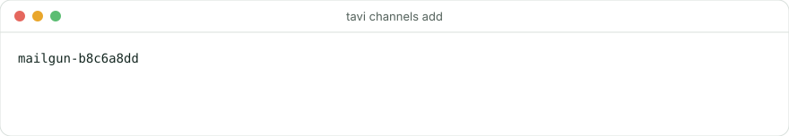
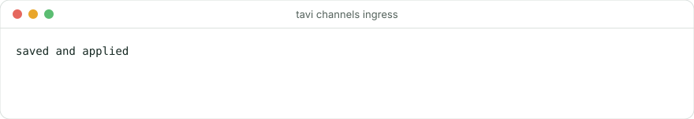
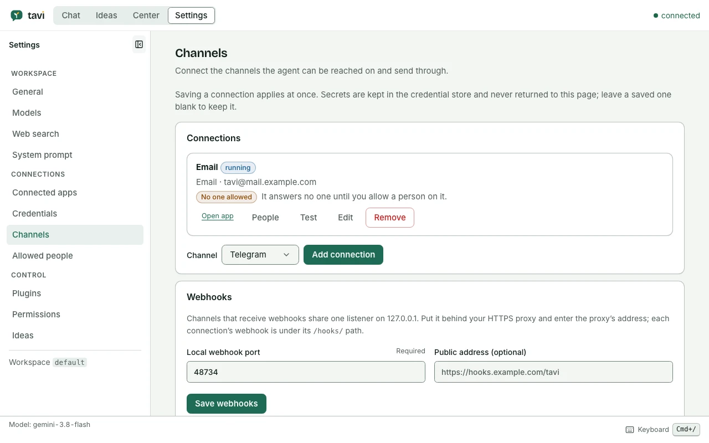
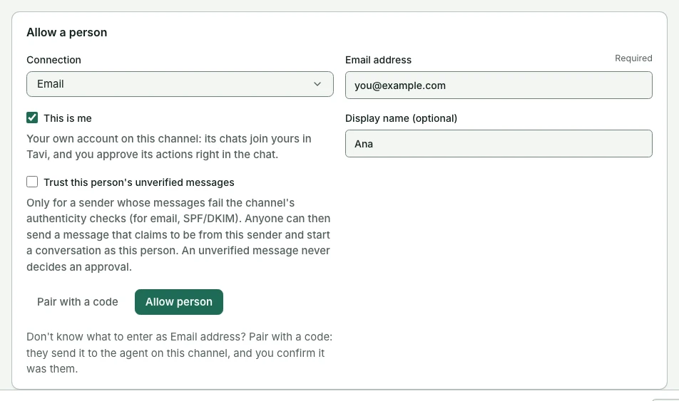
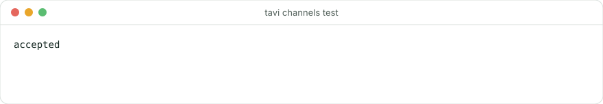

# Talk to Tavi by email through Mailgun

Give Tavi an email address of its own on your domain, such as `tavi@mail.example.com`, through your Mailgun account: email it from anywhere and it answers from that address. About twenty minutes, plus Mailgun's own domain setup.

> **Uses:** the Mailgun email channel (`tavi.mailgun`, `tavi channels add mailgun`) · the webhook listener (`tavi channels ingress --port 48734`) · **Settings → Allowed people**
> **Before you start:** a model connected ([Connect your first model](../get-started/first-model.md)) · Tavi running in the background with `tavi serve` ([Keep Tavi running in the background](../get-started/keep-tavi-running.md)) · the canvas open ([Open the web canvas and walk through Welcome](../get-started/web-canvas-tour.md)) · a Mailgun account with a sending domain it verified (a domain in Mailgun's EU region adds `--set region=eu` in step 1) · an https address that reaches this computer, such as a reverse proxy or a tunnel, for the mail coming in

## 1. Add the Mailgun connection

In Mailgun, copy your domain's **API key** and its **HTTP webhook signing key** (two different keys) into two files only you can read. Then run `tavi channels add mailgun --domain mail.example.com --secret-file apiKey=mailgun-api.key --secret-file webhookSigningKey=mailgun-webhook-signing.key`. Tavi checks the domain with Mailgun and prints the connection's id. It sends as `tavi@` your domain unless you give `--from`; for a domain in Mailgun's EU region, add `--set region=eu`.

<picture>
  <source media="(prefers-color-scheme: dark)" srcset="../../assets/use-cases/channels/email-mailgun/01-add-the-mailgun-connection-dark.svg">
  
</picture>

## 2. Set up the webhook listener

Mail reaches Tavi as Mailgun's webhook, on a listener on this computer only. Choose its port and the https address your proxy or tunnel gives it: `tavi channels ingress --port 48734 --public-url https://tavi.example.com`. Forward `/hooks/*` (and `/i/*`, for approval links in emails) from that address to the port.

<picture>
  <source media="(prefers-color-scheme: dark)" srcset="../../assets/use-cases/channels/email-mailgun/02-set-up-the-webhook-listener-dark.svg">
  
</picture>

## 3. Route your mail to Tavi

In Mailgun, open **Receiving** and create a route: match the recipient `tavi@mail.example.com`, and forward to `https://tavi.example.com/hooks/<connection-id>/inbound`, with the connection's id as step 1 printed it (`tavi channels list` shows it too). In Tavi, **Settings → Channels** lists the connection by its address; its **Webhooks** section shows the port you set, and the public address once you gave one.

<!-- cover -->

## 4. Allow your own address

Open **Settings → Allowed people**, pick the Email connection, enter the address you write from, tick **This is me** and choose **Allow person**. A message is admitted only when Mailgun verified its sender (SPF and DKIM both pass for your address's domain); anything else is held.

## 5. Send yourself a test

Run `tavi channels test <connection-id> --to you@example.com`, or choose **Test** on the Email row. Tavi sends a short message from its address through Mailgun; check that it arrived, and not in spam.

<picture>
  <source media="(prefers-color-scheme: dark)" srcset="../../assets/use-cases/channels/email-mailgun/05-send-yourself-a-test-dark.svg">
  
</picture>

## Email Tavi

From your address, email `tavi@mail.example.com`, such as `What can you help me with, in one sentence?`. Tavi answers in the same thread, from its own address. Each thread is a chat of its own on the canvas.

## What Tavi will and won't do

The listener refuses a request without Mailgun's signature, a replayed one, or one past its size cap, before the channel reads it. Mail from someone you have not allowed, or that Mailgun could not verify, is held, not read; a quoted reply or a forwarded message is read as data, never as your words. Approvals can be decided by replying `approve` for low- and medium-risk rounds, and with a public address each approval email also carries single-use links. See [CHANNELS.md](../../CHANNELS.md#questions-and-approvals-by-email) and [OPERATIONS.md](../../OPERATIONS.md).

## Related

- [Talk to Tavi by Gmail](email-gmail.md)
- [Start a schedule from an email](../automation/trigger-from-email.md)
- [Start a schedule from a webhook](../automation/trigger-from-a-webhook.md)
- Reference: [CHANNELS.md](../../CHANNELS.md), [CLI.md](../../CLI.md#tavi-channels)
