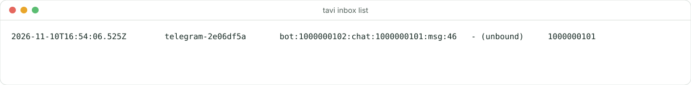
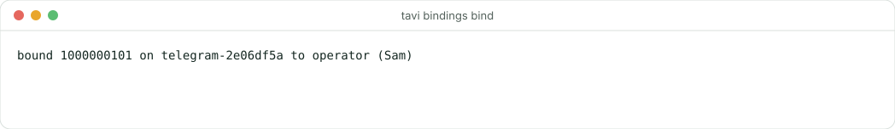
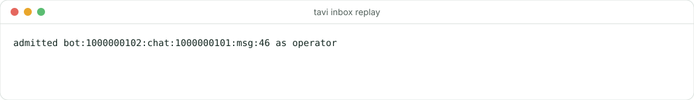
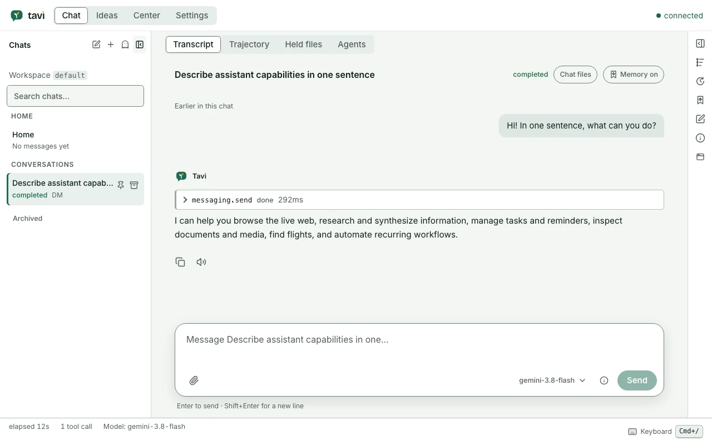

# Let in a message Tavi held back

When someone you haven't allowed yet writes to your bot, Tavi keeps the message and doesn't answer. Once you allow them, let that first message in so it gets its answer. About five minutes.

> **Uses:** held messages (`tavi inbox list`, and its `replay`) · bindings (`tavi bindings list`) · channels (Telegram)
> **Before you start:** a model connected ([Connect your first model](../get-started/first-model.md)) · your Telegram bot added ([Connect a Telegram bot](pair-telegram.md)) · Tavi running in the background with `tavi serve` ([Keep Tavi running in the background](../get-started/keep-tavi-running.md))

## 1. See what was held

Reading the held messages needs the data directory to itself, so stop `tavi serve` first (Ctrl-C where it runs), then run `tavi inbox list`. Each row is a message from someone not allowed yet: when it came, the connection, its event id, `- (unbound)`, and the sender's Telegram user ID.

<picture>
  <source media="(prefers-color-scheme: dark)" srcset="../../assets/use-cases/channels/held-messages/01-see-what-was-held-dark.svg">
  
</picture>

## 2. Allow the sender

If you know who it is, allow them with `tavi bindings bind --connection <connection> --sender <user-id> --principal <person> --name "<their name>"`. Someone else gets a person ID of their own, such as `--principal ana`, with their own memory, and you decide their approvals; your own second account takes `--principal operator` and no `--name`: a name belongs to the person, so a new one would rename you on every connection.

<picture>
  <source media="(prefers-color-scheme: dark)" srcset="../../assets/use-cases/channels/held-messages/02-allow-the-sender-dark.svg">
  
</picture>

## 3. Let the message in

Run `tavi inbox replay <event-id> --connection <connection>`, with the event id from the list. Tavi admits it as if it had just arrived from someone allowed, and answers it: the answer goes back to the sender in Telegram before the command ends. A sender still not allowed is refused, and the message stays held.

<!-- cover -->
<picture>
  <source media="(prefers-color-scheme: dark)" srcset="../../assets/use-cases/channels/held-messages/03-let-the-message-in-dark.svg">
  
</picture>

## 4. Start Tavi again

Start `tavi serve` again. The conversation is listed in the canvas under **Conversations**, with the answer the replay sent, and from now on their messages are answered as they come.

## What Tavi will and won't do

A message from someone you haven't allowed is never answered or read by the model until you let it in; it's kept, at most the newest 20 per sender and 5,000 in all, for 30 days. Allowing someone doesn't let in what they sent before: each held message is let in only by its own replay. Pairing with a code ([Connect a Telegram bot](pair-telegram.md)) is the way to allow someone without knowing their user ID. The details are in [CHANNELS.md](../../CHANNELS.md#quick-start).

## Related

- [Connect a Telegram bot](pair-telegram.md)
- [Ask Tavi to message someone by name](message-someone-by-name.md)
- Reference: [CLI.md](../../CLI.md#tavi-inbox), [CHANNELS.md](../../CHANNELS.md)
