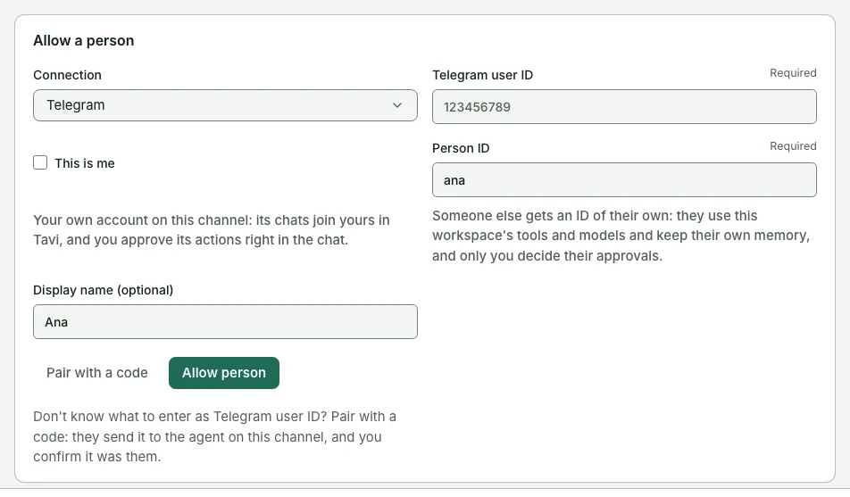
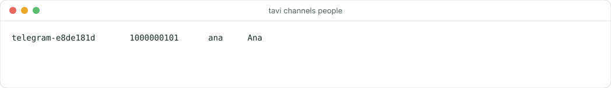
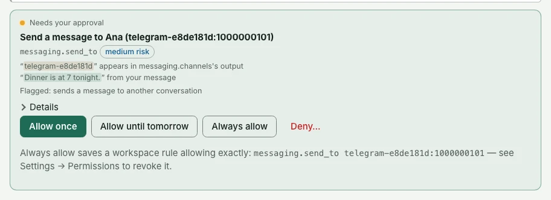
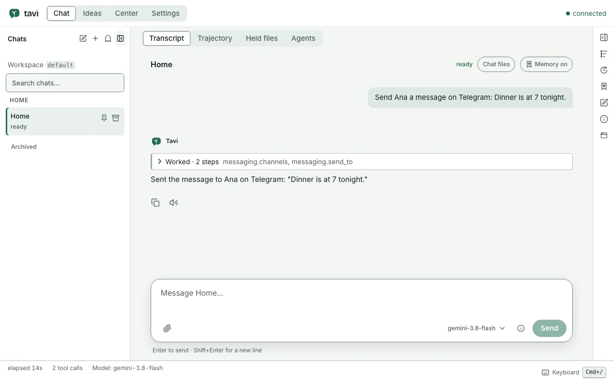

# Ask Tavi to message someone by name

Say who to message the way you'd say it to a person, `Send Ana a message…`, and Tavi finds Ana's chat from the people you allowed, shows you exactly where it will go, and sends it once you agree. About five minutes.

> **Uses:** messaging by name (`messaging.send_to`, `messaging.channels`) · allowed people (**Settings → Allowed people**, `tavi channels people`) · the send allowlist (`--messaging-allow-destination` on `tavi serve`) · approvals
> **Before you start:** a model connected ([Connect your first model](../get-started/first-model.md)) · your Telegram bot added ([Connect a Telegram bot](pair-telegram.md)) · the person has sent your bot a message on Telegram · the canvas open ([Open the web canvas and walk through Welcome](../get-started/web-canvas-tour.md))

## 1. Allow them, with a name

Open **Settings → Allowed people**, enter a **Person ID** for them (`ana`) and the **Display name** Tavi should know them by (`Ana`), and choose **Pair with a code**. They send the code to your bot, and you choose **Allow them** once Tavi shows it was them.

## 2. Let Tavi send to their chat

Tavi sends only where you allowed it. Find their Telegram user ID with `tavi channels people telegram`, then start `tavi serve` with `--messaging-allow-destination <connection>:<user-id>`, repeated for each person (`telegram:*` allows everyone on Telegram). A name never widens that list.

<picture>
  <source media="(prefers-color-scheme: dark)" srcset="../../assets/use-cases/channels/message-someone-by-name/02-let-tavi-send-to-their-chat-dark.svg">
  
</picture>

## 3. Ask Tavi to message them

In Home, say it plainly: `Send Ana a message on Telegram: Dinner is at 7 tonight.` Before anything goes, Tavi shows the card: the message, and where Ana resolved to, by her name, connection and chat. A name that matches nobody, or more than one person, is refused with the names it can reach.

<!-- cover -->

## 4. Allow it

Choose **Allow once**. The message goes to Ana's chat with your bot, and Tavi says it was sent. If her chat changed between the card and the send, the send is refused, so a message never lands somewhere you didn't see.

## What Tavi will and won't do

Every message to someone else asks you first and names exactly where it's going, and only to people you allowed whose chat is on the send allowlist. Reading a room's recent messages back works on a channel that can read them, such as Discord, in a room you turned it on for; Telegram doesn't let a bot read a group's history. The details are in [CHANNELS.md](../../CHANNELS.md#conversations-and-tasks) and, for rooms, [CHANNELS.md](../../CHANNELS.md#rooms).

## Related

- [Connect a Telegram bot](pair-telegram.md)
- [Approve actions from your phone](approve-from-your-phone.md)
- [Approve, reject or always-allow a tool call](../chat/approve-tool-calls.md)
- Reference: [CHANNELS.md](../../CHANNELS.md), [CLI.md](../../CLI.md#tavi-channels)
