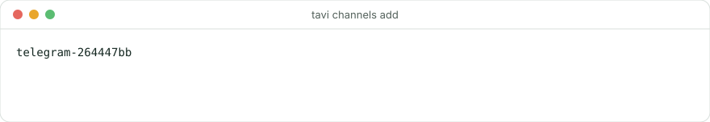
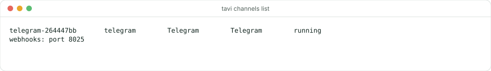
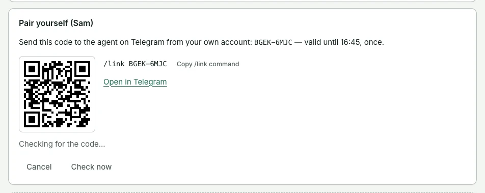
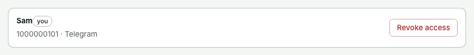
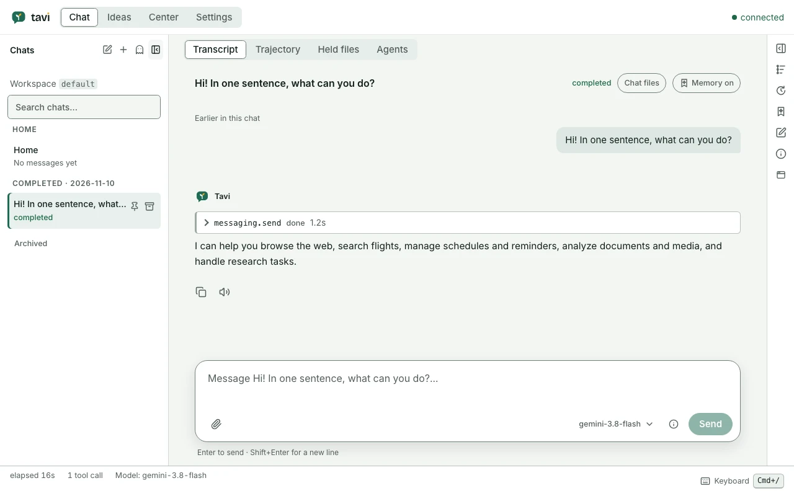

# Connect a Telegram bot

Talk to Tavi from Telegram through a bot of your own: add the bot from a terminal, pair your account with a one-time code, and say hello. About five minutes.

> **Uses:** channels (`tavi channels list`, **Settings → Channels**) · allowed people (**Settings → Allowed people**, `tavi channels people`) · pairing with a one-time code
> **Before you start:** Tavi running in the background with `tavi serve` ([Keep Tavi running in the background](../get-started/keep-tavi-running.md)) · the canvas open ([Open the web canvas and walk through Welcome](../get-started/web-canvas-tour.md)) · Telegram on your phone or computer

## 1. Create a bot and add it

In Telegram, send `/newbot` to @BotFather, pick a name, and save the token it gives you in a file only you can read (`chmod 600`). Then run `tavi channels add telegram --secret-file token=<file>`: Tavi stores the token in its credential store and prints the new connection's id.

<picture>
  <source media="(prefers-color-scheme: dark)" srcset="../../assets/use-cases/channels/pair-telegram/01-create-a-bot-and-add-it-dark.svg">
  
</picture>

## 2. Check that it's running

Run `tavi channels list`. Your bot's row says **running** once Telegram has accepted the token; a wrong token says why it could not open, and the other channels open anyway.

<picture>
  <source media="(prefers-color-scheme: dark)" srcset="../../assets/use-cases/channels/pair-telegram/02-check-that-it-s-running-dark.svg">
  
</picture>

## 3. Pair your account

Open **Settings → Allowed people**, tick **This is me**, give yourself a **Display name**, and choose **Pair with a code**. Send the code to your bot within ten minutes: scan the QR code with your phone, tap **Open in Telegram**, or send `/link` and the code. From a terminal, `tavi channels link telegram` does the same.

<!-- cover -->

## 4. Confirm it was you

Tavi shows who sent the code and asks **Is this you?** Choose **Yes, it's me** if it was. You're listed under your display name, marked **you**, with your Telegram user ID.

## 5. Say hello

Send your bot a message, such as `Hi! In one sentence, what can you do?` Tavi answers in Telegram, and you can read the conversation in the canvas too: under **Conversations** when Home is on, otherwise among your chats by its day.

## What Tavi will and won't do

The bot answers only people you allowed: a message from anyone else is kept, not answered, until you let it in ([Let in a message Tavi held back](held-messages.md)). A chat on Telegram can't write files or run code, and anything it would change or send asks you first, in that chat. Telegram messages go out with link previews off. Removing the connection (`tavi channels remove <connection>`) erases what it brought in after 24 hours, as Telegram's bot terms ask. The details are in [CHANNELS.md](../../CHANNELS.md).

## Related

- [Pair your phone in two minutes (QR code)](../get-started/pair-your-phone.md)
- [Approve actions from your phone](approve-from-your-phone.md)
- [Let in a message Tavi held back](held-messages.md)
- Reference: [CHANNELS.md](../../CHANNELS.md), [CLI.md](../../CLI.md#tavi-channels)
