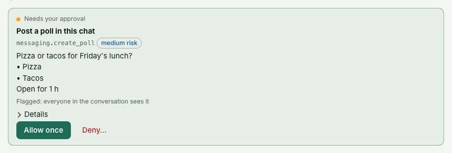
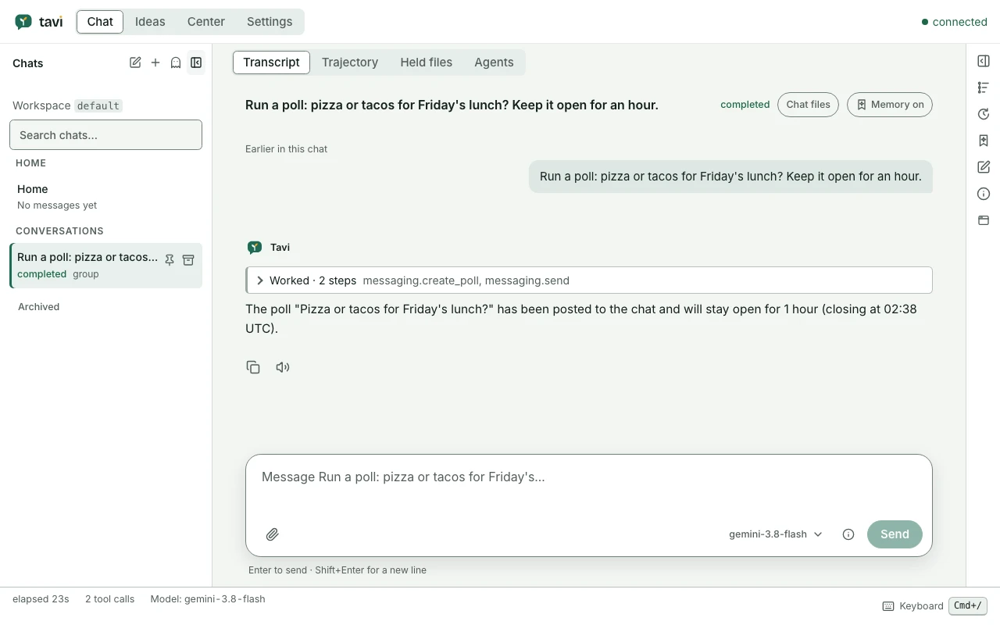
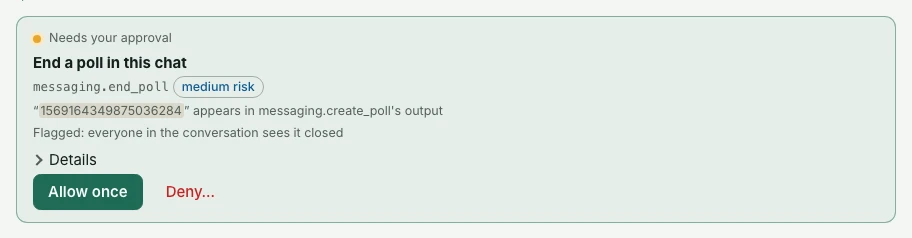
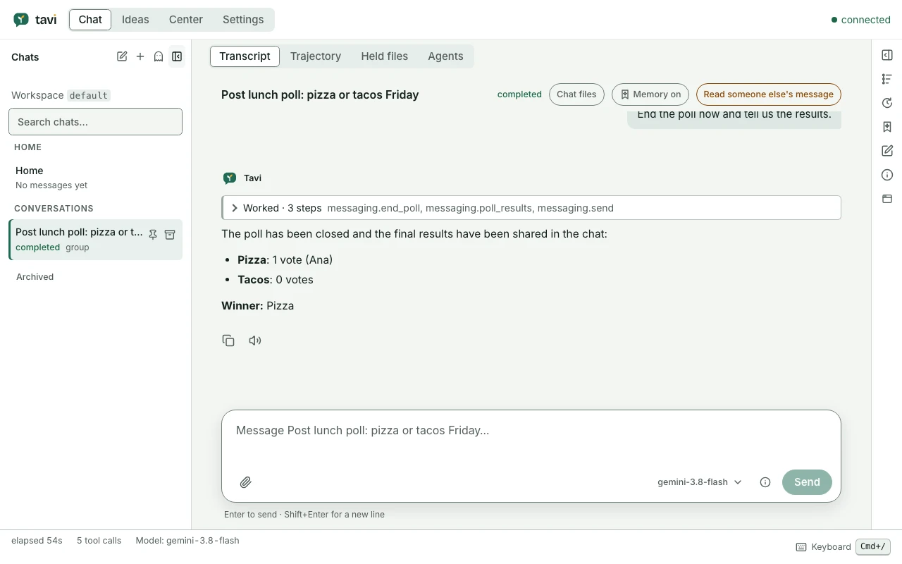

# Run a poll in a group and wait for the answers

Ask Tavi in a Discord room to put a question to everyone, then have it read the votes back: who chose what, as far as Tavi knows them. Nothing is posted until you approve it. About five minutes, plus the time people take to vote.

> **Uses:** the group tools (`messaging.create_poll`, `messaging.poll_results`, `messaging.end_poll`) · approvals · rooms
> **Before you start:** a model connected ([Connect your first model](../get-started/first-model.md)) · Tavi on your Discord server, with a room, and you allowed ([Add Tavi to a Discord server](discord-rooms.md)) · someone else in that room to vote; to try it alone, a second Discord account of your own

## 1. Ask for a poll in the room

In the room, address the bot with the question and its answers, such as `@yourbot Run a poll: pizza or tacos for Friday's lunch? Keep it open for an hour.` Tavi drafts the poll and asks you first: the card, in the canvas and in your DM with the bot, shows the question and every answer.

## 2. Approve it

Choose **Allow once**, in the canvas or with the button in your DM. Tavi posts the poll in the room, as a Discord poll anyone there can vote in, and says when it closes.

## 3. Let people vote, then close it

Once people have voted, ask in the room, such as `@yourbot End the poll now and tell us the results.` Ending it early asks you first too. Left alone, Tavi can also wait for the poll to close on its own: a message from you meanwhile ends its wait early.

## 4. Read the results

Choose **Allow once**. Tavi reads the final votes with `messaging.poll_results` and answers in the room: each answer's count, naming the voters you allowed and only counting everyone else.

<!-- cover -->

## What Tavi will and won't do

Polls are only for rooms: a one-to-one chat, Home and the terminal have no poll tools. Posting or ending a poll always asks the person whose chat it is, with every answer on the card, and the same poll is never posted twice. Tavi reads only the polls its own chat posted, and the votes are information, never instructions. Without Discord's **Send Polls** permission the poll is refused and the refusal says so; invite the bot again with the current link. See [CHANNELS.md](../../CHANNELS.md#discord).

## Related

- [Add Tavi to a Discord server](discord-rooms.md)
- [Approve, reject or always-allow a tool call](../chat/approve-tool-calls.md)
- Reference: [CHANNELS.md](../../CHANNELS.md#rooms)
