<!-- Generated by scripts/docs/guide-indexes.mjs from the guides: edit the guides, not this file. -->

# Chat

Home, side chats, approvals and everything a conversation can do.

| | Guide |
| :--- | :--- |
| 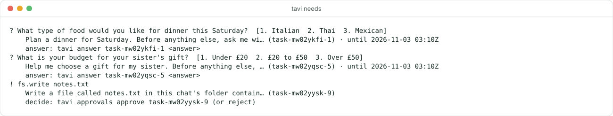 | [Find and answer everything Tavi is waiting on](answer-waiting-questions.md) See in one list every question Tavi asked you and every call waiting for your approval, across all your chats and schedules, and answer each from the terminal or the canvas. |
| 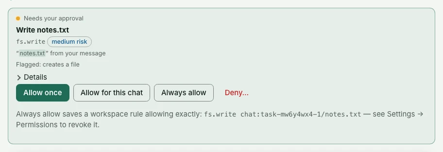 | [Approve, reject or always-allow a tool call](approve-tool-calls.md) Decide what Tavi may do when it wants to change something: allow a call once, for the rest of the chat or always, or deny it with a reason the model reads. |
| 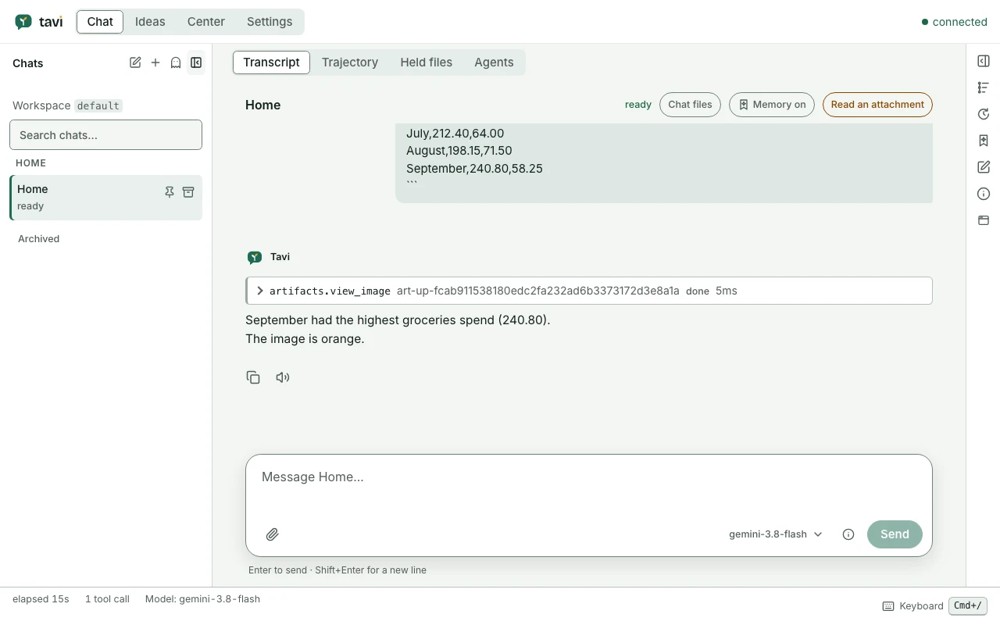 | [Send a file or image with your message](attach-files-to-chat.md) Attach a spreadsheet, a document or an animated image to a message on the canvas, and ask Tavi about it. |
| 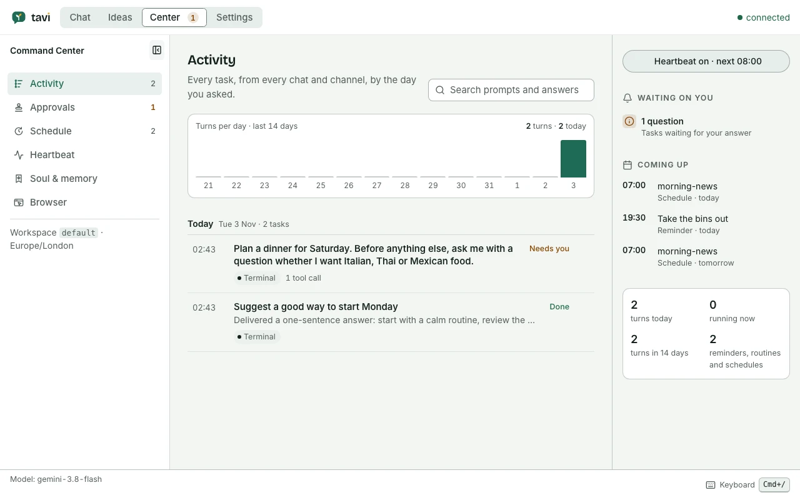 | [Find your way around the Command Center](command-center.md) The Command Center is where the web canvas shows everything Tavi is doing and will do: every task, what waits on you, what is scheduled, the heartbeat, what Tavi knows about you, and the sites its browser visited. |
| 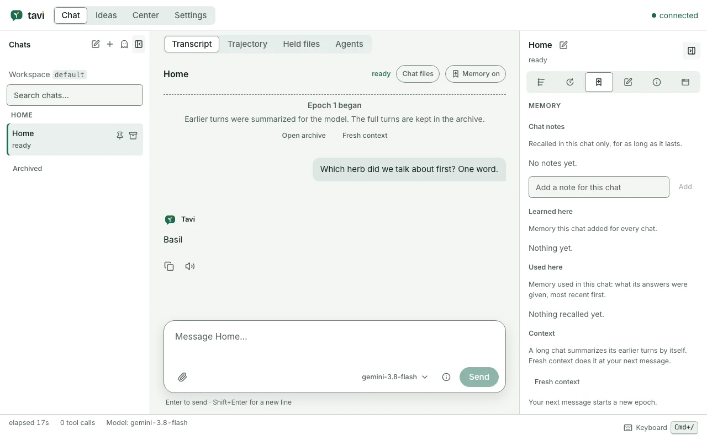 | [Compact a long chat into a new epoch](compact-a-long-chat.md) Give a long chat a fresh start without losing it: its earlier turns are summarized for the model and archived, and the chat goes on from the summary. |
| 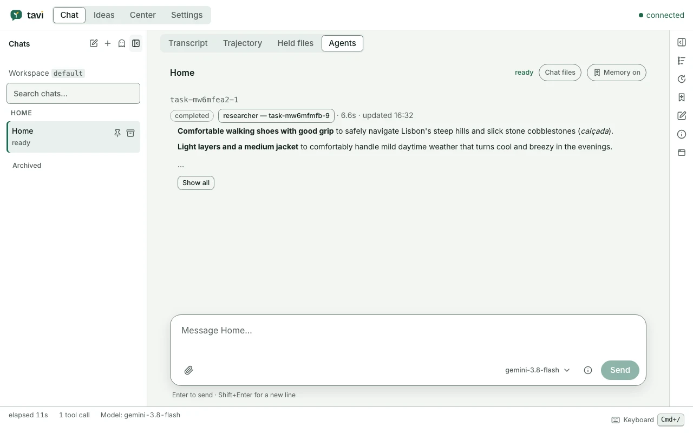 | [Hand background work to an agent, and follow its tree](delegate-to-agents.md) Give a named agent a piece of work to do in the background while you carry on, then watch it run and read its answer when it comes back to your chat. |
| 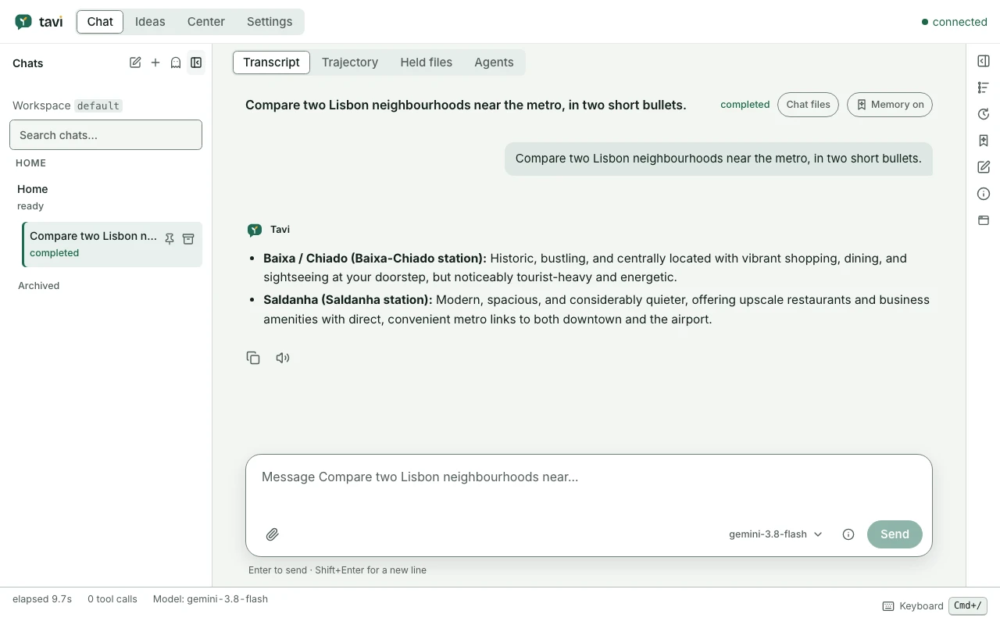 | [Keep one conversation, branch side chats](home-and-side-chats.md) Talk to Tavi in one continuous conversation, Home, and take a detour into a side chat when a question would clutter it. |
| 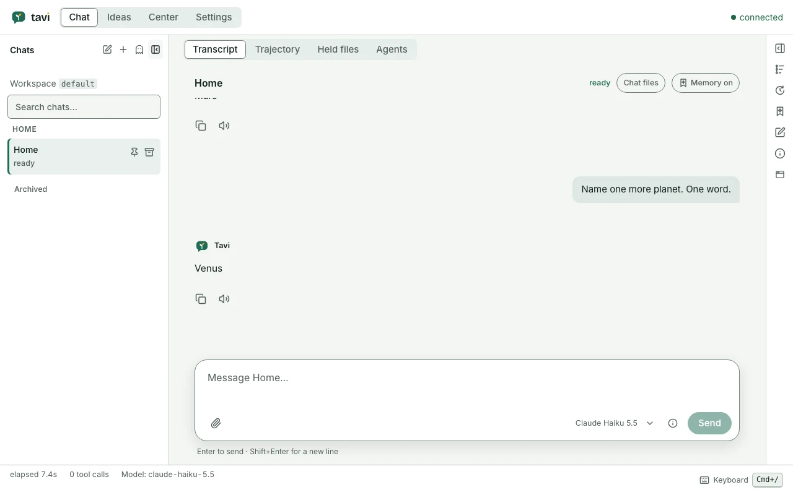 | [Switch the model for one chat](pick-a-model-per-chat.md) Pick a different model for the chat you are in, from the canvas or the terminal, and see the next answer come from it. |
| 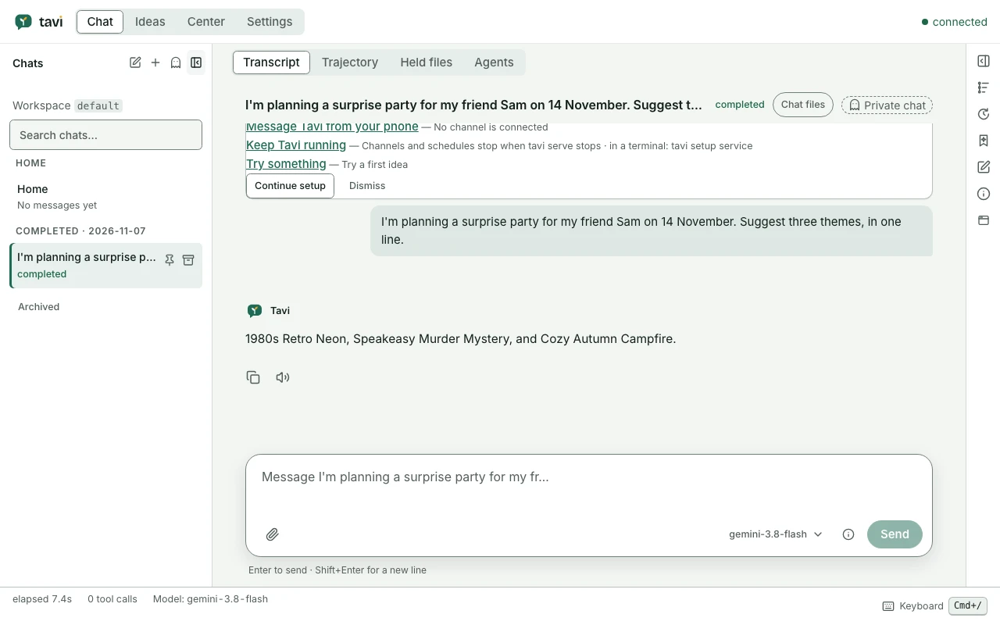 | [Chat without leaving a trace](private-chats.md) Ask something you don't want Tavi to learn from: a private chat has its memory off for good, is left out of past-chat search, and its saved turns are forgotten about a day after its last message. |
| 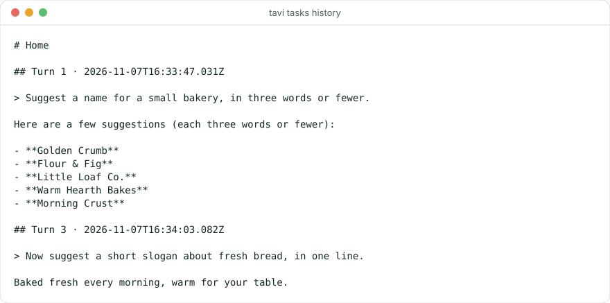 | [Rewind a chat, export it, or forget it](rewind-or-forget.md) Take back a message and send it again differently, print a chat's saved history as Markdown, or erase what a chat saved. |
| 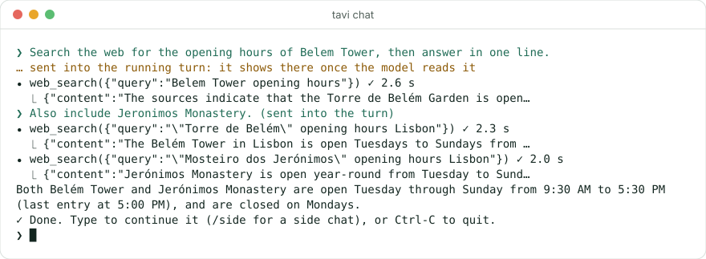 | [Redirect a running turn, or queue the next message](steer-and-queue.md) Change course while Tavi is still working, without stopping it: send a correction into the turn that is running, or line up your next message to go as soon as it ends. |
| 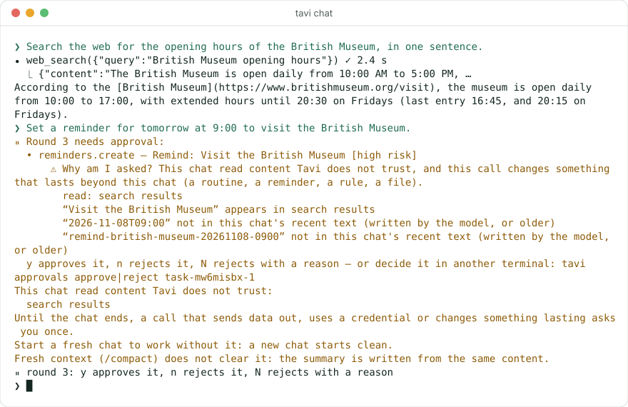 | [Understand a blocked action (untrusted content)](why-was-this-blocked.md) Once a chat has read something from outside, such as a web page, a search result or an email, Tavi asks before that chat does anything lasting, even what it would otherwise do without asking. |

[All how-to guides](../README.md)
