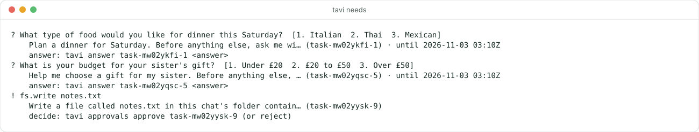
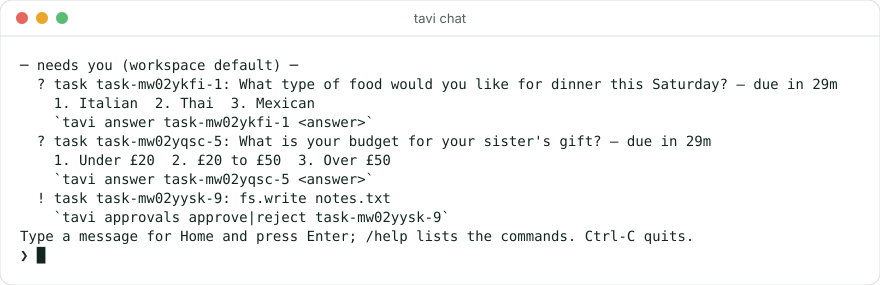
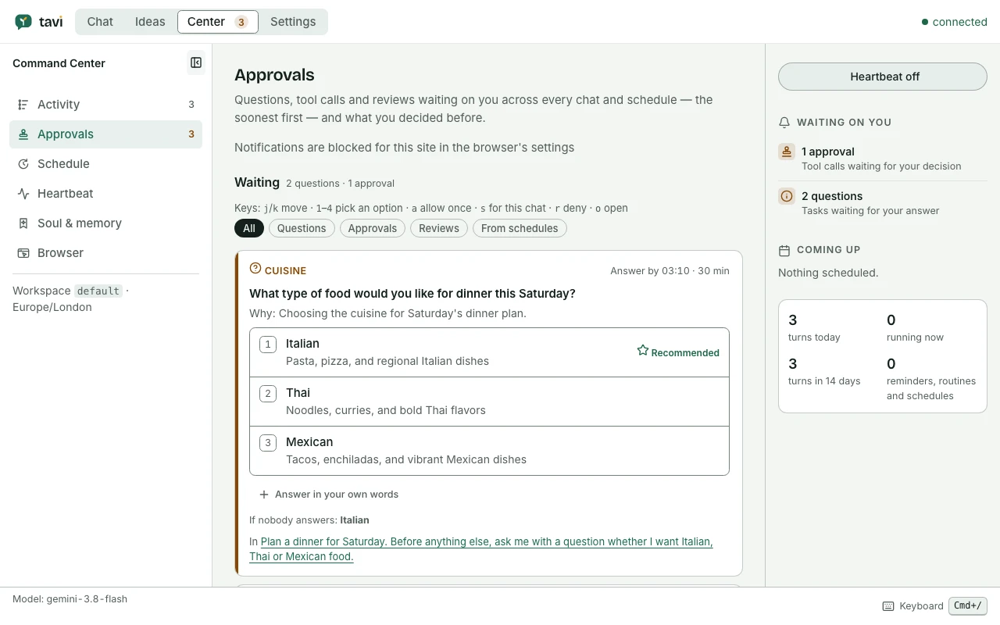
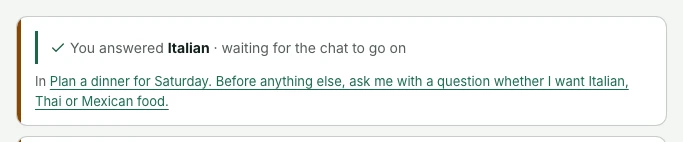
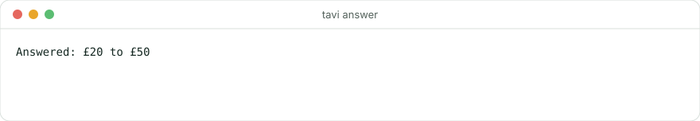
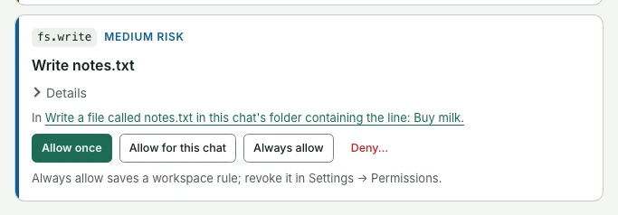
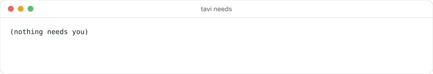

# Find and answer everything Tavi is waiting on

See in one list every question Tavi asked you and every call waiting for your approval, across all your chats and schedules, and answer each from the terminal or the canvas. About five minutes.

> **Uses:** questions (`operator.ask_user`) · approvals · `tavi needs` and `tavi answer <task-id> <answer>` · the Command Center's Approvals
> **Before you start:** a model connected ([Connect your first model](../get-started/first-model.md)) · Tavi running in the background with `tavi serve` ([Keep Tavi running in the background](../get-started/keep-tavi-running.md)) · the canvas open ([Open the web canvas and walk through Welcome](../get-started/web-canvas-tour.md))

## 1. List what is waiting

When a chat needs a choice from you, Tavi asks a question and waits; when it wants to change something, it waits for your approval. Run `tavi needs` to list them all, the soonest deadline first: each line says whether it is a question or an approval, its deadline, its task and what it asks.

<!-- cover -->
<picture>
  <source media="(prefers-color-scheme: dark)" srcset="../../assets/use-cases/chat/answer-waiting-questions/01-list-what-is-waiting-dark.svg">
  
</picture>

## 2. Check from the chat

In `tavi chat`, type `/needs`. It lists the same things under **needs you**, each with how to answer it, such as `tavi answer <task-id> <answer>`.

<picture>
  <source media="(prefers-color-scheme: dark)" srcset="../../assets/use-cases/chat/answer-waiting-questions/02-check-from-the-chat-dark.svg">
  
</picture>

## 3. Open the Approvals queue

On the canvas, choose **Center**, then **Approvals**. **Waiting** shows a card for each question and each call, the soonest first, and the rail beside it counts them under **Waiting on you**.

## 4. Answer a question on the canvas

Choose one of the question's options, or **Answer in your own words**. After a moment to undo, the answer is sent and the chat that asked carries on. The same card is in the chat that asked, as its last message.

## 5. Answer from the terminal

Run `tavi answer <task-id> <answer>`, with the task id `tavi needs` printed. The answer is an option's number or label, or your own words where the question allows them.

<picture>
  <source media="(prefers-color-scheme: dark)" srcset="../../assets/use-cases/chat/answer-waiting-questions/05-answer-from-the-terminal-dark.svg">
  
</picture>

## 6. Decide the waiting call

Back in **Approvals**, the call's card shows the tool, its risk and the chat it is in. Choose **Allow once**, **Allow for this chat**, **Always allow** or **Deny…**, as on the card in the chat. Deciding resumes the chat that asked, wherever it started.

## 7. Check that nothing is left

Run `tavi needs` again: it prints `(nothing needs you)`, and the canvas's **Waiting** says so too.

<picture>
  <source media="(prefers-color-scheme: dark)" srcset="../../assets/use-cases/chat/answer-waiting-questions/07-check-that-nothing-is-left-dark.svg">
  
</picture>

## What Tavi will and won't do

A question waits until it is answered or its deadline passes, which its card shows (by default 30 minutes for one asked by a run from the terminal, 24 hours for one from a chat or a schedule). Past the deadline, Tavi carries on with the option the card names under **If nobody answers**. An answer goes only to the chat that asked, and every answer and decision is kept in **History**.

## Related

- [Approve, reject or always-allow a tool call](approve-tool-calls.md)
- [Find your way around the Command Center](command-center.md)
- Reference: [CLI.md](../../CLI.md), [TERMINAL-UI.md](../../TERMINAL-UI.md), [WEB-UI.md](../../WEB-UI.md)
