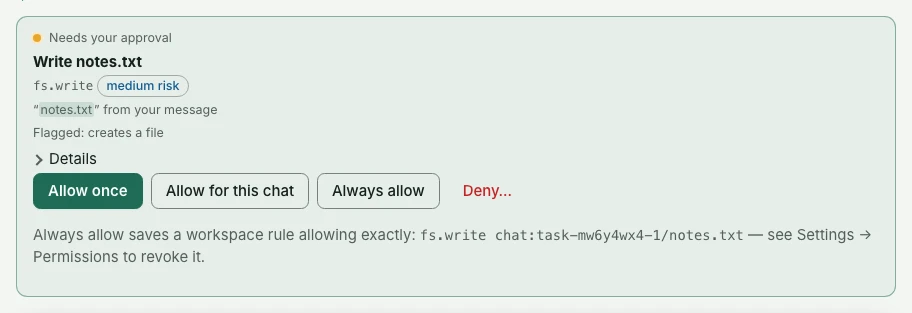
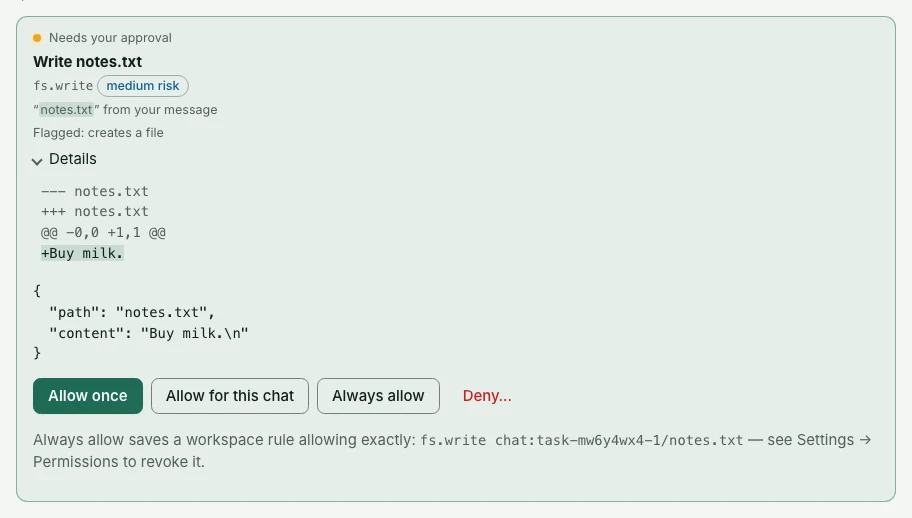
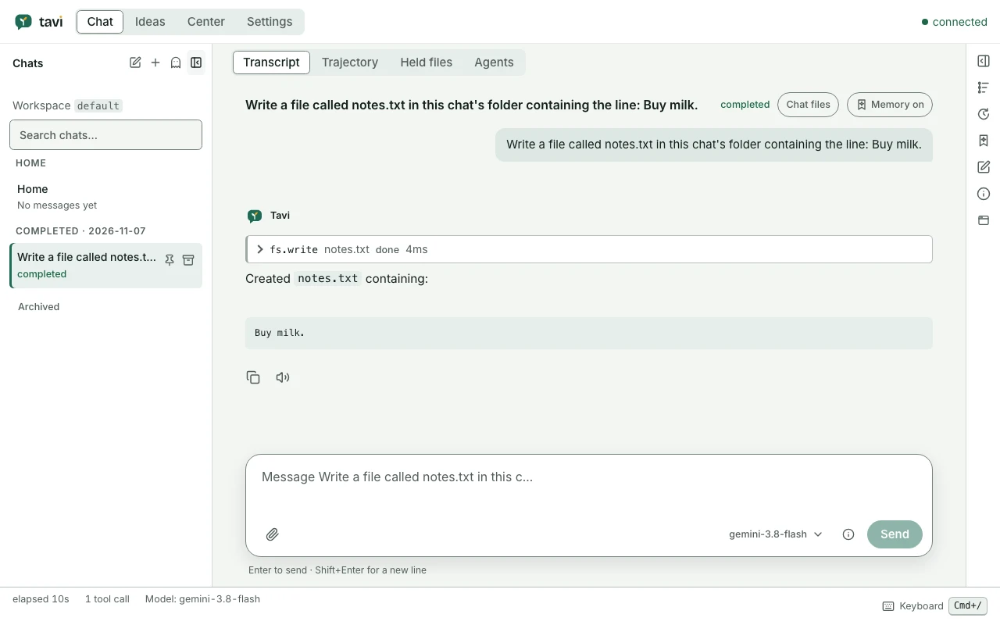
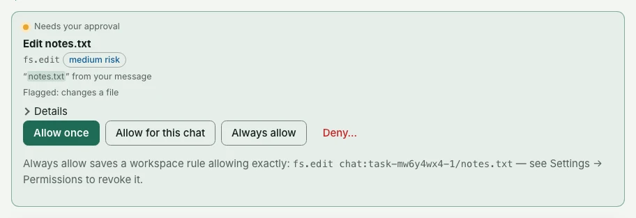
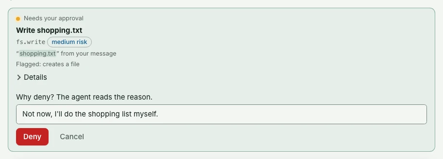
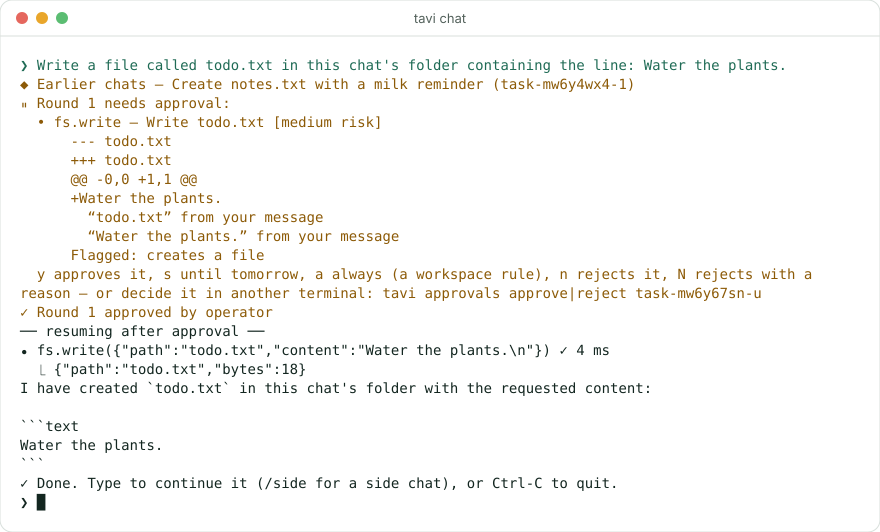
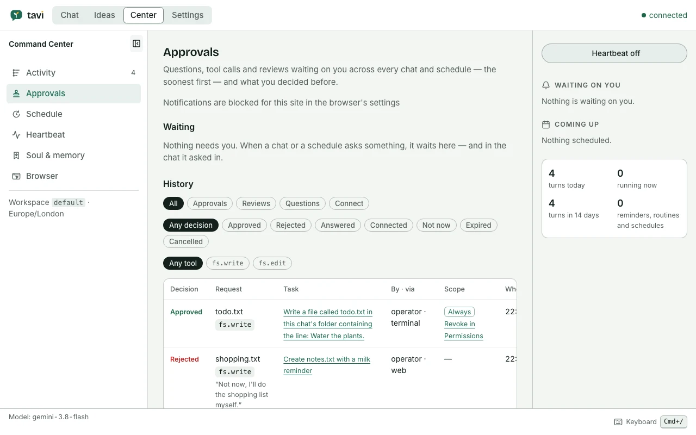
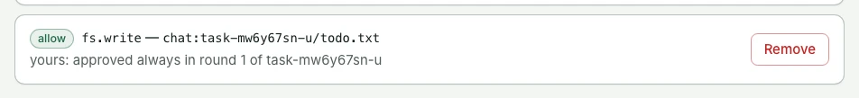

# Approve, reject or always-allow a tool call

Decide what Tavi may do when it wants to change something: allow a call once, for the rest of the chat or always, or deny it with a reason the model reads. About five minutes.

> **Uses:** approvals (the approval card, `tavi approvals list`) · permissions (`tavi permissions list`) · the web canvas and the terminal chat
> **Before you start:** a model connected ([Connect your first model](../get-started/first-model.md)) · Tavi running in the background with `tavi serve` ([Keep Tavi running in the background](../get-started/keep-tavi-running.md)) · the canvas open ([Open the web canvas and walk through Welcome](../get-started/web-canvas-tour.md))

## 1. Ask for a change

Start a new chat with **+** above the chat list and ask for something that changes a file, such as `Write a file called notes.txt in this chat's folder containing the line: Buy milk.` Before the write, Tavi stops and shows **Needs your approval**: what the call does, its risk, and where its values came from.

<!-- cover -->

## 2. Check what it will do

Open **Details** to see the change itself: for a file, the lines it adds or removes, then the call's full input. Nothing has been written yet.

## 3. Allow it once

Choose **Allow once**. The write goes ahead and Tavi finishes its answer. The next call like it asks you again.

## 4. Allow it for the rest of the chat

Ask for another change to the same file, for example `Add a second line to notes.txt: Call the plumber.`, and choose **Allow for this chat**. In this chat, Tavi won't ask again for that tool on that file; another file still asks. In Home, the same button reads **Allow until tomorrow**.

## 5. Deny it with a reason

Ask for something you don't want, such as `Also write shopping.txt with: Eggs, bread.` Choose **Deny…**, type why, and choose **Deny**. Nothing is written, and the model reads your reason and carries on without it.

## 6. Decide in the terminal

In `tavi chat` the same card appears in the transcript. Press `y` to allow once, `s` for the rest of the chat, `a` to always allow (a rule for the whole workspace), `n` to deny, or `N` to deny with a reason. You can also decide from another terminal with `tavi approvals approve <task-id>` or `tavi approvals reject <task-id>`.

<picture>
  <source media="(prefers-color-scheme: dark)" srcset="../../assets/use-cases/chat/approve-tool-calls/06-decide-in-the-terminal-dark.svg">
  
</picture>

## 7. Look back in the Command Center

Open **Center → Approvals**. **Waiting** lists every call still waiting on you, from every chat and schedule, and **History** shows what you decided: by whom, from where, and for how long (**Once**, **This chat**, **Always**).

## 8. Remove an Always allow rule

Open **Settings → Permissions**. Each **Always allow** you chose is an **allow** rule under **Rules**, matching exactly the call it was saved from. Choose **Remove**, and Tavi asks about that call again.

## What Tavi will and won't do

A call that changes something or sends something out waits for you, and nothing runs until you decide. **Always allow** saves a rule for exactly what the card showed, never for the whole tool, and in a chat that has read a web page or an email, a call that could send data out or change something lasting asks every time, whatever your rules say. The details are in [SECURITY-MODEL.md](../../SECURITY-MODEL.md).

## Related

- [Find and answer everything Tavi is waiting on](answer-waiting-questions.md)
- [Understand a blocked action (untrusted content)](why-was-this-blocked.md)
- [Find your way around the Command Center](command-center.md)
- Reference: [CLI.md](../../CLI.md), [WEB-UI.md](../../WEB-UI.md), [TERMINAL-UI.md](../../TERMINAL-UI.md)
