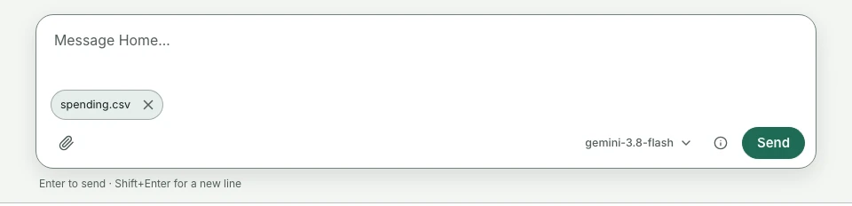
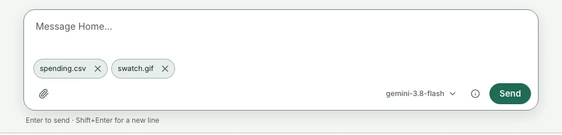
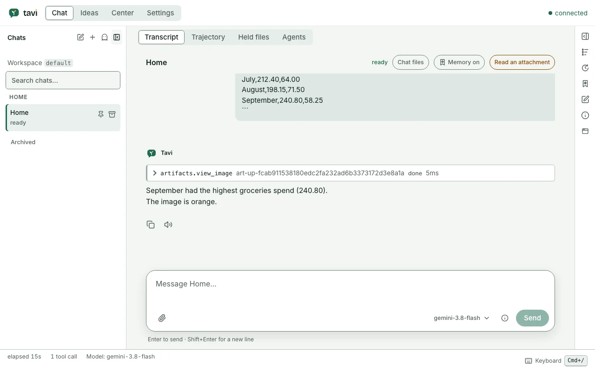
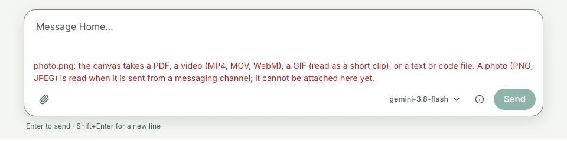

# Send a file or image with your message

Attach a spreadsheet, a document or an animated image to a message on the canvas, and ask Tavi about it. About three minutes.

> **Uses:** the composer's attachments (`tavi ui`) · viewing an attached image (`artifacts.view_image`)
> **Before you start:** a model connected ([Connect your first model](../get-started/first-model.md)) · Tavi running in the background with `tavi serve` ([Keep Tavi running in the background](../get-started/keep-tavi-running.md))

## 1. Attach a file

Run `tavi ui`, and in **Home**'s message box choose the paperclip (**Attach PDF, video, GIF, text and code files**), then pick a file. It shows as a chip under the box. Text and code files (a CSV, Markdown, JSON or source file) of up to 48 KB go into the message itself; a PDF of up to 20 MB is uploaded when you send.

## 2. Add an image

Choose the paperclip again and pick a GIF: up to five files go with one message. A GIF, like a video (MP4, MOV or WebM, up to 50 MB), is uploaded when you send, and the chat looks at it with its tools. Choose the cross on a chip to take a file off before sending.

## 3. Ask about them and send

Type your question and press Enter. The text file's content is added under your question in the message, and the image is uploaded for the chat to open (its tool line shows `artifacts.view_image`). The answer draws on both.

<!-- cover -->

## 4. Know what is refused

A photo saved as PNG or JPEG, or another binary file, is refused with a note under the box saying what can be attached; so is a text file over 48 KB, or a file merely renamed to `.pdf`. Save a photo as a GIF, or put it in a PDF, to send it.

## What Tavi will and won't do

An uploaded file is kept as an untrusted attachment: the chat reads it with its tools and treats what is in it as data, never as instructions, and the chat is marked as having read an attachment. A file goes when the chat is erased. Nothing is uploaded until you send.

## Related

- [Have your first conversation in the terminal](../get-started/first-chat.md)
- [Switch the model for one chat](pick-a-model-per-chat.md)
- [Keep one conversation, branch side chats](home-and-side-chats.md)
- Reference: [WEB-UI.md](../../WEB-UI.md#attachments), [PDF.md](../../PDF.md), [VIDEO.md](../../VIDEO.md)
