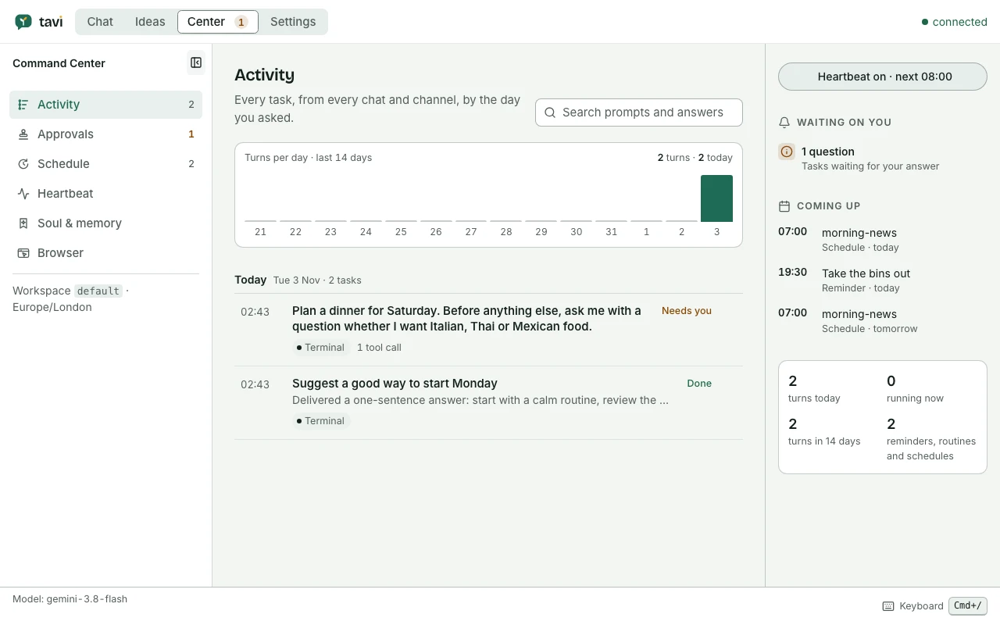
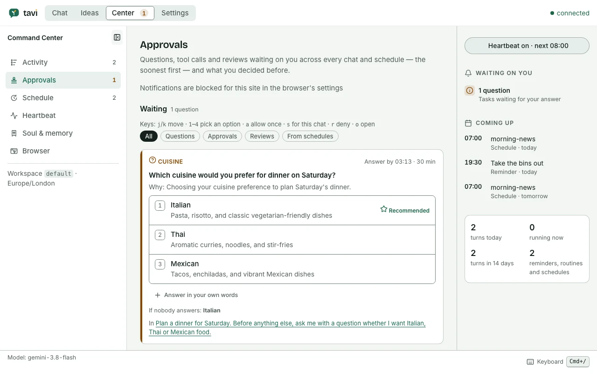
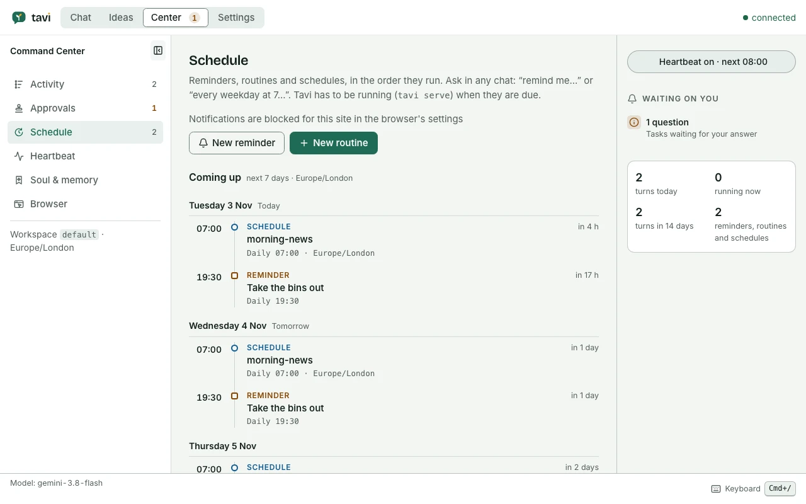
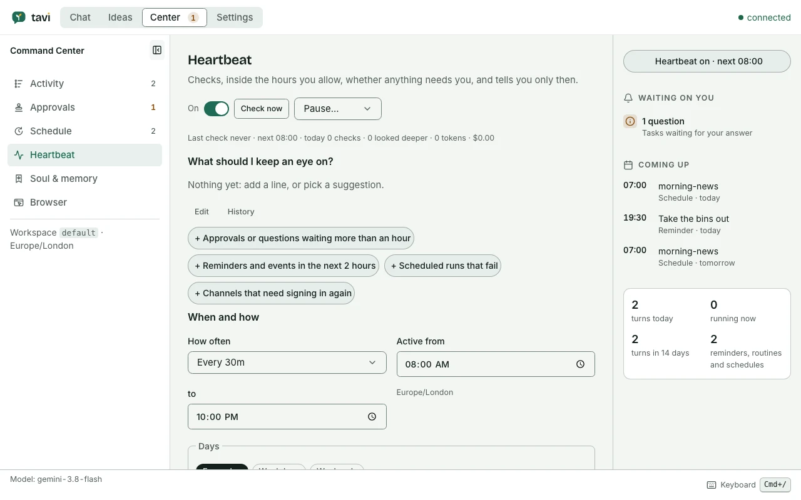
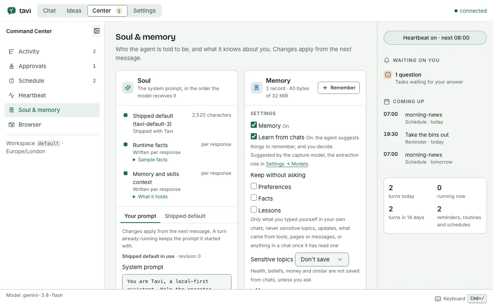
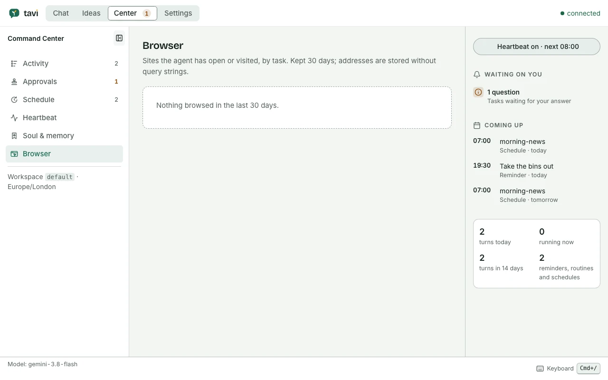

# Find your way around the Command Center

The Command Center is where the web canvas shows everything Tavi is doing and will do: every task, what waits on you, what is scheduled, the heartbeat, what Tavi knows about you, and the sites its browser visited. A short tour of its six sections. About five minutes.

> **Uses:** the web canvas's Command Center (`/center`) · approvals and questions · reminders, schedules and to-dos · the heartbeat · memory
> **Before you start:** the canvas open ([Open the web canvas and walk through Welcome](../get-started/web-canvas-tour.md)) · a few chats behind you ([Have your first conversation in the terminal](../get-started/first-chat.md))

## 1. Open the Command Center

Choose **Center** in the bar at the top. The chat list becomes the section list, each with a count, and **Activity** opens: every task from every chat, channel and schedule, newest first, under the day it was asked, with a bar per day for the last two weeks. The rail on the right shows what is **Waiting on you**, what is **Coming up**, and a few figures.

<!-- cover -->

## 2. See what is waiting on you

Choose **Approvals**. **Waiting** holds every question and tool call waiting on you, from any chat or schedule, the soonest first; answer or decide each right on its card. **History** below lists what you decided before.

## 3. Check what is coming up

Choose **Schedule**. **Coming up** lists every reminder and schedule due in the next seven days; **Recurring** lists the repeating ones with their next run and how the last went, with **Run now** on a schedule and **More** on each; your **To-dos** are at the bottom. **New reminder** and **New routine** add one.

## 4. Look at the heartbeat

Choose **Heartbeat**. When it is on, Tavi checks, inside the hours you allow, whether anything needs you, and tells you only then. **What should I keep an eye on?** takes a line of your own or a suggestion; **When and how** sets how often, the hours and days, and how it tells you.

## 5. Read Tavi's soul and memory

Choose **Soul & memory**. **Soul** is the system prompt, in the order the model receives it, which you can replace with **Write a custom prompt**. **Memory** lists what Tavi remembers about you, each with **Correct** and **Forget**, and **Skills** the procedures it can load.

## 6. See what the browser visited

Choose **Browser**. It lists the sites Tavi's browser has open or visited, by task, for 30 days, and any task waiting for you to act in its browser. With nothing browsed yet, it says so.

## What Tavi will and won't do

The Command Center follows the owner as it changes, so counts and lists update without a reload, and a section appears only when the owner offers it. It shows what is already recorded; it never starts a task by itself, and nothing on it runs without the same approval a chat would ask for.

## Related

- [Find and answer everything Tavi is waiting on](answer-waiting-questions.md)
- [Approve, reject or always-allow a tool call](approve-tool-calls.md)
- [Open the web canvas and walk through Welcome](../get-started/web-canvas-tour.md)
- Reference: [WEB-UI.md](../../WEB-UI.md#the-command-center)
