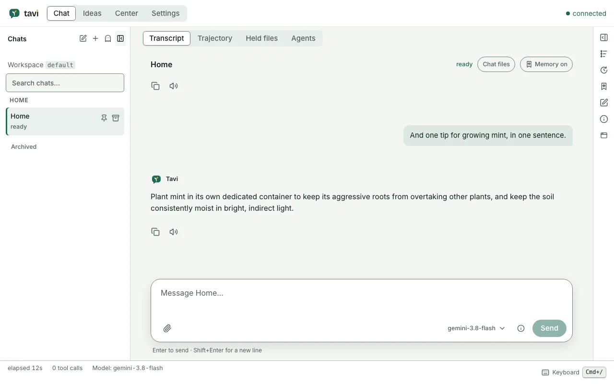
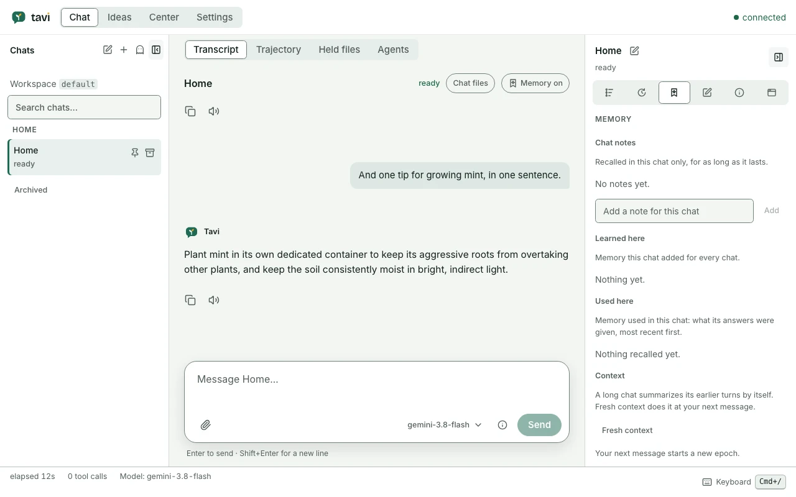
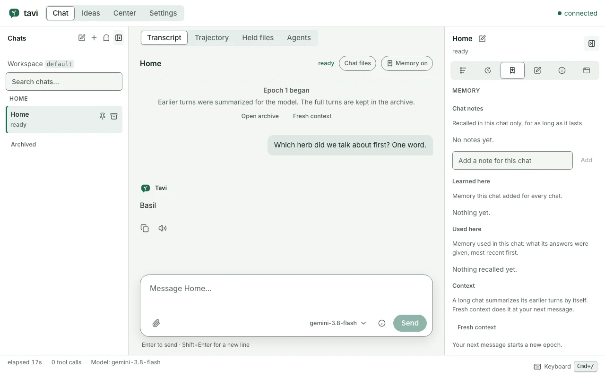
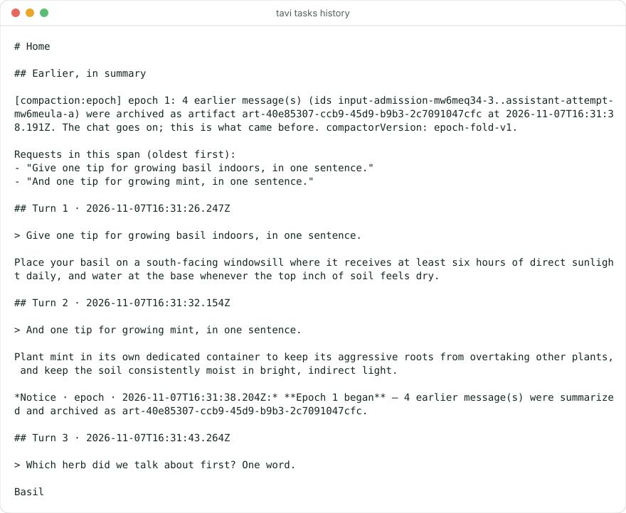
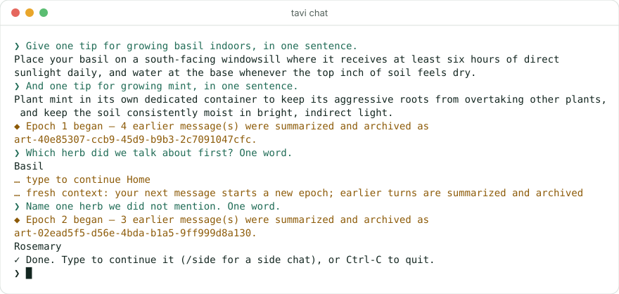

# Compact a long chat into a new epoch

Give a long chat a fresh start without losing it: its earlier turns are summarized for the model and archived, and the chat goes on from the summary. About three minutes.

> **Uses:** fresh context in the chat panel's Memory tab (`tavi ui`) · `/compact` in the terminal chat (`tavi chat`) · the chat's saved history (`tavi tasks history <task-id>`)
> **Before you start:** a model connected ([Connect your first model](../get-started/first-model.md)) · Tavi running in the background with `tavi serve` ([Keep Tavi running in the background](../get-started/keep-tavi-running.md))

## 1. Talk for a while

Run `tavi ui` and have a conversation on **Home**. A chat never ends for being long: once its history nears its limit, Tavi folds the earlier turns into a summary by itself. The next steps do it now, on purpose.

## 2. Ask for fresh context

Open the chat panel from the right-hand rail, choose **Memory**, and under **Context** choose **Fresh context**. It says **Your next message starts a new epoch.**

## 3. Send your next message

Send the chat its next message. A divider, **Epoch 1 began**, now sits above it: the earlier turns were summarized for the model, and the full turns are kept in the archive. The model still knows what was said, from the summary.

<!-- cover -->

## 4. Read the summary

The chat panel's **Details** tab shows the chat's id under **Task**. Run `tavi tasks history <task-id>`: the export starts with **Earlier, in summary**, the requests the summary kept, then every turn, with the epoch notice where it began.

<picture>
  <source media="(prefers-color-scheme: dark)" srcset="../../assets/use-cases/chat/compact-a-long-chat/04-read-the-summary-dark.svg">
  
</picture>

## 5. Compact from the terminal

In `tavi chat`, type `/compact`. It answers that your next message starts a new epoch; send one, and **Epoch 2 began** appears above the answer.

<picture>
  <source media="(prefers-color-scheme: dark)" srcset="../../assets/use-cases/chat/compact-a-long-chat/05-compact-from-the-terminal-dark.svg">
  
</picture>

## What Tavi will and won't do

Compacting never deletes anything: the folded turns are archived, `tavi tasks history <task-id>` still prints them, and the request survives a restart of `tavi serve` until your next message takes it. It does not clear what the chat has read from untrusted sources (see `/taint` in [TERMINAL-UI.md](../../TERMINAL-UI.md)); for a clean slate, start a new chat.

## Related

- [Have your first conversation in the terminal](../get-started/first-chat.md)
- [Rewind a chat, export it, or forget it](rewind-or-forget.md)
- [Keep one conversation, branch side chats](home-and-side-chats.md)
- Reference: [CONCEPTS.md](../../CONCEPTS.md#epochs-and-compaction), [WEB-UI.md](../../WEB-UI.md#saved-history-rewind-and-forget)
