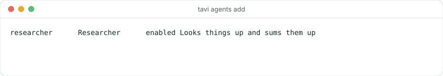
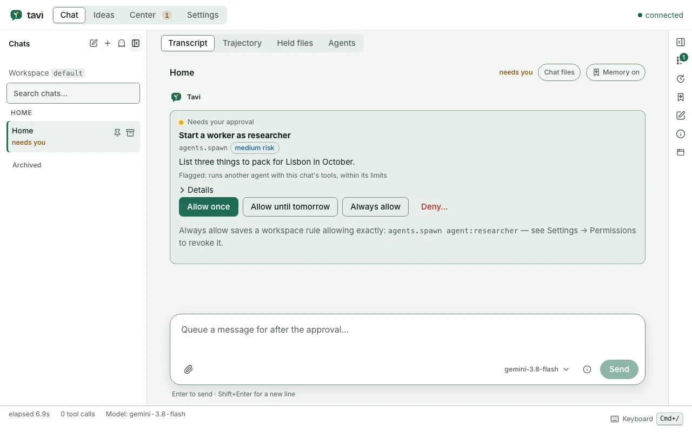
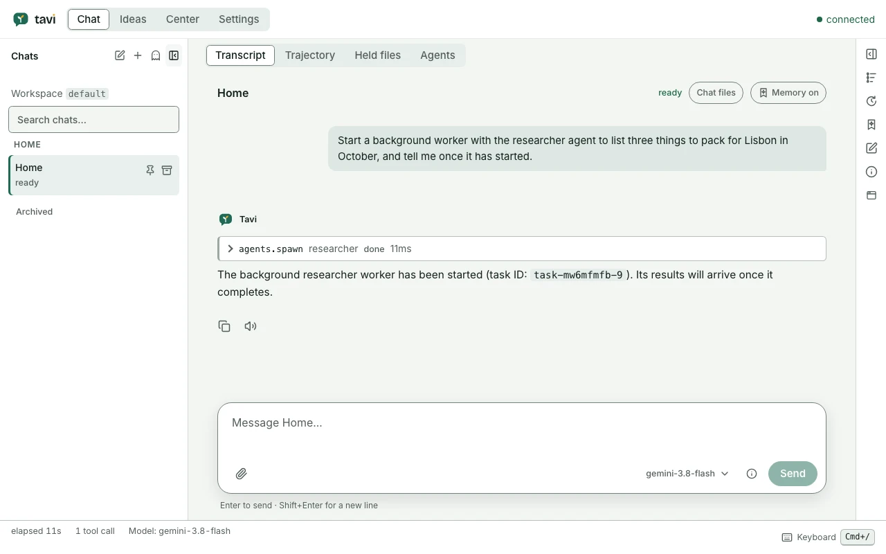
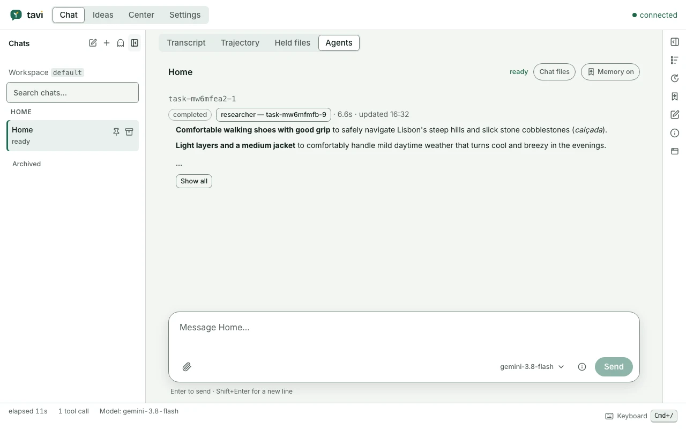
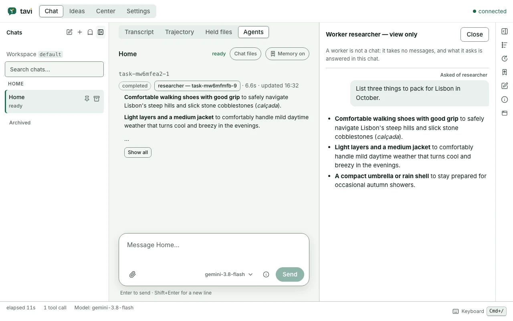
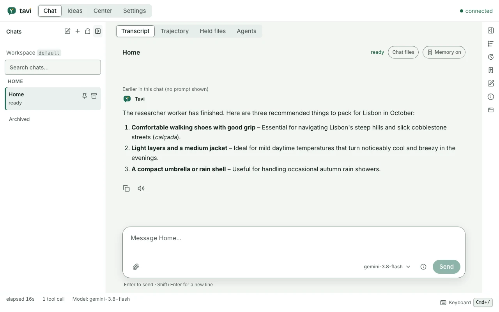

# Hand background work to an agent, and follow its tree

Give a named agent a piece of work to do in the background while you carry on, then watch it run and read its answer when it comes back to your chat. About five minutes.

> **Uses:** agents (`tavi agents list`) · workers (`agents.spawn`) · the canvas's **Agents** view
> **Before you start:** a model connected ([Connect your first model](../get-started/first-model.md)) · Tavi running in the background with `tavi serve` ([Keep Tavi running in the background](../get-started/keep-tavi-running.md))

## 1. Define an agent

Run `tavi agents add researcher --name Researcher --prompt "…" --description "…"`. The prompt is the persona's instructions: what it is for and how it answers. `tavi agents list` shows it, enabled.

<picture>
  <source media="(prefers-color-scheme: dark)" srcset="../../assets/use-cases/chat/delegate-to-agents/01-define-an-agent-dark.svg">
  
</picture>

## 2. Ask a chat to hand work to it

In the canvas, ask in plain words, naming the agent and saying it should run in the background: "Start a background worker with the researcher agent to …". Starting a worker asks you first: the card says **Start a worker as researcher**, and **Details** shows the task it will be given.

## 3. Allow it

Choose **Allow once**. The worker starts at once and the chat says it has handed the work over; you can keep talking while it runs.

## 4. Follow its tree

Open **Agents** above the conversation. It lists the workers this chat started, with their status, when each last changed, and **Cancel** for one still running; a finished one shows the start of its answer.

<!-- cover -->

## 5. Open the worker

Choose the worker's name to see what it was asked and what it did, beside the chat: **Worker researcher — view only**. A worker is not a chat, so it takes no messages; **Close** returns to the chat.

## 6. Read its answer

Go back to **Transcript**. When the worker ends, its answer comes back to the chat, and the chat takes a turn to read it and tell you what it found; the page shows that turn as it comes.

## What Tavi will and won't do

A worker can use only the tools its chat may use, and inherits what you allowed the chat. **Always allow** saves a rule for that one agent (`agents.spawn agent:researcher`), never for any agent; **Settings → Permissions** revokes it. A chat's workers are at most three deep and five at a time. The worker's answer reaches the chat as a quoted message, never as instructions, and a worker that read a web page passes that on, so the chat's riskier actions ask you first ([AUTOMATION.md](../../AUTOMATION.md#agents-and-workers)).

## Related

- [Keep one conversation, branch side chats](home-and-side-chats.md)
- [Chat without leaving a trace](private-chats.md)
- Reference: [AUTOMATION.md](../../AUTOMATION.md#agents-and-workers), [CLI.md](../../CLI.md#tavi-agents), [WEB-UI.md](../../WEB-UI.md)
