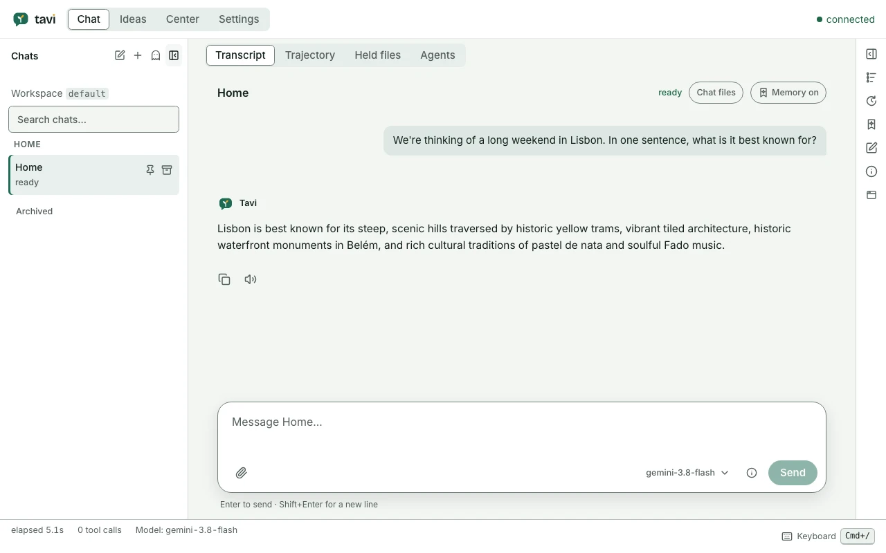
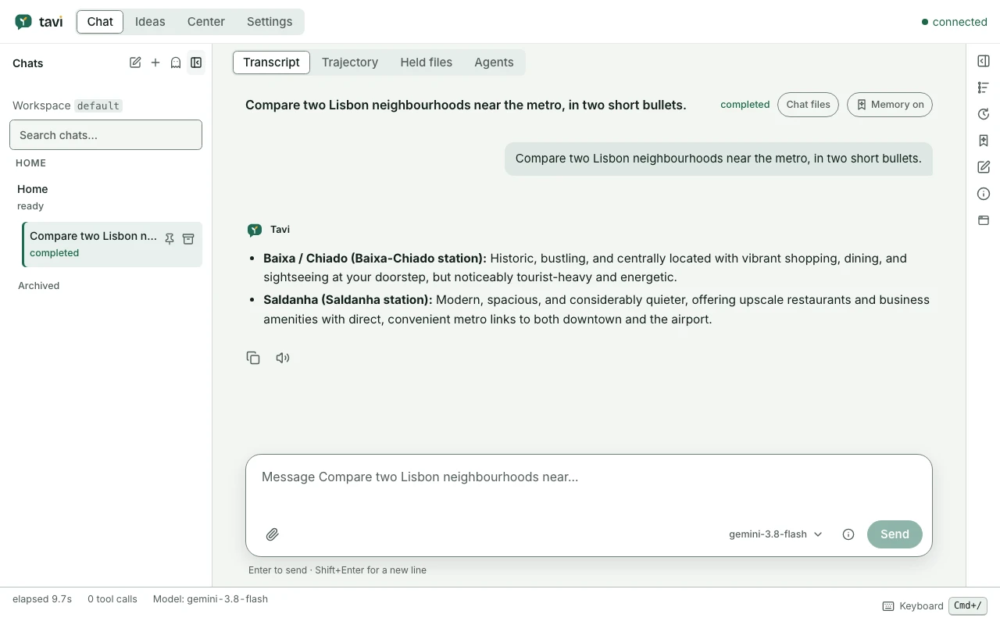
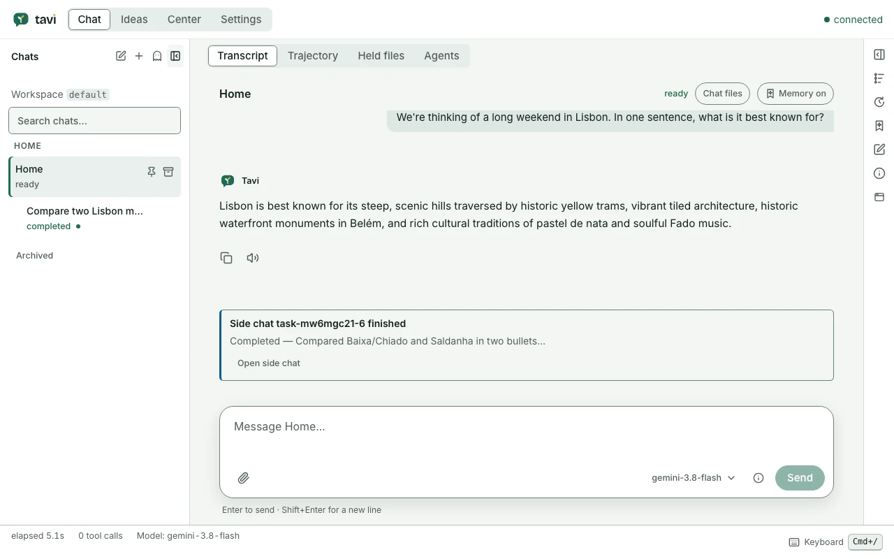
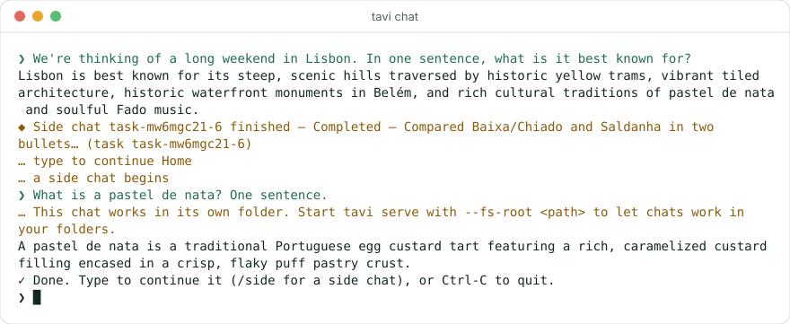
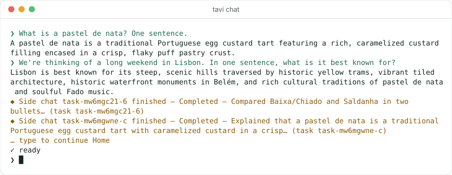

# Keep one conversation, branch side chats

Talk to Tavi in one continuous conversation, Home, and take a detour into a side chat when a question would clutter it. The side chat starts with what Home was about, and reports back when it is done. About five minutes.

> **Uses:** Home · side chats (**New side chat** in the canvas, `/side` and `/home` in `tavi chat`)
> **Before you start:** a model connected ([Connect your first model](../get-started/first-model.md)) · Tavi running in the background with `tavi serve` ([Keep Tavi running in the background](../get-started/keep-tavi-running.md))

## 1. Talk in Home

Open the canvas with `tavi ui` and type in the box that says **Message Home…**. Home is pinned at the top of the chats list and stays your one conversation: every message you send with nothing else open goes there.

## 2. Start a side chat

Choose **New side chat** (the **+** above the chats list). The canvas empties and the box says **Start a side chat…**; send your question. The side chat begins with background from Home, so you don't have to repeat yourself.

<!-- cover -->

## 3. See it report back in Home

Choose **Home** in the chats list. When the side chat's turn ends, Home shows a card, **Side chat … finished**, with its status (and a one-line summary once Tavi has written one) and **Open side chat** to go back to it. The card is a notice, not a message: Home reads it the next time you write.

## 4. Branch from the terminal

In `tavi chat`, which opens on Home, type `/side` and your question, for example `/side What is a pastel de nata? One sentence.` The question starts a side chat of the chat on screen, and its answer streams in below.

<picture>
  <source media="(prefers-color-scheme: dark)" srcset="../../assets/use-cases/chat/home-and-side-chats/04-branch-from-the-terminal-dark.svg">
  
</picture>

## 5. Go back with /home

Type `/home`. Home comes back with its newest turns and a line saying the side chat finished; your next message continues Home.

<picture>
  <source media="(prefers-color-scheme: dark)" srcset="../../assets/use-cases/chat/home-and-side-chats/05-go-back-with-home-dark.svg">
  
</picture>

## What Tavi will and won't do

A side chat reads Home's recent turns and notes as background, marked as data rather than instructions, and Home reads a side chat's notice the same way: neither takes orders from the other. A side chat of a chat that read something from the web, or a worker's answer, is treated as having read it too, so its riskier actions still ask you first. Turning a chat's memory off turns it off in its side chats as well. Leaving with Ctrl-C loses nothing: Home and every side chat are kept by `tavi serve`.

## Related

- [Have your first conversation in the terminal](../get-started/first-chat.md)
- [Open the web canvas and walk through Welcome](../get-started/web-canvas-tour.md)
- Reference: [TERMINAL-UI.md](../../TERMINAL-UI.md#side-chats), [WEB-UI.md](../../WEB-UI.md#home-and-side-chats), [CONCEPTS.md](../../CONCEPTS.md)
