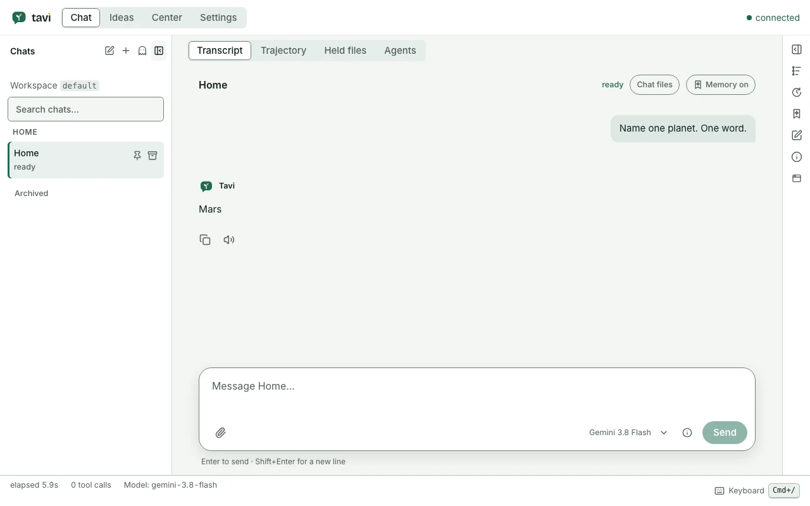
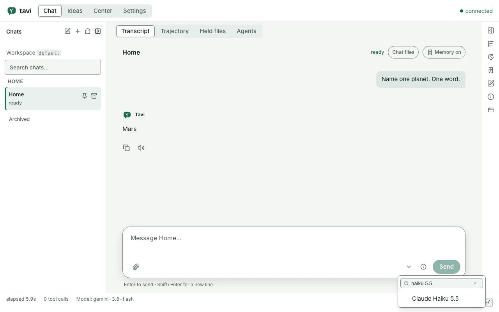
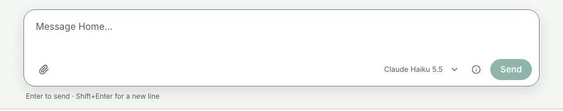
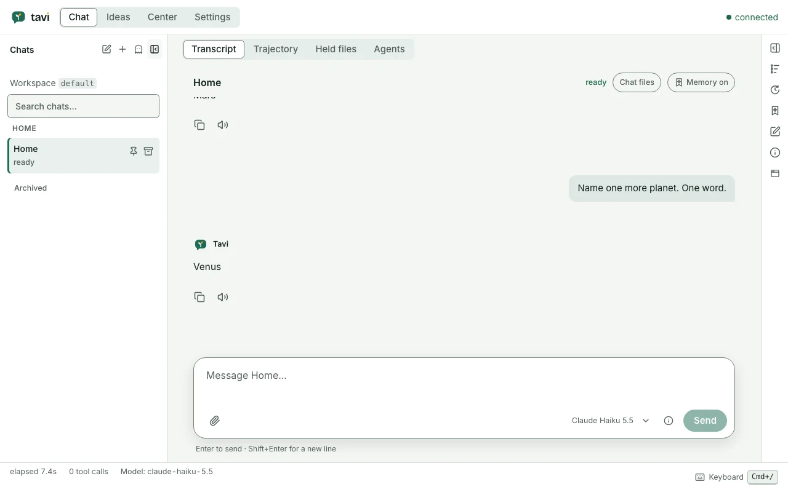
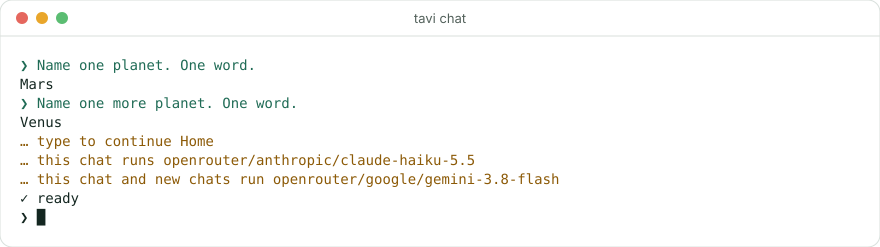

# Switch the model for one chat

Pick a different model for the chat you are in, from the canvas or the terminal, and see the next answer come from it. About three minutes.

> **Uses:** the composer's model picker (`tavi ui`) · `/model` in the terminal chat (`tavi chat`)
> **Before you start:** a model connected ([Connect your first model](../get-started/first-model.md)) · Tavi running in the background with `tavi serve` ([Keep Tavi running in the background](../get-started/keep-tavi-running.md))

## 1. Start a chat

Run `tavi ui` and send a message to **Home**. The strip at the foot of the page names the model that answered: **Model: gemini-3.8-flash**.

## 2. Open the model picker

Choose the model's name in the composer, beside **Send**. The list holds every model your connections offer; type part of a name to narrow it.

## 3. Pick a model

Choose the model. The picker shows it at once, and nothing needs a restart: the chat runs it from its next message.

## 4. Send your next message

Send the chat its next message. The answer comes from the model you picked, and the footer names it: **Model: claude-haiku-5.5**.

<!-- cover -->

## 5. Switch from the terminal

In `tavi chat`, type `/model` to see which model the chat shown runs, and `/model <connection> <model>` to change it, for example `/model openrouter google/gemini-3.8-flash`. The chat runs it from its next turn, and new chats start with it too.

<picture>
  <source media="(prefers-color-scheme: dark)" srcset="../../assets/use-cases/chat/pick-a-model-per-chat/05-switch-from-the-terminal-dark.svg">
  
</picture>

## What Tavi will and won't do

A pick changes the chat from its next message, never a turn already running. It also becomes the default for new chats, the same as **Default** in **Settings → Models**; when something else still chooses the model for new chats (a role binding, or a model given to `tavi serve`), a note under the picker says so. The picker only offers models your own connections reach: adding a provider is done in **Settings → Models**.

## Related

- [Have your first conversation in the terminal](../get-started/first-chat.md)
- [Connect your first model](../get-started/first-model.md)
- [Send a file or image with your message](attach-files-to-chat.md)
- Reference: [WEB-UI.md](../../WEB-UI.md#the-composer-and-the-model-picker), [TERMINAL-UI.md](../../TERMINAL-UI.md)
