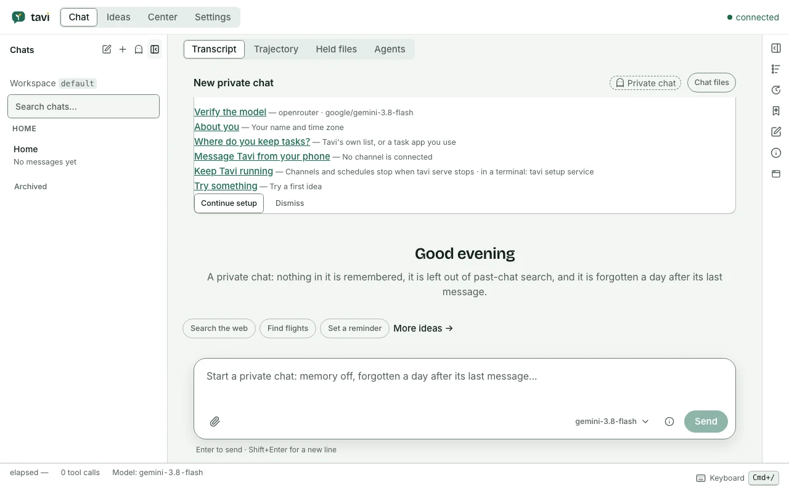
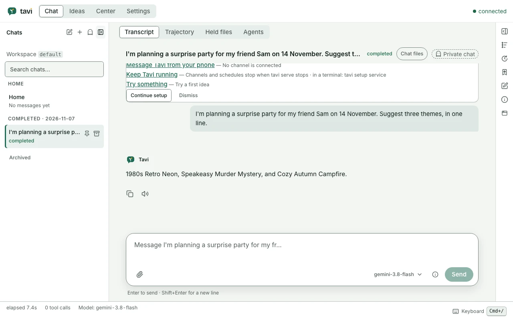
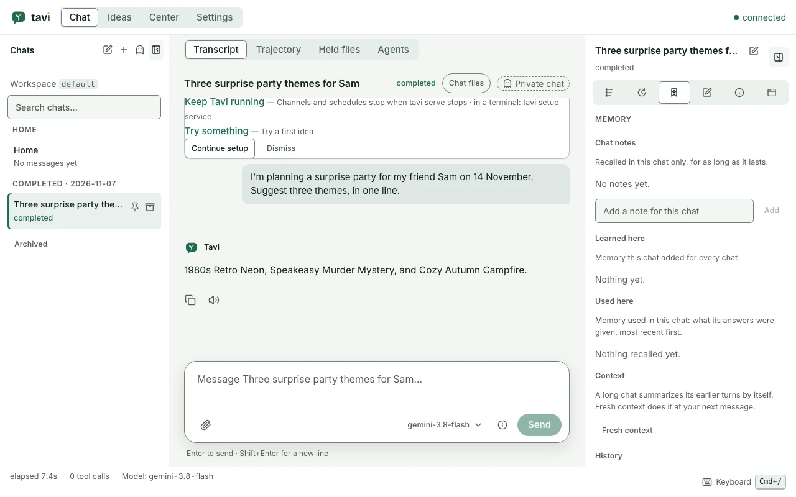
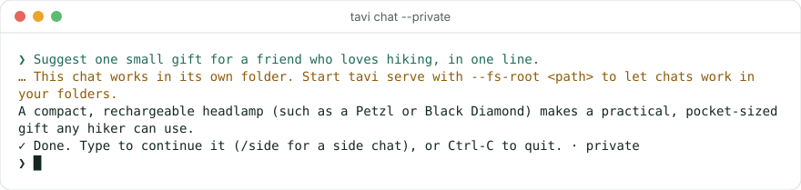

# Chat without leaving a trace

Ask something you don't want Tavi to learn from: a private chat has its memory off for good, is left out of past-chat search, and its saved turns are forgotten about a day after its last message. About three minutes.

> **Uses:** private chats (**New private chat** in the canvas, `tavi chat --private`) · memory
> **Before you start:** a model connected ([Connect your first model](../get-started/first-model.md)) · Tavi running in the background with `tavi serve` ([Keep Tavi running in the background](../get-started/keep-tavi-running.md))

## 1. Start a private chat

In the canvas, choose **New private chat**, the ghost beside the **+** above the chats list. The box says **Start a private chat: memory off, forgotten a day after its last message…**.

## 2. Talk as usual

Send your message. The chat works like any other, and its header carries **Private chat** so you can tell it apart. Nothing from Home or your other chats is recalled into it, and nothing in it is offered to memory.

<!-- cover -->

## 3. Check that nothing was learned

Open **Memory** in the chat's panel (the bookmark on the right). **Learned here** says **Nothing yet.**: the chat proposed nothing for Tavi to remember, and `tavi memory proposals` has nothing from it to review.

## 4. Start one from the terminal

Run `tavi chat --private`. Your first message starts a private chat, never Home; it answers as usual, and the chat is kept only until about a day after your last message.

<picture>
  <source media="(prefers-color-scheme: dark)" srcset="../../assets/use-cases/chat/private-chats/04-start-one-from-the-terminal-dark.svg">
  
</picture>

## What Tavi will and won't do

A private chat never recalls or proposes memories, and you can't turn its memory back on. Past-chat search and the **Earlier chats** list never show it, and its side chats are private too. Its turns still go to the model you chose, so for text that must not leave your computer use a chat on a local model ([PRIVACY.md](../../PRIVACY.md)).

## Related

- [Keep one conversation, branch side chats](home-and-side-chats.md)
- [Have your first conversation in the terminal](../get-started/first-chat.md)
- Reference: [TERMINAL-UI.md](../../TERMINAL-UI.md#memory-off-and-private-chats), [PRIVACY.md](../../PRIVACY.md), [MEMORY.md](../../MEMORY.md)
