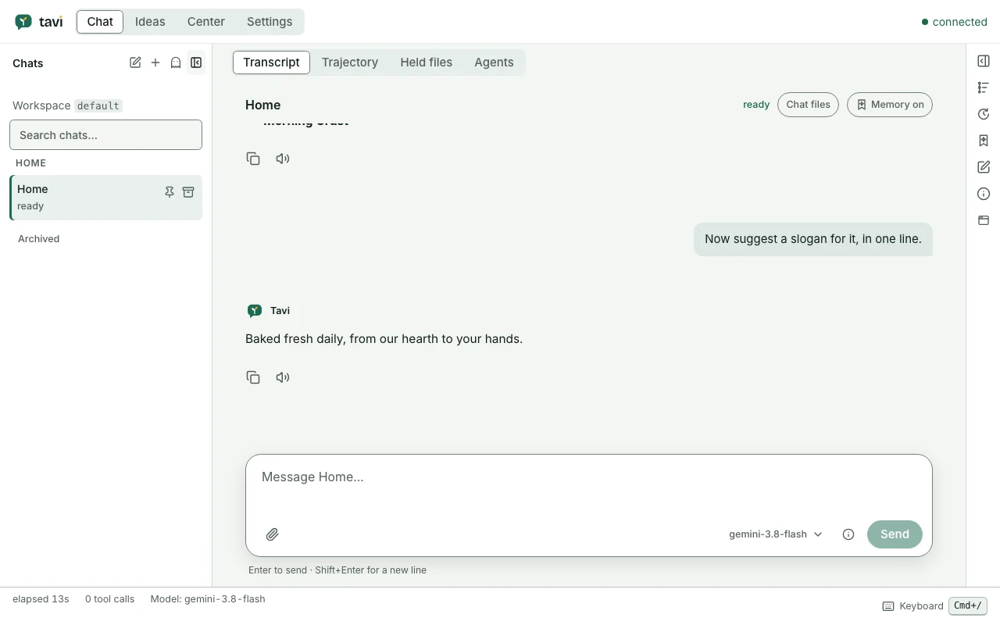
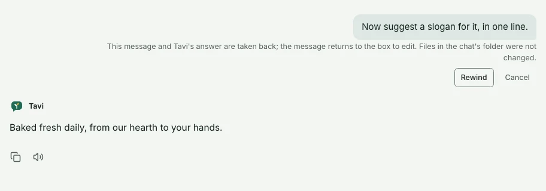
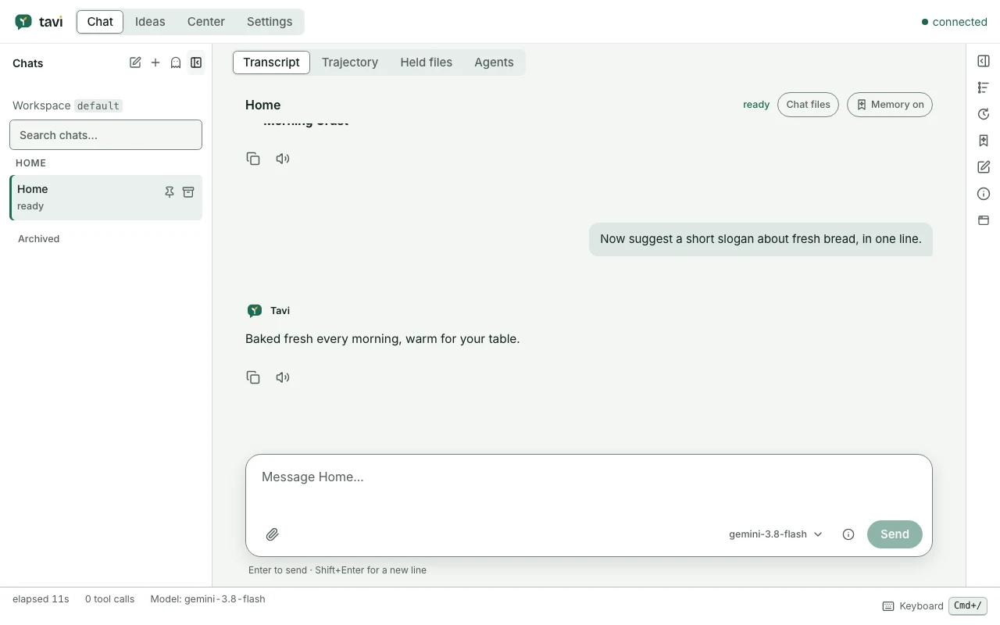
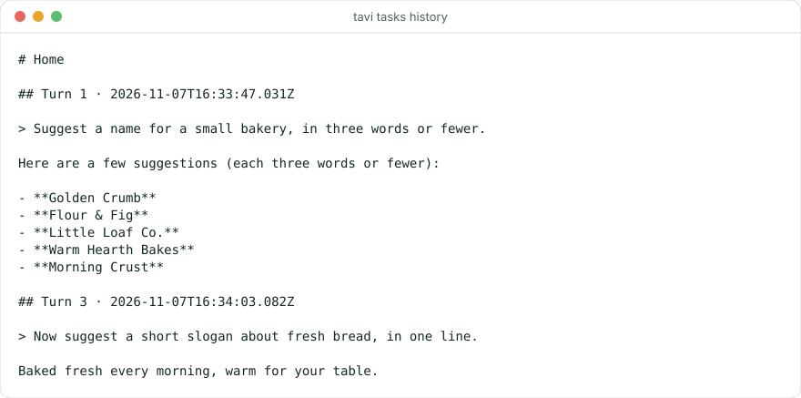
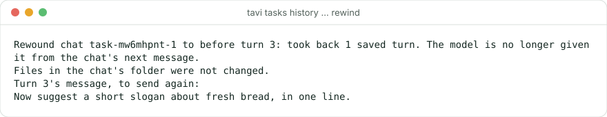
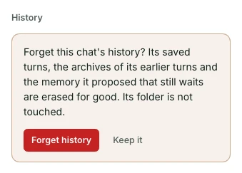

# Rewind a chat, export it, or forget it

Take back a message and send it again differently, print a chat's saved history as Markdown, or erase what a chat saved. About five minutes.

> **Uses:** **Rewind to here** on a message and **Forget history…** in the chat panel (`tavi ui`) · the chat's saved history (`tavi tasks history <task-id>`)
> **Before you start:** a model connected ([Connect your first model](../get-started/first-model.md)) · Tavi running in the background with `tavi serve` ([Keep Tavi running in the background](../get-started/keep-tavi-running.md))

## 1. Have a short conversation

Run `tavi ui` and send **Home** two messages. Every turn is saved as it ends, so the chat is there after a restart too.

## 2. Rewind to here

Point at a message you sent and choose **Rewind to here** (the arrow that points back, under it). It says what will be taken back, and that files in the chat's folder are not changed; choose **Rewind**.

## 3. Edit and send it again

The message is back in the box. Change it and send it: the chat goes on as if the old turn had never happened, and the model no longer sees it.

## 4. Export the chat

Open the chat panel's **Details** tab and copy the chat's id under **Task**. Run `tavi tasks history <task-id>` to print the chat as Markdown, oldest turn first, each under its `## Turn n` heading; add `> chat.md` to keep it in a file. A rewound turn's number is not used again, so the message you sent again is **Turn 3**.

<!-- cover -->
<picture>
  <source media="(prefers-color-scheme: dark)" srcset="../../assets/use-cases/chat/rewind-or-forget/04-export-the-chat-dark.svg">
  
</picture>

## 5. Rewind from the terminal

`tavi tasks history <task-id> rewind --turn 3` does what **Rewind to here** does, by the turn's number in the export: that turn and every later one are taken back, and it prints the message, to send again as it was or edited.

<picture>
  <source media="(prefers-color-scheme: dark)" srcset="../../assets/use-cases/chat/rewind-or-forget/05-rewind-from-the-terminal-dark.svg">
  
</picture>

## 6. Forget the history

In the chat panel's **Memory** tab, choose **Forget history…** under **History**. It asks first, and says what goes for good: the saved turns, the archives of earlier turns and the memory the chat proposed that still waits. Choose **Forget history** to erase them, or **Keep it**. From a terminal, `tavi tasks history <task-id> forget --before 2026-10-01T00:00:00Z` erases only what was saved before that time.

## What Tavi will and won't do

Rewind and forget never touch the chat's folder or the files in it, and neither runs while a turn is still going or waiting on you. Forget is permanent; memory the chat taught stays unless you tick the box to forget it too (or add `--with-memory`), and side chats begun from this one keep their own copy. See [PRIVACY.md](../../PRIVACY.md) for what Tavi keeps.

## Related

- [Have your first conversation in the terminal](../get-started/first-chat.md)
- [Compact a long chat into a new epoch](compact-a-long-chat.md)
- [Chat without leaving a trace](private-chats.md)
- Reference: [WEB-UI.md](../../WEB-UI.md#saved-history-rewind-and-forget), [CLI.md](../../CLI.md)
