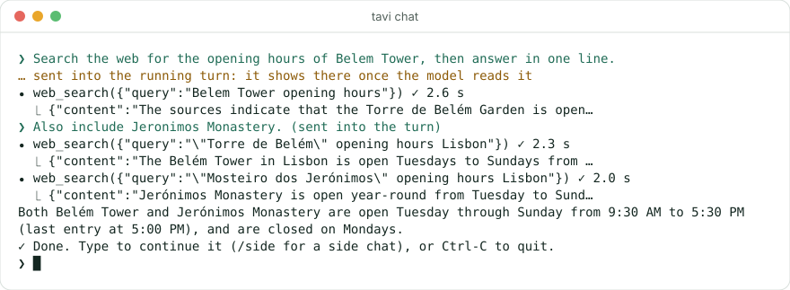
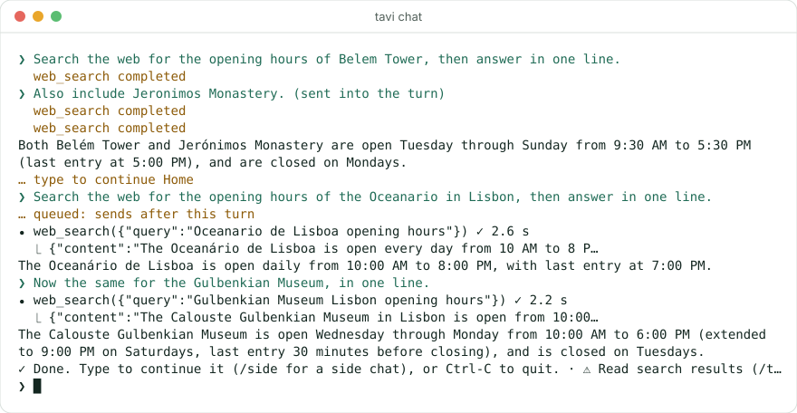
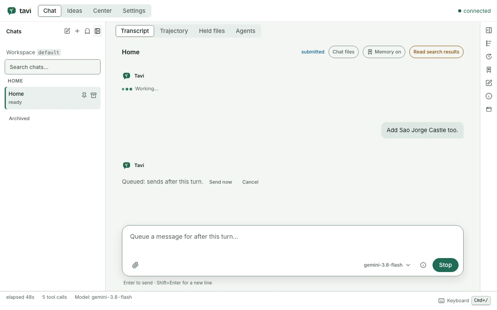
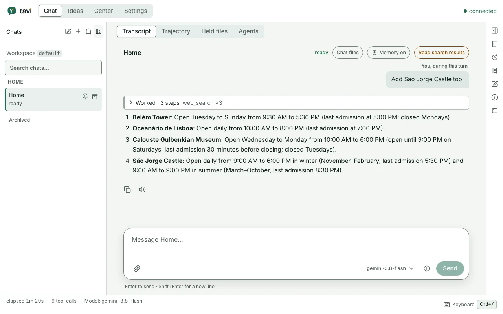

# Redirect a running turn, or queue the next message

Change course while Tavi is still working, without stopping it: send a correction into the turn that is running, or line up your next message to go as soon as it ends. About five minutes.

> **Uses:** the terminal chat (`/steer`, queued messages) · the canvas's queue (**Send now**, **Cancel**) · web search (`web_search`), for a turn that takes a few steps
> **Before you start:** a model connected ([Connect your first model](../get-started/first-model.md)) · Tavi running in the background with `tavi serve` ([Keep Tavi running in the background](../get-started/keep-tavi-running.md)) · web search set up ([Open the web canvas and walk through Welcome](../get-started/web-canvas-tour.md))

## 1. Steer a running turn

In `tavi chat`, ask for something that takes a few steps, such as a web search. While it runs, type `/steer` and the correction, for example `/steer Also include Jeronimos Monastery.` The model reads it before its next step: the chat shows your line marked **(sent into the turn)**, and the answer takes it into account.

<!-- cover -->
<picture>
  <source media="(prefers-color-scheme: dark)" srcset="../../assets/use-cases/chat/steer-and-queue/01-steer-a-running-turn-dark.svg">
  
</picture>

## 2. Queue your next message

Type a plain message while a turn runs and press Enter. The chat says **queued: sends after this turn**, and your message goes as the next turn as soon as this one ends; the turn running is not changed.

<picture>
  <source media="(prefers-color-scheme: dark)" srcset="../../assets/use-cases/chat/steer-and-queue/02-queue-your-next-message-dark.svg">
  
</picture>

## 3. Queue from the canvas

In the canvas the box says **Queue a message for after this turn…** while a turn runs. Send a message then, and it waits under the turn as **Queued: sends after this turn.**, with **Send now** and **Cancel**.

## 4. Send it into the turn now

Choose **Send now** to send the queued message into the running turn instead, as `/steer` does. It says **Sent into this turn** until the model reads it, then shows in the turn as **You, during this turn**. A message the turn ends before reading becomes the chat's next turn, so nothing you send is lost.

## What Tavi will and won't do

A message sent into a turn is read as yours, at the model's next step; it never skips an approval the turn is waiting on (while one waits, a message is queued instead). A turn takes at most five such messages. A queued message is cancelled with the turn if you cancel the chat; to stop a turn outright, use **Stop** in the canvas or Esc in `tavi chat`.

## Related

- [Keep one conversation, branch side chats](home-and-side-chats.md)
- [Have your first conversation in the terminal](../get-started/first-chat.md)
- Reference: [TERMINAL-UI.md](../../TERMINAL-UI.md#continuing-a-chat), [WEB-UI.md](../../WEB-UI.md#queueing-and-sending-into-a-running-turn), [CLI.md](../../CLI.md#tavi-chat)
