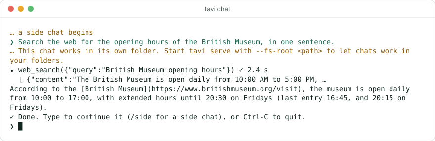
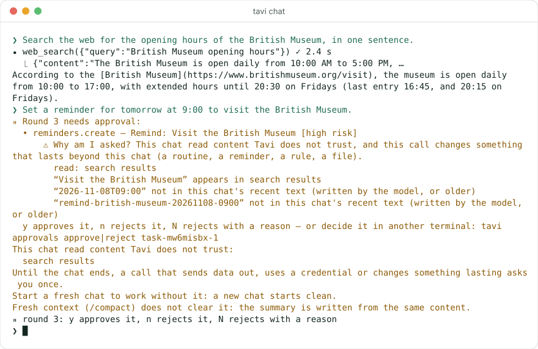
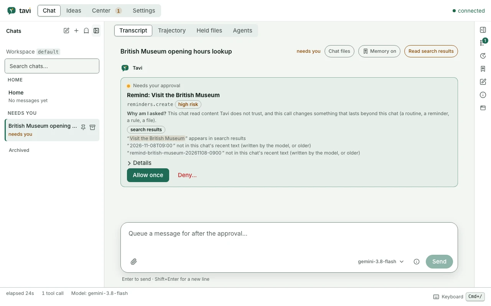
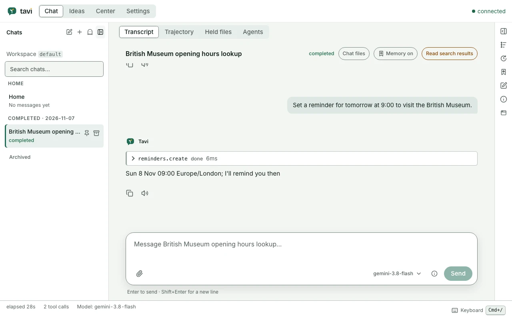
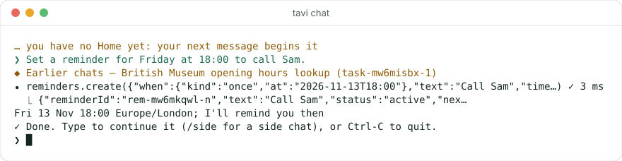
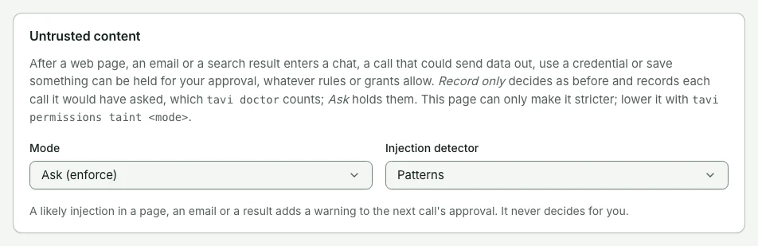

# Understand a blocked action (untrusted content)

Once a chat has read something from outside, such as a web page, a search result or an email, Tavi asks before that chat does anything lasting, even what it would otherwise do without asking. See why a call was held, what the chat read, and how to work without it. About five minutes.

> **Uses:** the untrusted-content check (`security.taint`, `tavi permissions taint`) · web search (`web_search`) · reminders (`reminders.create`) · `/taint` and the canvas's taint chip
> **Before you start:** a model connected ([Connect your first model](../get-started/first-model.md)) · Tavi running in the background with `tavi serve` ([Keep Tavi running in the background](../get-started/keep-tavi-running.md)) · web search set up ([Open the web canvas and walk through Welcome](../get-started/web-canvas-tour.md))

## 1. Let a chat read the web

In `tavi chat`, start a side chat with a question that needs a search: `/side Search the web for the opening hours of the British Museum, in one sentence.` A side chat keeps what it reads out of your Home.

<picture>
  <source media="(prefers-color-scheme: dark)" srcset="../../assets/use-cases/chat/why-was-this-blocked/01-let-a-chat-read-the-web-dark.svg">
  
</picture>

## 2. Ask for something that lasts

In the same chat, ask `Set a reminder for tomorrow at 9:00 to visit the British Museum.` A reminder never asks in a clean chat, but this one stops: **Why am I asked?** says the chat read content Tavi does not trust, names what it read (**search results**), and marks each value the model wrote rather than you. Only `y` (once), `n` and `N` (deny with a reason) are offered: no rule or grant can lift it, so there is no `s` or `a`. Type `/taint` to see what that changes until the chat ends, and the way out: a fresh chat starts clean, and `/compact` does not clear it.

<!-- cover -->
<picture>
  <source media="(prefers-color-scheme: dark)" srcset="../../assets/use-cases/chat/why-was-this-blocked/02-ask-for-something-that-lasts-dark.svg">
  
</picture>

## 3. Spot it on the canvas

Open the same chat on the canvas (it is under **Chats**). Its header carries a chip naming what it read, **Read search results**, and the waiting card shows the same **Why am I asked?**, with only **Allow once** and **Deny…**.

## 4. Allow it once if it is right

The values on the card are what will happen. If they are what you asked for, choose **Allow once** (in `tavi chat`, press `y`); if anything looks steered by what the chat read, choose **Deny…**. The next lasting call in this chat asks again.

## 5. Start a clean chat

Leave the chat that read the web: in `tavi chat`, type `/home`, then ask there, `Set a reminder for Friday at 18:00 to call Sam.` Home has read nothing untrusted, so it sets the reminder without asking.

<picture>
  <source media="(prefers-color-scheme: dark)" srcset="../../assets/use-cases/chat/why-was-this-blocked/05-start-a-clean-chat-dark.svg">
  
</picture>

## 6. Check the setting

Open **Settings → Permissions**. **Untrusted content** shows the mode in force: **Ask (enforce)**, the default, holds such calls for you. `tavi permissions taint` prints the same, and `tavi doctor` counts the calls it asked about in the last week.

## What Tavi will and won't do

In a chat that has read untrusted content, a call that could send data out, use a stored credential, or change something lasting (a reminder, a to-do, a file outside the chat's folder) asks you once each time, whatever your rules, grants or **Always allow** say. A run nobody watches, such as a schedule, has such calls refused instead. The details are in [SECURITY-MODEL.md](../../SECURITY-MODEL.md#what-makes-a-chat-tainted).

## Related

- [Approve, reject or always-allow a tool call](approve-tool-calls.md)
- [Find and answer everything Tavi is waiting on](answer-waiting-questions.md)
- Reference: [SECURITY-MODEL.md](../../SECURITY-MODEL.md), [TERMINAL-UI.md](../../TERMINAL-UI.md), [CLI.md](../../CLI.md)
