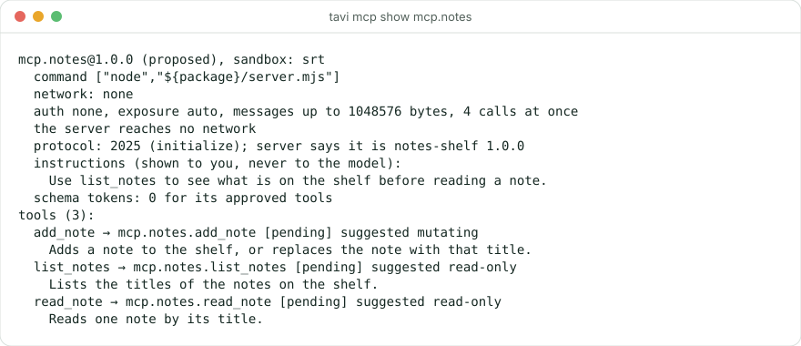
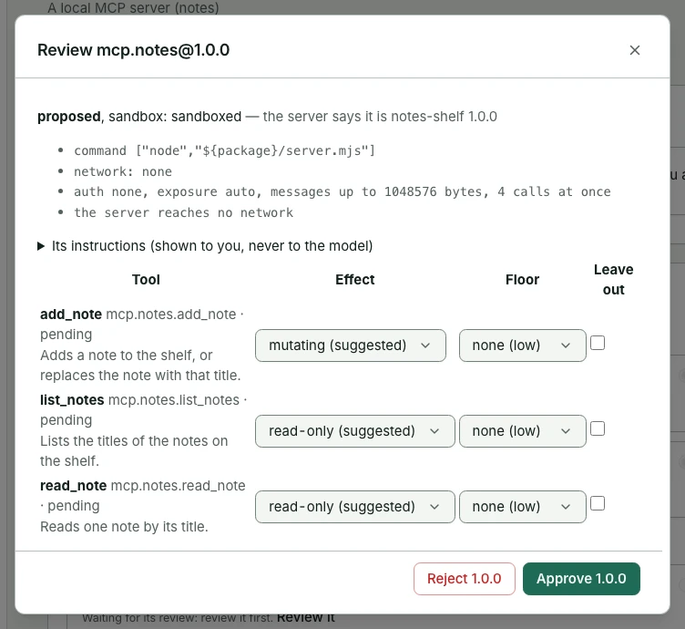
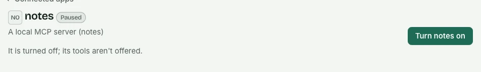
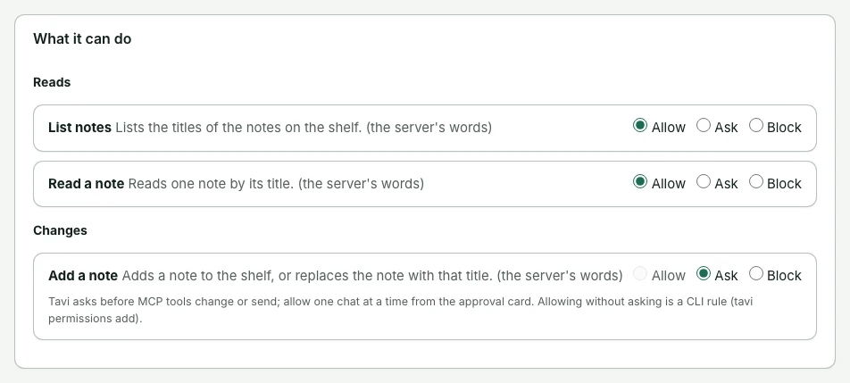
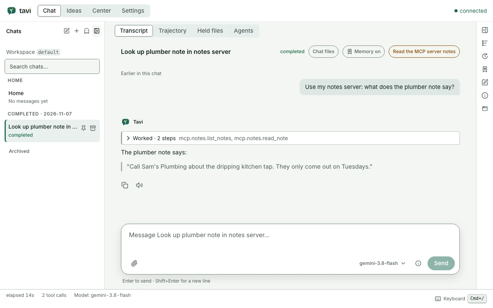
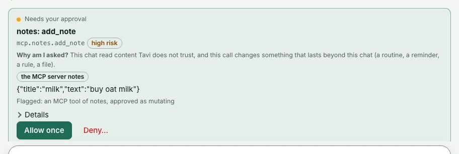
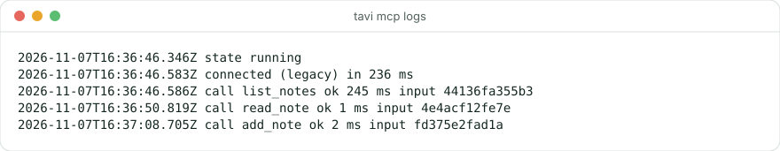

# Add any MCP server, sandboxed

Give Tavi the tools of any MCP server, a program on your computer or a service on the web: add it, read every tool it offers, approve it, and use it in a chat. A server on your computer runs in a sandbox of its own, with no network and none of your files. About ten minutes.

> **Uses:** MCP servers (`tavi mcp show mcp.notes`, `tavi mcp logs mcp.notes`) · **Settings → Connected apps** · approvals
> **Before you start:** a model connected ([Connect your first model](../get-started/first-model.md)) · Tavi running in the background with `tavi serve` ([Keep Tavi running in the background](../get-started/keep-tavi-running.md)) · the canvas open ([Open the web canvas and walk through Welcome](../get-started/web-canvas-tour.md)) · an MCP server: here, a small notes server in a folder, `notes-server`, started with `node server.mjs`

## 1. Add the server

Run `tavi mcp add notes --dir ./notes-server -- node server.mjs`. Tavi copies the folder, starts the server once in its sandbox and prints its review, as `tavi mcp show mcp.notes` does again at any time: nothing is approved yet, and the name `notes` is yours. A server on the web is added with `--url`, and an npm package with `--npm <package>@<exact version>`.

<picture>
  <source media="(prefers-color-scheme: dark)" srcset="../../assets/use-cases/connected-apps/add-an-mcp-server/01-add-the-server-dark.svg">
  
</picture>

## 2. Review its tools

Open **Settings → Connected apps**, then **notes**, and choose **Review notes' tools**. The review shows what runs and what it reaches, then every tool with the effect Tavi suggests from what the server says about it: `list_notes` and `read_note` only read, `add_note` changes something.

## 3. Approve it

Choose **Approve 1.0.0**. A tool that claims to only read but has a name that writes, or whose description reads like instructions, keeps Approve off until you choose its effect or leave it out. `tavi mcp approve mcp.notes 1.0.0` does the same in the terminal.

## 4. Turn it on

Choose **Turn notes on** (or run `tavi plugins enable mcp.notes`). Its tools are offered in your chats from the next message, with no restart. Under **What it can do**, a tool that only reads can be set to **Allow**, **Ask** or **Block**; one that changes something asks, or is blocked (allowing it without asking is a CLI rule, `tavi permissions add --tool mcp.notes.add_note --decision allow`).

## 5. Ask about your notes

In a new chat, ask for something the server knows, such as `Use my notes server: what does the plumber note say?` Its tools that only read run without asking, and **Worked** lists them by their Tavi names, `mcp.notes.list_notes` and `mcp.notes.read_note`. The chat is now marked **Read the MCP server notes**: what a server returns is untrusted content.

<!-- cover -->

## 6. Approve a change it makes

Ask for a change, such as `Add a note called milk to my notes server: buy oat milk.` A tool that changes something waits for you, and the card names the server; since this chat has read what the server returned, it says so and offers only **Allow once**. Choose it: the server writes the note in its own folder, the only place its sandbox lets it write.

## 7. Read its log

Run `tavi mcp logs mcp.notes` to see when the server started and each call: the tool, how it ended, how long it took and a digest of its input, never the input itself.

<picture>
  <source media="(prefers-color-scheme: dark)" srcset="../../assets/use-cases/connected-apps/add-an-mcp-server/07-read-its-log-dark.svg">
  
</picture>

## What Tavi will and won't do

A server runs only once you approve it, and only the definitions you approved reach the model: if the server changes a tool later, that tool is held back until you review it again ([Review an MCP server whose tools changed](review-mcp-changes.md)). Tavi refuses launchers that download code at every start, such as `npx`, and treats everything a server returns as untrusted content, so after a chat reads it, its changes ask every time. The sandbox and the review are described in [MCP.md](../../MCP.md#the-sandbox).

## Related

- [Review an MCP server whose tools changed](review-mcp-changes.md)
- [Approve, reject or always-allow a tool call](../chat/approve-tool-calls.md)
- Reference: [MCP.md](../../MCP.md), [APPS.md](../../APPS.md), [CLI.md](../../CLI.md#tavi-mcp)
