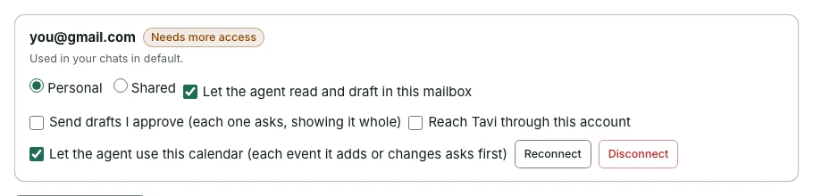
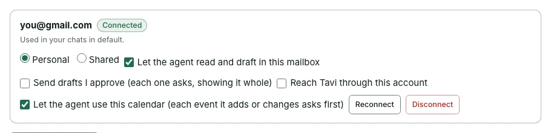
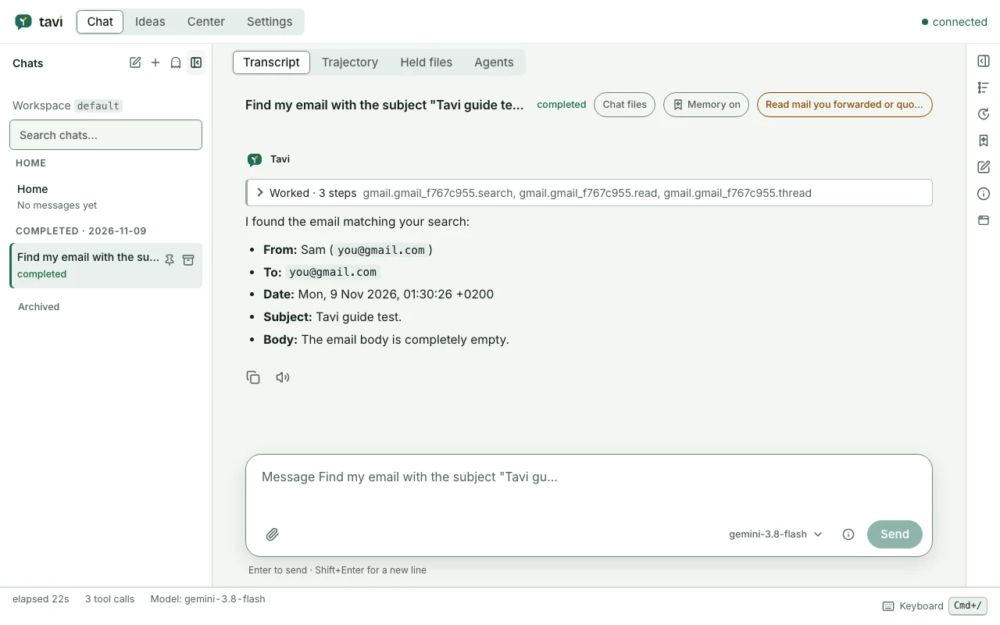
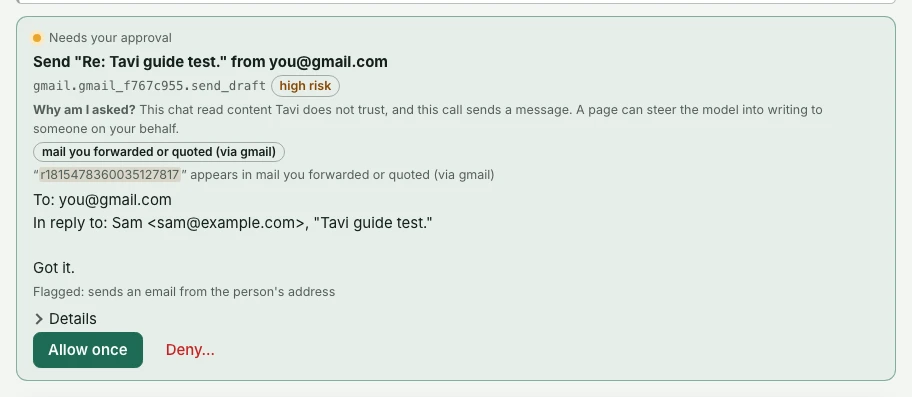

# Let Tavi read (or send) your Gmail

Turn Gmail on for your Google account, then let the agent search, read and draft in your mailbox, and send only the drafts you approve. About five minutes once Google is set up.

> **Uses:** a Google account's mailbox (`gmail.<account>.search`, `.read`, `.draft` and `.send_draft`) · **Settings → Connected apps** · approvals
> **Before you start:** a model connected ([Connect your first model](../get-started/first-model.md)) · Tavi running in the background with `tavi serve` ([Keep Tavi running in the background](../get-started/keep-tavi-running.md)) · a Google account added and signed in ([Connect Google Calendar](connect-google-calendar.md), steps 1 to 5)

## 1. Let the agent read your mailbox

Open **Settings → Connected apps**, then **Google**, and on your account tick **Let the agent read and draft in this mailbox**. The account gains its own search, read and draft tools; it still sends nothing (`tavi apps mailbox gmail <account> read` does the same, where `<account>` is the account's id, such as `gmail-15de0532`, that `tavi apps show gmail` lists).

## 2. Sign in again for Gmail

The account now asks Google for Gmail's access too: choose **Reconnect** on it, then **Sign in to Google** in the sheet that opens, sign in on Google's page, and tick every box it lists, Gmail's included. The account then says it is connected.

## 3. Ask about a message

In a new chat, ask about a message you can name, such as `Find my email with the subject "Tavi guide test" and tell me what it says.` Reading runs without asking; **Worked** shows the account's `search` and `read` tools.

<!-- cover -->

## 4. Send a reply you approve

Tick **Send drafts I approve**, then ask `Reply to that email, to you@gmail.com only, saying "Got it."` with your own address. The card shows the draft whole, flags a recipient you have never written to, and nothing goes until you choose **Allow once**.

## What Tavi will and won't do

Reading and drafting are off until you tick them, per account, and what the mailbox returns is untrusted, personal email. Every send asks once and shows the draft whole; a draft that changed since it was shown is refused, and a run nobody attends never sends. Labelling and archiving ask too, and Tavi never trashes mail, reports spam or makes a label ([APPS.md](../../APPS.md#a-gmail-mailbox)). Reaching Tavi by email is a separate choice on the same account ([Talk to Tavi by Gmail](../channels/email-gmail.md)).

## Related

- [Connect Google Calendar](connect-google-calendar.md)
- [Approve, reject or always-allow a tool call](../chat/approve-tool-calls.md)
- Reference: [APPS.md](../../APPS.md#a-gmail-mailbox), [CHANNELS.md](../../CHANNELS.md), [CLI.md](../../CLI.md#tavi-apps)
