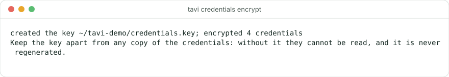
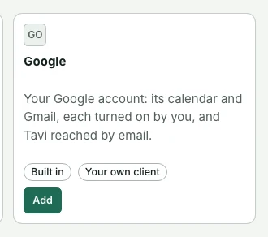
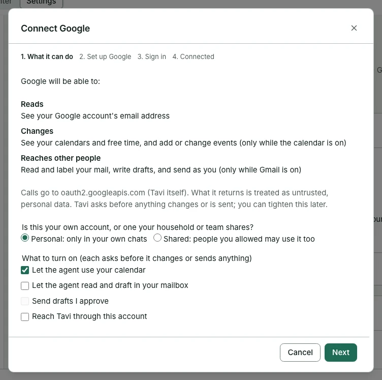
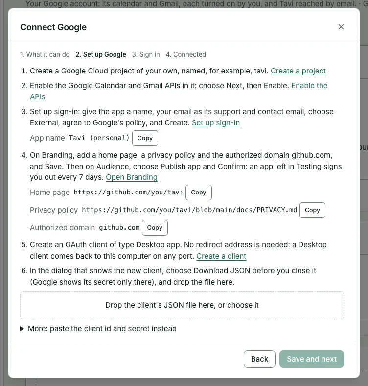
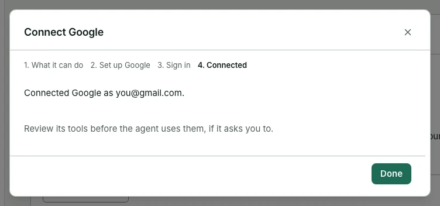
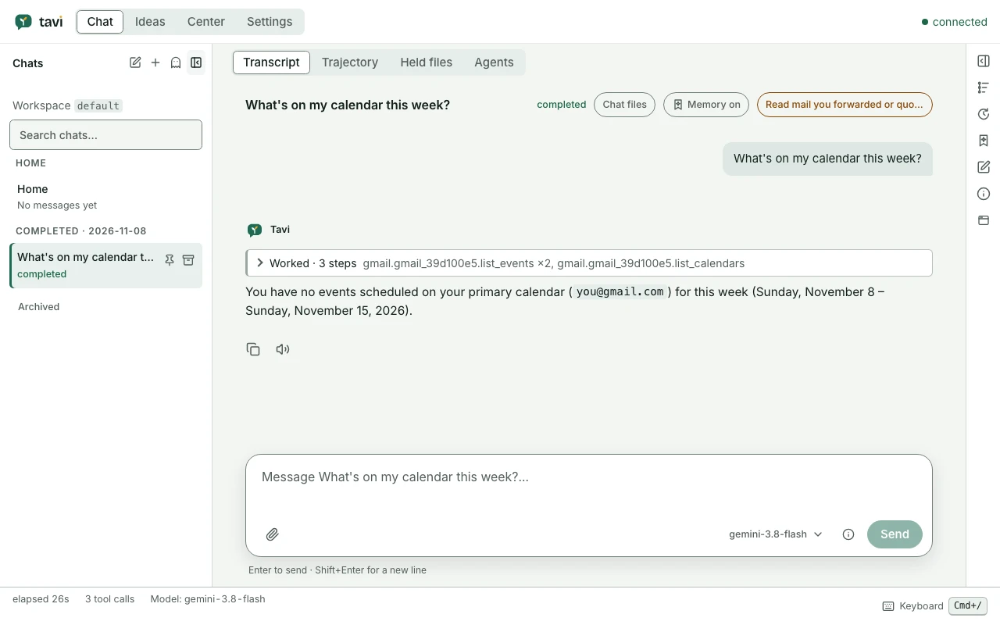
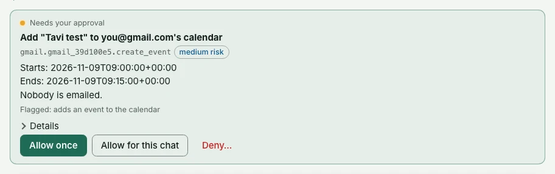

# Connect Google Calendar

Let Tavi read your calendars and free time, and add or change events once you approve each one. You set up Google once, with a Desktop app client of your own that every Google account in Tavi then shares. About ten minutes the first time, most of it in the Google Cloud console.

> **Uses:** a Google account (`gmail.<account>.list_events`, `.create_event`) · **Settings → Connected apps** · approvals
> **Before you start:** a model connected ([Connect your first model](../get-started/first-model.md)) · Tavi running in the background with `tavi serve` ([Keep Tavi running in the background](../get-started/keep-tavi-running.md)) · the canvas open ([Open the web canvas and walk through Welcome](../get-started/web-canvas-tour.md)) · a Google account

## 1. Encrypt your credentials

Run `tavi credentials encrypt`. A Google sign-in keeps a refresh token, and your client keeps a secret: Tavi stores both only in an encrypted credential store, with its key kept in the data directory.

<picture>
  <source media="(prefers-color-scheme: dark)" srcset="../../assets/use-cases/connected-apps/connect-google-calendar/01-encrypt-your-credentials-dark.svg">
  
</picture>

## 2. Add Google from Discover

Open **Settings → Connected apps**, then **Discover**, and choose **Add** on **Google**. Tavi adds a Google account and opens its connect sheet.

## 3. Turn on its calendar

The first step lists what each part may do. Tick **Let the agent use your calendar**, untick **Reach Tavi through this account** (this guide is about the calendar), keep **Personal**, and choose **Next**. The sign-in will ask Google only for what you ticked.

## 4. Set up Google

**Set up Google** lists six steps, the first five each with a button that opens its page in the [Google Cloud console](https://console.cloud.google.com/): create a project; enable the Calendar and Gmail APIs; set up sign-in (External); add the home page and privacy policy it shows, with **Copy**, and the domain `github.com`, then **Publish app**; and create an OAuth client of type **Desktop app**. In the dialog that shows the new client, choose **Download JSON** before you close it (Google shows its secret only there), drop the file on the sheet, and choose **Save and next**. There is no redirect address to register and no port to keep.

## 5. Sign in to Google

Choose **Sign in to Google**. Google's page opens in a window of its own: pick your account, pass the "unverified app" screen (it is your own app: **Advanced → Go to …**), and tick every box Google lists, or **Select all**. The sheet then says who it signed in as.

## 6. Ask about your week

In a new chat, ask `What's on my calendar this week?` Reading runs without asking, and **Worked** shows the account's `list_events`.

<!-- cover -->

## 7. Approve an event it adds

Ask for an event with nobody else on it, such as `Add "Tavi test" to my calendar tomorrow at 9:00 for 15 minutes, with no guests.` The card shows the event and says nobody is emailed, before anything is written; choose **Allow once**.

## What Tavi will and won't do

Tavi reads your calendar without asking, but every event it adds, changes or answers waits for your approval, and its card says whether Google emails the people invited; deleting one asks every time. What the calendar returns is treated as untrusted, personal data. Tavi calls Google's Calendar API with your own client, and your tokens stay in your data directory ([APPS.md](../../APPS.md#a-google-account)).

## Related

- [Let Tavi read (or send) your Gmail](connect-gmail-app.md)
- [Approve, reject or always-allow a tool call](../chat/approve-tool-calls.md)
- Reference: [APPS.md](../../APPS.md#a-google-accounts-calendar), [CLI.md](../../CLI.md#tavi-apps)
