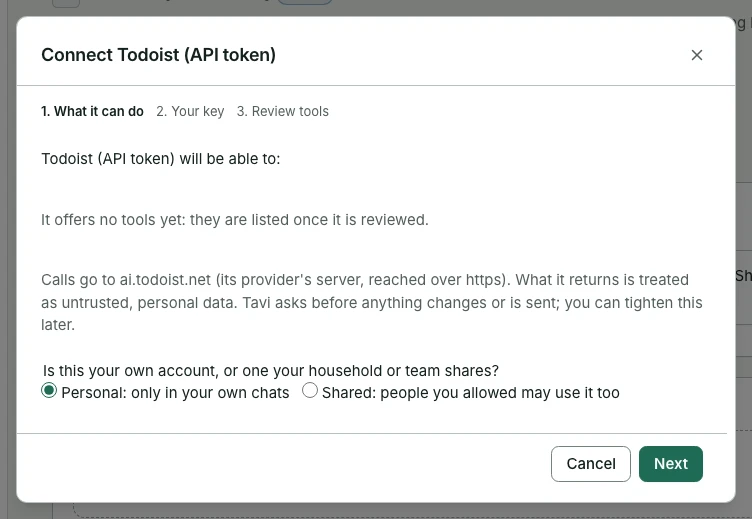
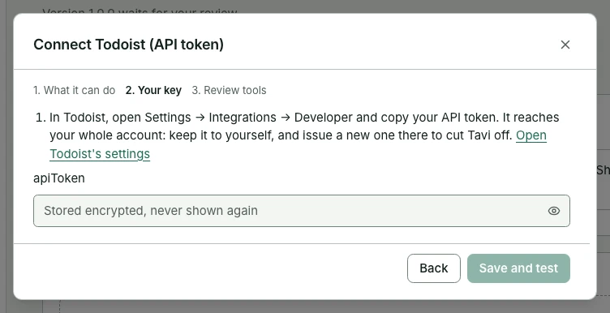
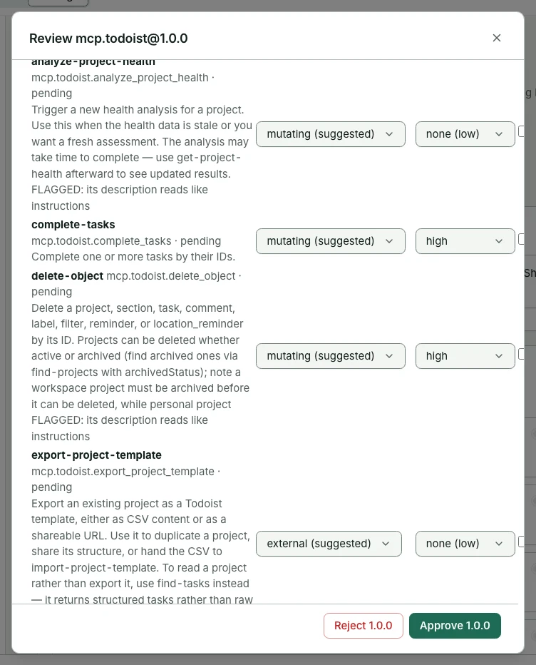
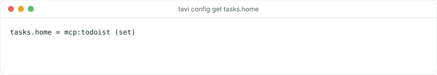
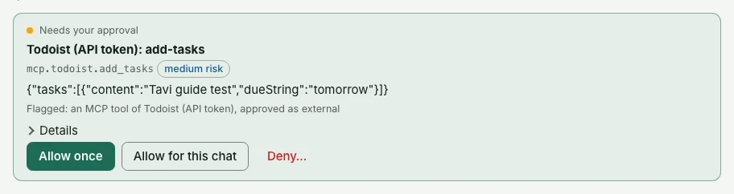

# Connect Todoist with an API token

Connect Todoist by pasting your own Todoist API token instead of signing in through the browser, make it Tavi's task home, and let Tavi add tasks there once you approve. About ten minutes.

> **Uses:** Todoist (`mcp.todoist`: `add-tasks`, `find-tasks`) · **Settings → Connected apps** · the credential store (`tavi credentials list`) · the task home (`tasks.home`) · approvals
> **Before you start:** a model connected ([Connect your first model](../get-started/first-model.md)) · Tavi running in the background with `tavi serve` ([Keep Tavi running in the background](../get-started/keep-tavi-running.md)) · the canvas open ([Open the web canvas and walk through Welcome](../get-started/web-canvas-tour.md)) · credentials encrypted (`tavi credentials encrypt`, [Store and rotate API keys](../run-and-maintain/credentials.md#6-encrypt-an-older-store)) · a Todoist account, connected one way: with a token here, or by signing in ([Connect your own task app](connect-your-task-app.md)), not both

## 1. Add Todoist (API token)

Open **Settings → Connected apps → Discover** and choose **Add** on **Todoist (API token)**. It reaches the same server as **Todoist**, Doist's own, but with a token you paste rather than a sign-in. If you signed in with **Todoist** already, **Add** asks first: **Switch to Todoist (API token)** removes that sign-in and adds this one as `mcp.todoist`, its tools to review again. Choose **Next**.

## 2. Paste your token

In Todoist, open **Settings → Integrations → Developer** and copy your API token; the sheet's **Open Todoist's settings** goes there. Paste it and choose **Save and test**: Tavi stores it encrypted, never shows it again, and asks Todoist's server for its tools with it. `tavi credentials set plugins.mcp.todoist.apiToken --file todoist-token.txt`, then `tavi plugins config mcp.todoist --set apiToken=plugins.mcp.todoist.apiToken` and `tavi mcp probe mcp.todoist`, does the same ([MCP.md](../../MCP.md#todoist) has the commands that approve and turn it on). If the test says the server refused its credentials, check the token and paste it again: until one works, Connected apps shows Todoist (API token) as **Not set up**, and **Finish setting up** brings you back to this step.

## 3. Review and turn on its tools

Once the test answers, choose **Review its tools**. Todoist offers about fifty tools. Finding and reading only read; changing and completing tasks stay in your own account; adding tasks, comments or reminders Todoist itself marks as reaching outside it (**external**); and deleting a task, project, section or comment (`delete-object`) keeps a **high** floor. Some say **FLAGGED: its description reads like instructions**, with their **Effect** on **Choose…**, because their descriptions name Todoist's other tools: read each, and when it only does that, take its **(suggested)** effect. Choose **Approve**, then **Turn Todoist (API token) on**.

## 4. Make it your task home

Run `tavi config set tasks.home mcp:todoist`. From now on Tavi sends your to-dos to Todoist, and its own list keeps only its follow-ups.

<picture>
  <source media="(prefers-color-scheme: dark)" srcset="../../assets/use-cases/connected-apps/connect-todoist-with-a-token/04-make-it-your-task-home-dark.svg">
  
</picture>

## 5. Add a task you approve

In a new chat, ask `Add a to-do: Tavi guide test, due tomorrow.` The card names Todoist's `add-tasks` and the task it adds; choose **Allow once**, and the task is in your Todoist.

<!-- cover -->

## What Tavi will and won't do

The token reaches your whole Todoist account and does not expire on its own: Tavi keeps it encrypted and sends it only to Todoist's server. To cut Tavi off, issue a new token in Todoist's settings, or remove the app. Tavi reads your tasks without asking, but every task it adds, changes or completes waits for your approval (adding one is marked **external**, as Todoist marks it), and deleting a task, project, section or comment asks at a higher level. What Todoist returns is treated as untrusted, personal data ([MCP.md](../../MCP.md#todoist)).

## Related

- [Connect your own task app (e.g. Todoist)](connect-your-task-app.md): the other way in; Tavi keeps one, and **Add** on it offers to switch
- [Connect Google Maps](google-maps.md)
- Reference: [MCP.md](../../MCP.md#todoist), [APPS.md](../../APPS.md), [CONFIGURATION.md](../../CONFIGURATION.md)
