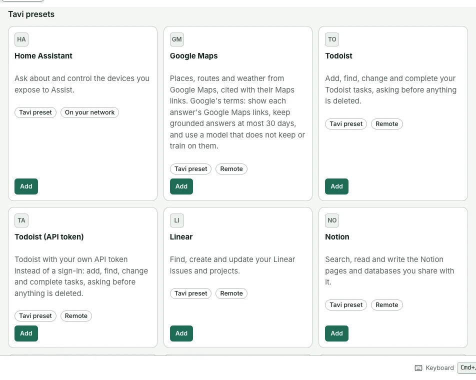
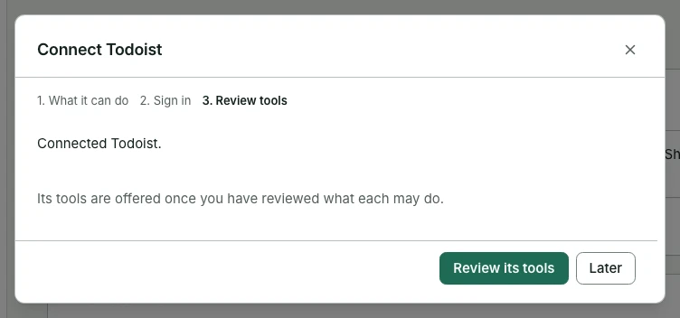
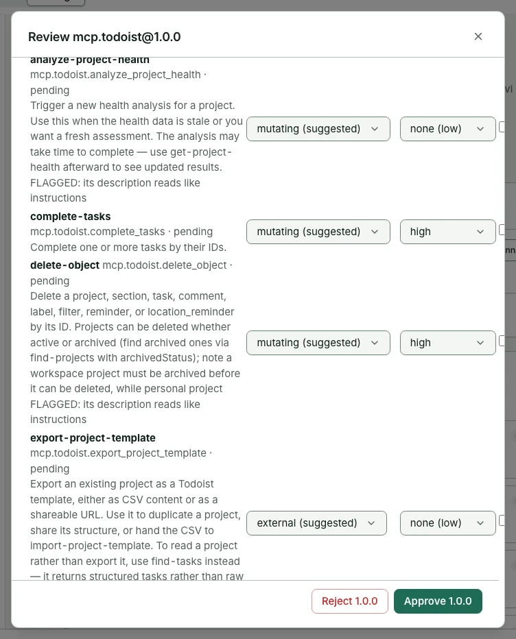
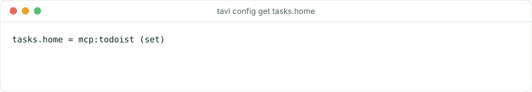
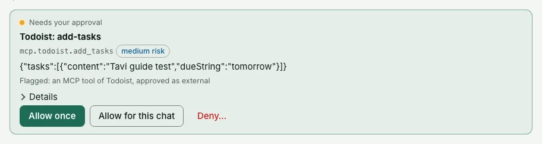

# Connect your own task app (e.g. Todoist)

Keep your to-dos where you already keep them: connect Todoist with one sign-in, make it Tavi's task home, and let Tavi add tasks there once you approve. About ten minutes.

> **Uses:** Todoist (`mcp.todoist`: `add-tasks`, `find-tasks`) · **Settings → Connected apps** · the task home (`tasks.home`) · approvals
> **Before you start:** a model connected ([Connect your first model](../get-started/first-model.md)) · Tavi running in the background with `tavi serve` ([Keep Tavi running in the background](../get-started/keep-tavi-running.md)) · the canvas open ([Open the web canvas and walk through Welcome](../get-started/web-canvas-tour.md)) · credentials encrypted (`tavi credentials encrypt`, [Store and rotate API keys](../run-and-maintain/credentials.md#6-encrypt-an-older-store)) · a Todoist account, connected one way: by signing in here, or with a token ([Connect Todoist with an API token](connect-todoist-with-a-token.md)), not both

## 1. Add Todoist from Discover

Open **Settings → Connected apps**, then **Discover**, and choose **Add** on **Todoist**. Its server is Doist's own, and its client registers itself, so there is no client of yours to make. If you added **Todoist (API token)** already, **Add** asks first: **Switch to Todoist** deletes that token and adds this one as `mcp.todoist`, its tools to review again.

## 2. Sign in to Todoist

In the connect sheet, keep **Personal** and choose **Next**, then **Sign in to Todoist**. Sign in on Todoist's page in the window that opens and allow the access; the sheet then says it is connected.

## 3. Review and turn on its tools

Choose **Review its tools**. Todoist offers about fifty tools. Finding and reading only read; changing and completing tasks stay in your own account; adding tasks, comments or reminders Todoist itself marks as reaching outside it (**external**); and deleting a task, project, section or comment (`delete-object`) keeps a **high** floor. Some say **FLAGGED: its description reads like instructions**, with their **Effect** on **Choose…**, because their descriptions name Todoist's other tools: read each, and when it only does that, take its **(suggested)** effect. Choose **Approve**, then **Turn Todoist on**.

## 4. Make it your task home

Run `tavi config set tasks.home mcp:todoist`. From now on Tavi sends your to-dos to Todoist, and its own list keeps only its follow-ups. Nothing is copied over: ask in a chat to move what is in Tavi's list.

<picture>
  <source media="(prefers-color-scheme: dark)" srcset="../../assets/use-cases/connected-apps/connect-your-task-app/04-make-it-your-task-home-dark.svg">
  
</picture>

## 5. Add a task you approve

In a new chat, ask `Add a to-do: Tavi guide test, due tomorrow.` The card names Todoist's `add-tasks` and the task it adds; choose **Allow once**, and the task is in your Todoist.

<!-- cover -->

## What Tavi will and won't do

Tavi reads your tasks without asking, but every task it adds, changes or completes waits for your approval (adding one is marked **external**, as Todoist marks it), and deleting a task, project, section or comment asks at a higher level. What Todoist returns is treated as untrusted, personal data. There is no sync between Tavi's own list and Todoist ([AUTOMATION.md](../../AUTOMATION.md#to-dos)).

## Related

- [Connect Todoist with an API token](connect-todoist-with-a-token.md): the other way in; Tavi keeps one, and **Add** on it offers to switch
- [Connect Google Calendar](connect-google-calendar.md)
- [Add any MCP server, sandboxed](add-an-mcp-server.md)
- Reference: [MCP.md](../../MCP.md#todoist), [APPS.md](../../APPS.md), [CONFIGURATION.md](../../CONFIGURATION.md)
