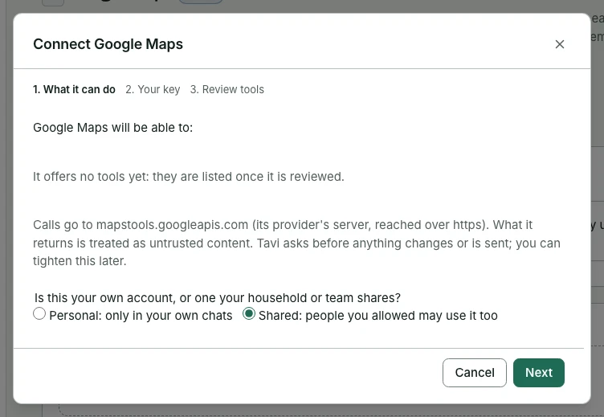
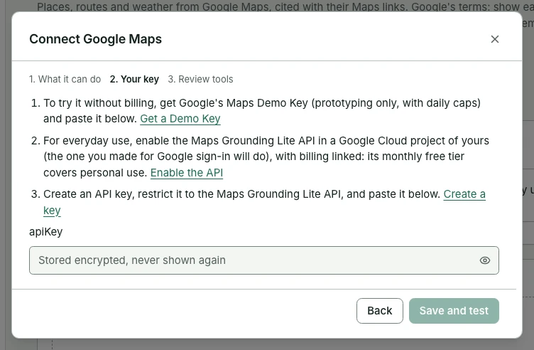
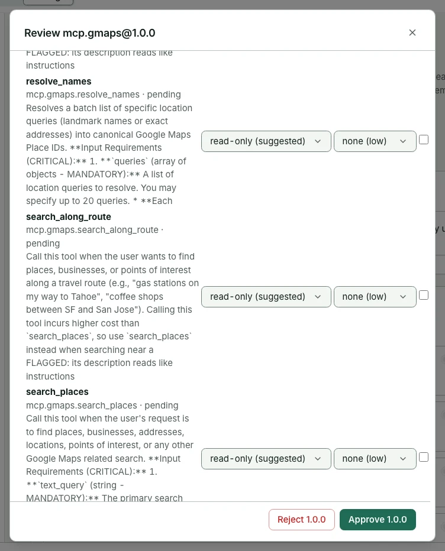
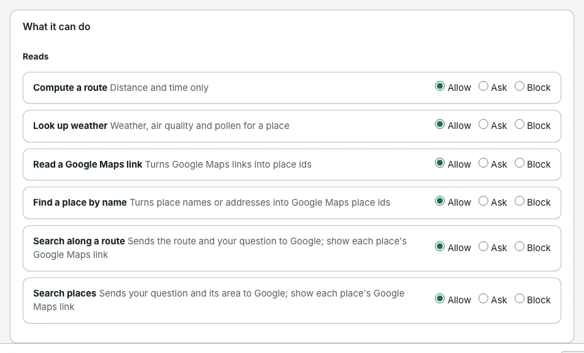
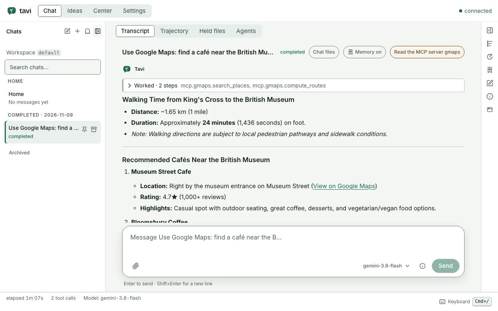

# Connect Google Maps

Let Tavi ground answers about places, routes and weather in Google Maps, with your own Maps Platform key, each answer linking its Google Maps sources. About ten minutes.

> **Uses:** Google Maps Grounding Lite (`mcp.gmaps`: `search_places`, `compute_routes`, `search_along_route`, `lookup_weather`) · **Settings → Connected apps** · the credential store (`tavi credentials list`)
> **Before you start:** a model connected ([Connect your first model](../get-started/first-model.md)) · Tavi running in the background with `tavi serve` ([Keep Tavi running in the background](../get-started/keep-tavi-running.md)) · the canvas open ([Open the web canvas and walk through Welcome](../get-started/web-canvas-tour.md)) · credentials encrypted (`tavi credentials encrypt`, [Store and rotate API keys](../run-and-maintain/credentials.md#6-encrypt-an-older-store)) · a Google account, for Google's Maps Demo Key or a Maps Platform API key (the sheet links where to get each)

## 1. Add Google Maps

Open **Settings → Connected apps → Discover** and choose **Add** on **Google Maps**. Its sheet says where the calls go (`mapstools.googleapis.com`), that what comes back is treated as untrusted content, and asks whether the key is yours alone or one others you allowed may use too; its tools are listed once you review them. **Shared** only makes lending possible: people you allowed use it once you tick **People you allowed may use it** on its page, and every call they make is billed to your key, so keep a key you pay for **Personal** unless you mean to lend it. Choose **Next**.

## 2. Paste your key

The sheet's **Your key** step links Google's pages: **Get a Demo Key** to try it without billing (prototyping only, with daily caps), or, for everyday use, **Enable the API** (Maps Grounding Lite, in a Google Cloud project of yours with billing linked) and **Create a key**, restricted to that API. Paste the key and choose **Save and test**: Tavi stores it encrypted, never shows it again, and asks Google for the tools with it. Google lists them without checking the key, so the sheet says **Saved the key; Google Maps listed its tools.**: a mistyped key, or one not restricted to the Grounding Lite API, shows only when step 5's chat first uses a tool. `tavi credentials set plugins.mcp.gmaps.apiKey --file maps-key.txt`, then `tavi plugins config mcp.gmaps --set apiKey=plugins.mcp.gmaps.apiKey` and `tavi mcp probe mcp.gmaps`, does the same ([MCP.md](../../MCP.md#google-maps) has the commands that approve and turn it on).

## 3. Review its tools

Once its tools are listed, choose **Review its tools**: all six only read. Some say **FLAGGED: its description reads like instructions**, with their **Effect** on **Choose…**: Google's descriptions name its other tools, and one holds a link, the shapes a poisoned tool hides orders in. Read each flagged description; when it only points at Google's other tools, set its **Effect** to **read-only (suggested)**.

## 4. Turn it on

Choose **Approve 1.0.0**, then **Turn Google Maps on**. **What it can do** lists the six tools under **Reads**, each set to **Allow**, **Ask** or **Block**.

## 5. Ask about a place

In a new chat, ask something Maps knows, such as `Use Google Maps: find a café near the British Museum and how long the walk from King's Cross takes.` **Worked** shows `mcp.gmaps.search_places` and `mcp.gmaps.compute_routes`, and the answer gives the walking time and links each café on Google Maps.

<!-- cover -->

## What Tavi will and won't do

Every call sends its question and area to Google with your key, and what comes back is treated as untrusted content. Google's terms bind you as the operator: show each answer's Google Maps links, keep grounded answers at most 30 days, and use a model connection that does not cache, store or train on Maps content. Tavi's places store keeps only a place id ([MCP.md](../../MCP.md#google-maps), [PLACES.md](../../PLACES.md)).

## Related

- [Connect Google Calendar](connect-google-calendar.md)
- [Add any MCP server, sandboxed](add-an-mcp-server.md)
- Reference: [MCP.md](../../MCP.md#google-maps), [APPS.md](../../APPS.md), [CLI.md](../../CLI.md#tavi-apps)
