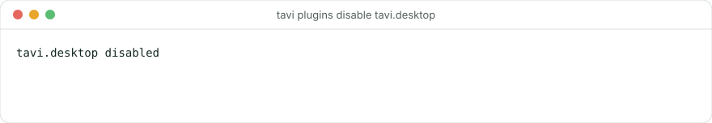
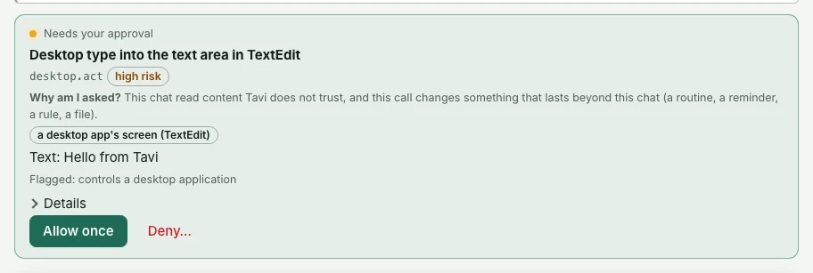

<!-- Generated by scripts/docs/guide-indexes.mjs from the guides: edit the guides, not this file. -->

# Desktop

Experimental control of apps on your Mac.

| | Guide |
| :--- | :--- |
|  | [Stop desktop control at once, and what it will never do](stop-desktop-control.md) Stop whatever desktop control is doing with one hotkey, see what it refuses on its own, and take its access away when you are done. |
|  | [Let Tavi use an app on your Mac (experimental)](turn-on-desktop-control.md) Let Tavi see and type in an app you choose, such as a TextEdit document, each action after its own approval card. |

[All how-to guides](../README.md)
