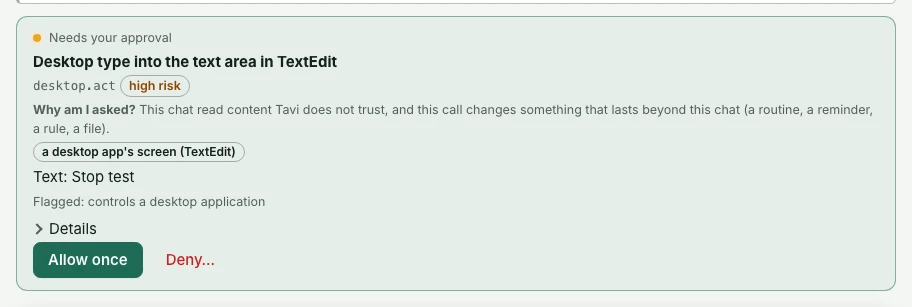
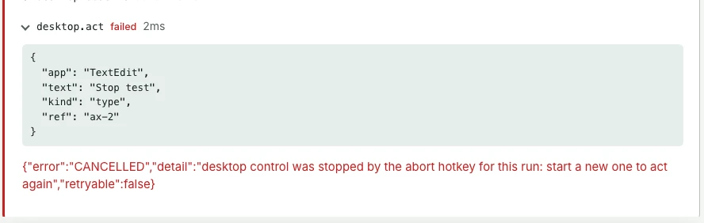
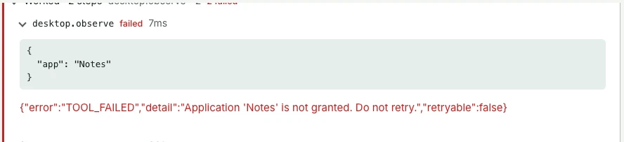
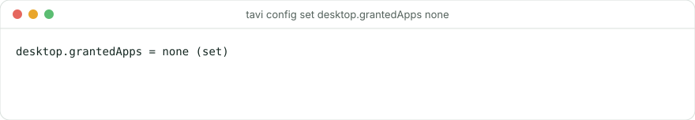
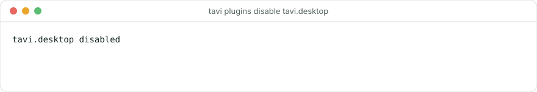

# Stop desktop control at once, and what it will never do

Stop whatever desktop control is doing with one hotkey, see what it refuses on its own, and take its access away when you are done. Experimental, macOS only. About ten minutes.

> **Uses:** desktop control (`tavi.desktop`: `desktop.act`) · the abort hotkey **⌘⇧Esc** · `desktop.grantedApps` · approvals
> **Before you start:** desktop control turned on, its helper built and allowed in System Settings, with TextEdit granted ([Let Tavi use an app on your Mac](turn-on-desktop-control.md)) · the canvas open ([Open the web canvas and walk through Welcome](../get-started/web-canvas-tour.md)) · a TextEdit document with nothing in it you mind losing

## 1. Leave an action waiting

In a new chat, ask `Type "Stop test" in my TextEdit document.` Every desktop call waits for its own card, naming the app and what it will do, a look at the window included.

## 2. Press the abort hotkey

Press **⌘⇧Esc** (Cmd+Shift+Escape), wherever you are. It stops the action in flight, refuses what was queued behind it, and stops desktop control for the rest of this run: choosing **Allow once** now only shows the refusal. A new chat acts again.

## 3. See what it refuses on its own

Ask `Use desktop control to type "hello" in Notes.` Notes is not on your list, so the call is refused before anyone is asked. So are password fields, password managers, system sign-in prompts and Tavi's own windows, whatever the list says.

## 4. Take its apps away

Run `tavi config set desktop.grantedApps none`. With no app granted, every desktop call is refused, at once and in every chat.

<picture>
  <source media="(prefers-color-scheme: dark)" srcset="../../assets/use-cases/desktop/stop-desktop-control/04-take-its-apps-away-dark.svg">
  
</picture>

## 5. Turn it off and revoke the grants

Run `tavi plugins disable tavi.desktop` and restart `tavi serve`: the desktop tools are gone. Then open **System Settings → Privacy & Security** and turn off **Accessibility** and **Screen Recording** for the terminal you ran `tavi serve` from; macOS keeps them until you do.

<picture>
  <source media="(prefers-color-scheme: dark)" srcset="../../assets/use-cases/desktop/stop-desktop-control/05-turn-it-off-and-revoke-the-grants-dark.svg">
  
</picture>

## What Tavi will and won't do

Desktop control acts only in a chat you attend, only in apps you granted, and only after each action's card; a run nobody attends never touches the desktop. Every check fails closed: when Tavi cannot tell which app or field an action lands in, it refuses ([DESKTOP.md](../../DESKTOP.md#safety-model-gates-that-fail-closed)).

## Related

- [Let Tavi use an app on your Mac (experimental)](turn-on-desktop-control.md)
- [Understand a blocked action (untrusted content)](../chat/why-was-this-blocked.md)
- Reference: [DESKTOP.md](../../DESKTOP.md), [CLI.md](../../CLI.md#tavi-config)
