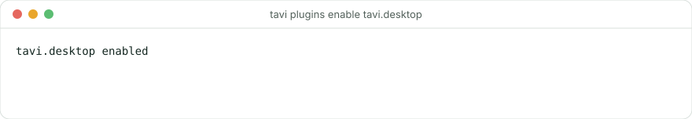
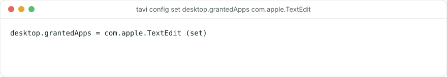
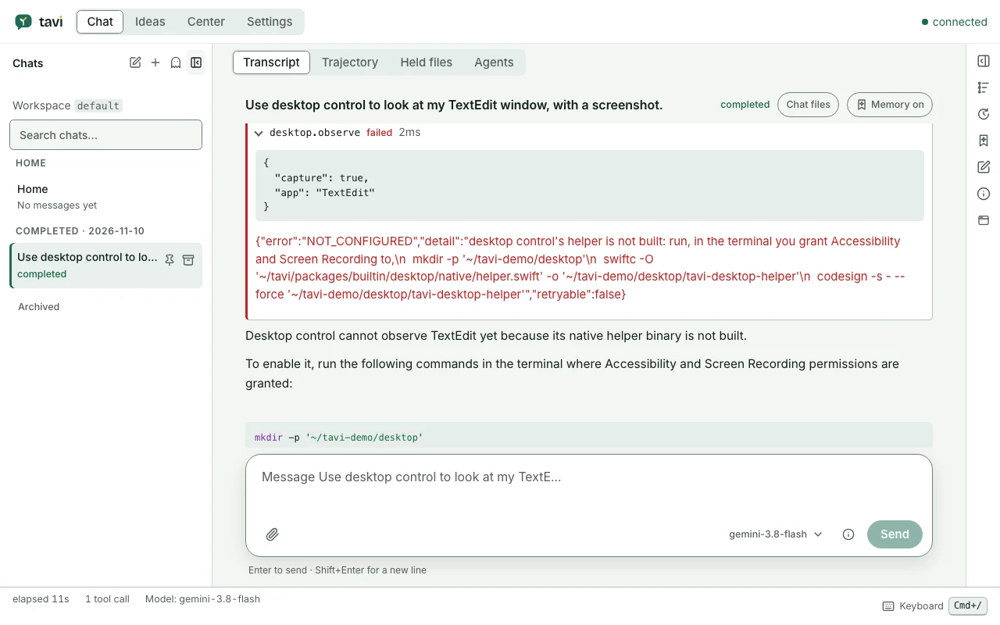
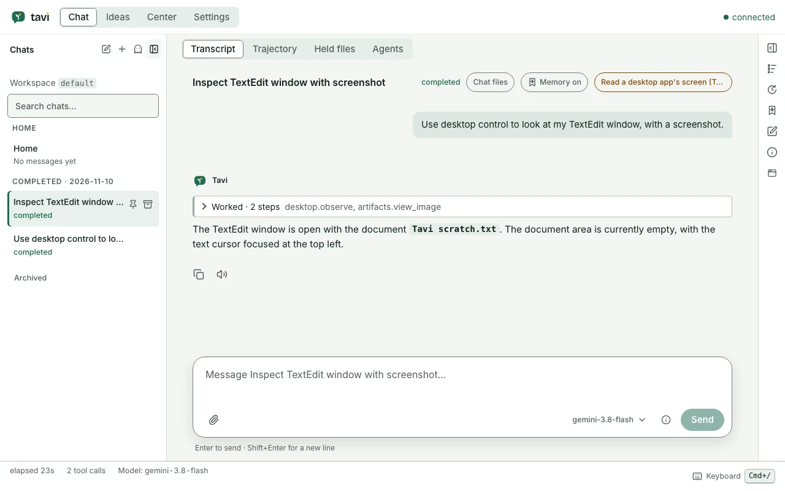
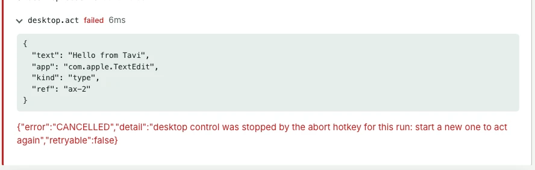
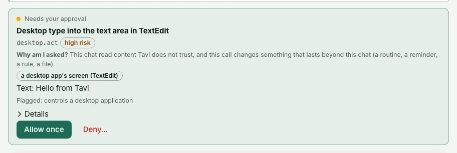

# Let Tavi use an app on your Mac (experimental)

Let Tavi see and type in an app you choose, such as a TextEdit document, each action after its own approval card. Experimental, macOS only, and off until you turn it on. About fifteen minutes.

> **Uses:** desktop control (`tavi.desktop`: `desktop.observe`, `desktop.act`) · `desktop.grantedApps` · approvals · macOS Accessibility and Screen Recording
> **Before you start:** a Mac with macOS 14 or newer and the Xcode Command Line Tools (`xcode-select --install`) · a model connected ([Connect your first model](../get-started/first-model.md)) · Tavi running in the background with `tavi serve` ([Keep Tavi running in the background](../get-started/keep-tavi-running.md)) · the canvas open ([Open the web canvas and walk through Welcome](../get-started/web-canvas-tour.md)) · a new TextEdit document with nothing in it you mind losing

## 1. Turn on desktop control

Run `tavi plugins enable tavi.desktop`, then restart `tavi serve`: plugins are put together when the owner starts.

<picture>
  <source media="(prefers-color-scheme: dark)" srcset="../../assets/use-cases/desktop/turn-on-desktop-control/01-turn-on-desktop-control-dark.svg">
  
</picture>

## 2. Choose the one app it may use

Run `tavi config set desktop.grantedApps com.apple.TextEdit`. Tavi sees and acts only in the apps on this list; any other app is refused, and `none` clears it.

<picture>
  <source media="(prefers-color-scheme: dark)" srcset="../../assets/use-cases/desktop/turn-on-desktop-control/02-choose-the-one-app-it-may-use-dark.svg">
  
</picture>

## 3. Build its helper

In a new chat, ask `Use desktop control to look at my TextEdit window, with a screenshot.` Even looking waits for its card: choose **Allow once**. The first time, the call refuses and prints the three commands that build Tavi's small macOS helper for your install: run them, once, in the terminal you run `tavi serve` from. Tavi never runs them itself.

## 4. Allow it in System Settings

Ask again. macOS asks for **Accessibility** and **Screen Recording** for the terminal running `tavi serve`: allow both in **System Settings → Privacy & Security**, restart `tavi serve` so the helper starts with them, and ask once more. Tavi now sees TextEdit's window, and only it.

## 5. Try the abort hotkey first

Before you approve any action, ask `Type "Hello from Tavi" in my TextEdit document.` While its first card waits, press **⌘⇧Esc** (Cmd+Shift+Escape), then choose **Allow once**: the call is refused, because the hotkey stopped desktop control for this run.

## 6. Approve an action

In a new chat, ask the same again. Each card names what the call will do, the element it acts on and TextEdit, at **high risk**; **Details** shows the whole call, the text it will type included. Choose **Allow once** on each, and the words appear in your document.

<!-- cover -->

## What Tavi will and won't do

Every desktop action waits for its own approval card in a chat you attend, in an app you granted, and the abort hotkey stops it at any time. Tavi refuses password fields, password managers, system sign-in prompts and its own windows, and keeps browsers and terminals to looking or clicking ([DESKTOP.md](../../DESKTOP.md#safety-model-gates-that-fail-closed)). When you are done, take the grants back: [Stop desktop control at once, and what it will never do](stop-desktop-control.md).

## Related

- [Stop desktop control at once, and what it will never do](stop-desktop-control.md)
- [Approve, reject or always-allow a tool call](../chat/approve-tool-calls.md)
- Reference: [DESKTOP.md](../../DESKTOP.md), [CLI.md](../../CLI.md#tavi-plugins)
