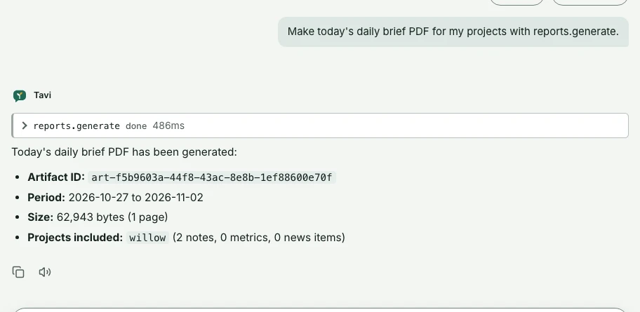
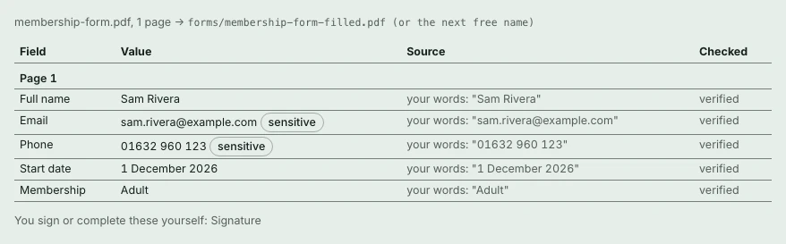
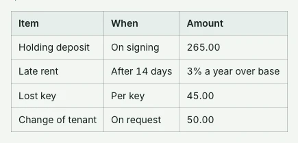
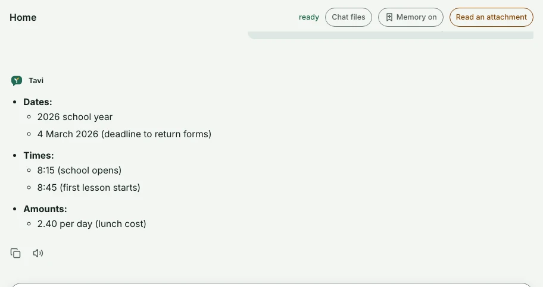

<!-- Generated by scripts/docs/guide-indexes.mjs from the guides: edit the guides, not this file. -->

# Documents

Reading, scanning and filling PDFs, and the daily brief.

| | Guide |
| :--- | :--- |
|  | [Get a daily-brief PDF for your projects](daily-brief-pdf.md) Register the projects you run — a website, an app, a shop — and have Tavi write a short PDF brief about them from their own numbers and the news. |
|  | [Fill a PDF form from your own notes](fill-a-pdf-form.md) Hand Tavi a fillable PDF form and your notes, check every value it will write and where it found it, and get a filled copy, with the signature left for you. |
|  | [Summarise a PDF and pull out tables](read-a-pdf.md) Attach a PDF in the canvas, get a short summary, lift a table out of it as a table, and ask about one clause. |
|  | [Read a scanned document (local OCR)](read-a-scan.md) A scanned letter is a picture of text: Tavi reads it on this computer with OCR, then answers about it like any other PDF. |

[All how-to guides](../README.md)
