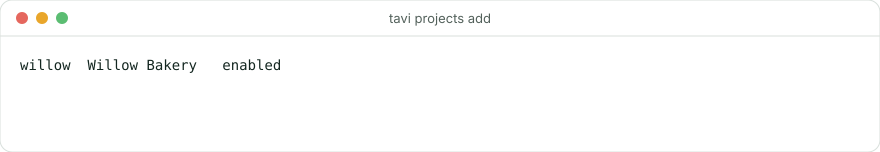
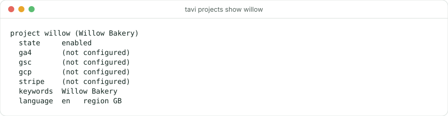
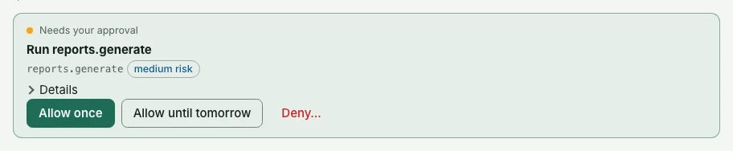
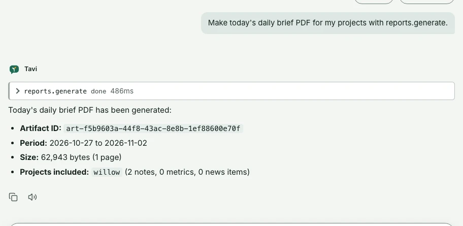
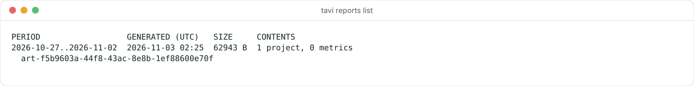
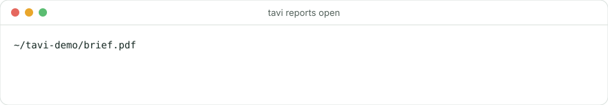

# Get a daily-brief PDF for your projects

Register the projects you run — a website, an app, a shop — and have Tavi write a short PDF brief about them from their own numbers and the news. About ten minutes, plus setting up each source you want.

> **Uses:** the project registry (`tavi projects list`) · the collectors (`collect.daily`) · writing the brief (`reports.generate`) · past briefs (`tavi reports list`) · approvals
> **Before you start:** a model connected ([Connect your first model](../get-started/first-model.md)) · Tavi running in the background with `tavi serve` ([Keep Tavi running in the background](../get-started/keep-tavi-running.md)) · for each source you want, its account and a read-only key: Google Analytics, Search Console and Cloud Billing through one Google service account, Stripe through a restricted key, news through feeds or a search key ([REPORTS.md](../../REPORTS.md#set-it-up))

## 1. Register your project

Run `tavi projects add willow --name "Willow Bakery" --keyword "Willow Bakery" --language en --region GB`. Add the flag of each source the project has: `--ga4`, `--gsc`, `--gcp-project` with `--gcp-table`, `--stripe-ref`; every source is optional.

<picture>
  <source media="(prefers-color-scheme: dark)" srcset="../../assets/use-cases/documents/daily-brief-pdf/01-register-your-project-dark.svg">
  
</picture>

## 2. Check what it will collect

Run `tavi projects show willow`. It lists each source as set or **(not configured)**; a source that is not configured is skipped, and the brief says so.

<picture>
  <source media="(prefers-color-scheme: dark)" srcset="../../assets/use-cases/documents/daily-brief-pdf/02-check-what-it-will-collect-dark.svg">
  
</picture>

## 3. Ask for the brief

In the canvas (`tavi ui`), ask *Make today's daily brief PDF for my projects.* Writing the brief stores a report, so Tavi asks first: a card for `reports.generate`.

## 4. Allow it

Choose **Allow once**. Tavi collects every configured source for each project, writes the PDF and tells you the report's id, the period it covers and how many notes it carries. The brief itself is not shown in the chat: it is kept as a stored report.

<!-- cover -->

## 5. List your briefs

Run `tavi reports list`. Each brief is one line, newest first: its period, when it was made, its id, its size and how many projects and figures it covers.

<picture>
  <source media="(prefers-color-scheme: dark)" srcset="../../assets/use-cases/documents/daily-brief-pdf/05-list-your-briefs-dark.svg">
  
</picture>

## 6. Open a brief

Opening a brief reads the store directly, so it needs the owner stopped: stop `tavi serve` (Ctrl-C in its terminal), then run `tavi reports open <artifact-id> --out brief.pdf` with the id from the list, and open `brief.pdf`. Start `tavi serve` again when you are done.

<picture>
  <source media="(prefers-color-scheme: dark)" srcset="../../assets/use-cases/documents/daily-brief-pdf/06-open-a-brief-dark.svg">
  
</picture>

## What Tavi will and won't do

The collectors only read, from fixed provider endpoints with your keys, which are never shown to the model or written into the brief. A source that fails becomes a note on its project and the rest of the brief is still written. News is someone else's text, so a chat that read it asks before its next outward action, and a scheduled brief cannot send anything elsewhere on its own.

## Related

- [Summarise a PDF and pull out tables](read-a-pdf.md)
- [Open the web canvas and walk through Welcome](../get-started/web-canvas-tour.md)
- Reference: [REPORTS.md](../../REPORTS.md), [CLI.md](../../CLI.md#tavi-reports), [AUTOMATION.md](../../AUTOMATION.md)
