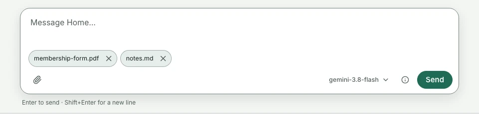
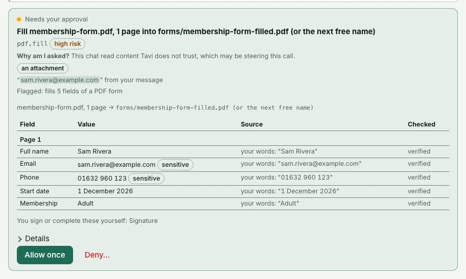
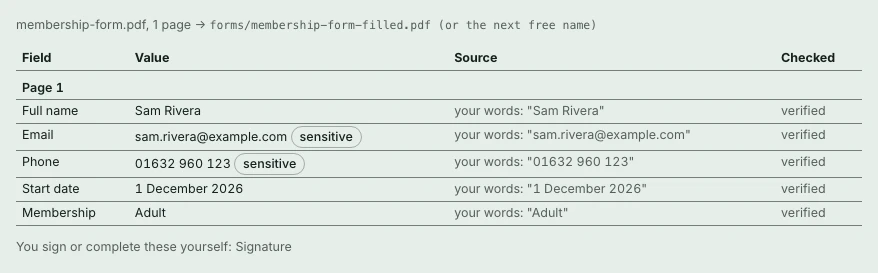
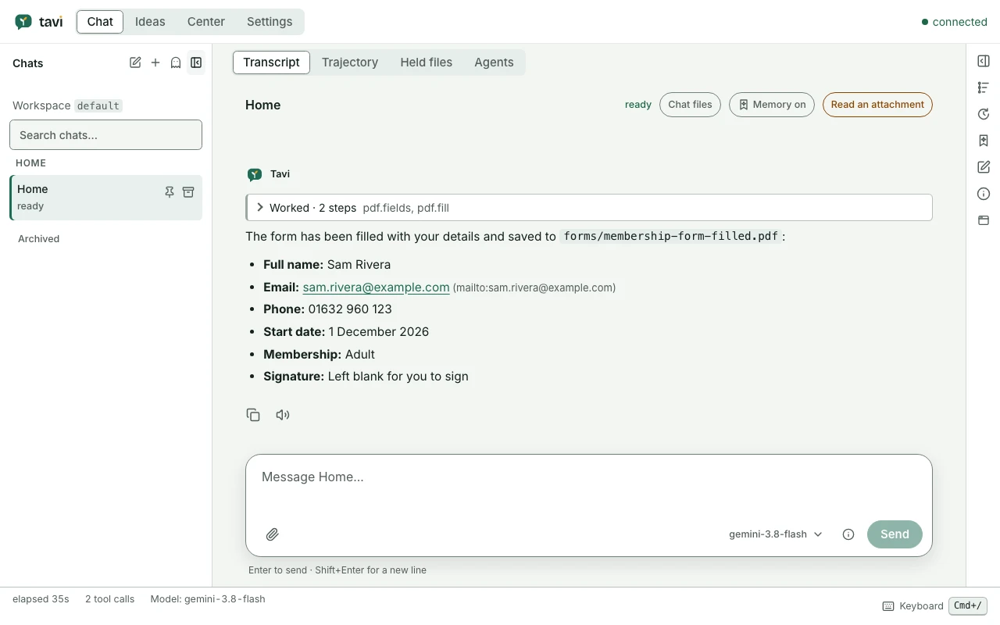

# Fill a PDF form from your own notes

Hand Tavi a fillable PDF form and your notes, check every value it will write and where it found it, and get a filled copy, with the signature left for you. About five minutes.

> **Uses:** the composer's attachments (`tavi ui`) · a form's fields (`pdf.fields`) · filling a form into a new copy (`pdf.fill`) · approvals
> **Before you start:** a model connected ([Connect your first model](../get-started/first-model.md)) · Tavi running in the background with `tavi serve` ([Keep Tavi running in the background](../get-started/keep-tavi-running.md)) · a fillable PDF form (one whose boxes you can type into in a PDF viewer)

## 1. Attach the form and your notes

Run `tavi ui`, and in **Home**'s message box choose the paperclip and pick the form, then your notes (a Markdown or text file). The notes go into your message as your own words; the form is uploaded when you send.

## 2. Ask Tavi to fill it in

Type *Fill in this form from my notes; each value is in my own words. Leave the signature for me.* and press Enter. Tavi lists the form's fields with `pdf.fields`, matches each to your notes, and stops before writing anything.

## 3. Check every value

The card lists every value it will write, by page: the field, the value, its source (here **your words**, with the quote), and whether the value was **verified** in that source. Contact details are marked **sensitive**. Under the table, **You sign or complete these yourself** names the signature box, which stays blank.

<!-- cover -->

## 4. Allow it and get the copy

Choose **Allow once**. Tavi fills a new copy in the chat's `forms/` folder (**Chat files** shows the folder; an attached form's copy is named after its upload, `forms/art-up-…-filled.pdf`), reads every field back, and tells you where it is. Your original form is never written over.

## What Tavi will and won't do

Every value needs a source, and one its file or memory does not contain is refused before you are asked. You approve all of them once, in one table; nothing is written until you do. Signature, initials and "I certify" boxes are never filled, and the copy is written without the form's scripts. A form that is encrypted, certified against change, or XFA-only is refused or gets an answer sheet instead, with a sentence on what to do.

## Related

- [Summarise a PDF and pull out tables](read-a-pdf.md)
- [Read a scanned document (local OCR)](read-a-scan.md)
- Reference: [PDF.md](../../PDF.md#filling-a-form), [SECURITY-MODEL.md](../../SECURITY-MODEL.md)
