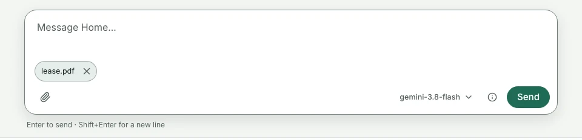
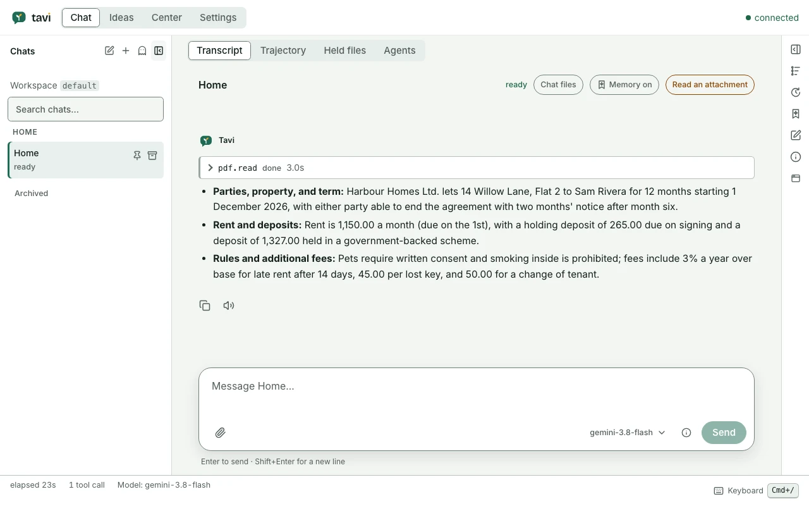
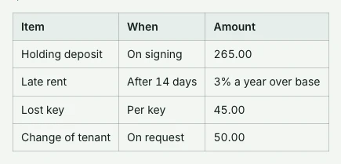
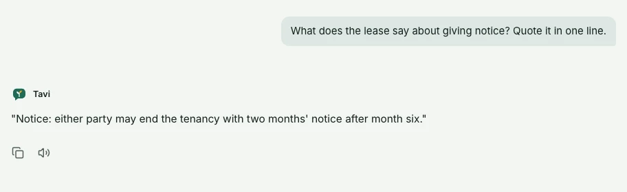

# Summarise a PDF and pull out tables

Attach a PDF in the canvas, get a short summary, lift a table out of it as a table, and ask about one clause. About three minutes.

> **Uses:** the composer's attachments (`tavi ui`) · reading a PDF (`pdf.read`)
> **Before you start:** a model connected ([Connect your first model](../get-started/first-model.md)) · Tavi running in the background with `tavi serve` ([Keep Tavi running in the background](../get-started/keep-tavi-running.md))

## 1. Attach the PDF

Run `tavi ui`, and in **Home**'s message box choose the paperclip (**Attach PDF, photo, video, GIF, audio, text and code files**), then pick the PDF. It shows as a chip under the box; a PDF of up to 20 MB is uploaded when you send.

## 2. Ask for a summary

Type what you want, such as *Summarise this lease in three short bullets*, and press Enter. Tavi reads the document with `pdf.read`, page by page, and answers from its text.

## 3. Pull out a table

Ask for the table by its heading: *Give me the fees and charges table*. Tavi reads the page laid out, with ruled tables kept as tables, and answers with the table itself, ready to copy.

<!-- cover -->

## 4. Ask about one clause

Ask about one part, such as *What does it say about giving notice? Quote it.* Tavi can look up only the pages that mention a phrase, so a long document is not read whole for one question.

## What Tavi will and won't do

A PDF someone gave you is untrusted: Tavi reads its words as data, never as instructions, and the chat is marked **Read an attachment**. Text hidden from a reader (white on white, tiny, covered by a shape) comes back apart, so you can be told it was there. The PDF is read in a single-use process with no network; reading it changes nothing, so nothing asks first.

## Related

- [Read a scanned document (local OCR)](read-a-scan.md)
- [Send a file or image with your message](../chat/attach-files-to-chat.md)
- [Have your first conversation in the terminal](../get-started/first-chat.md)
- Reference: [PDF.md](../../PDF.md), [WEB-UI.md](../../WEB-UI.md#attachments)
