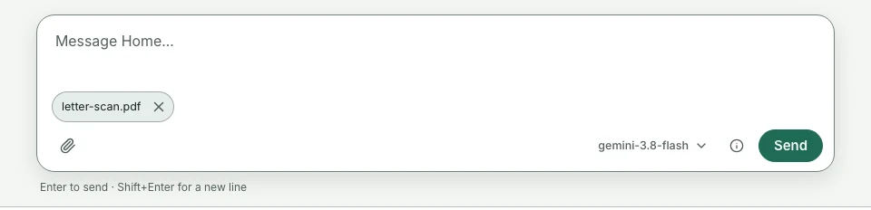
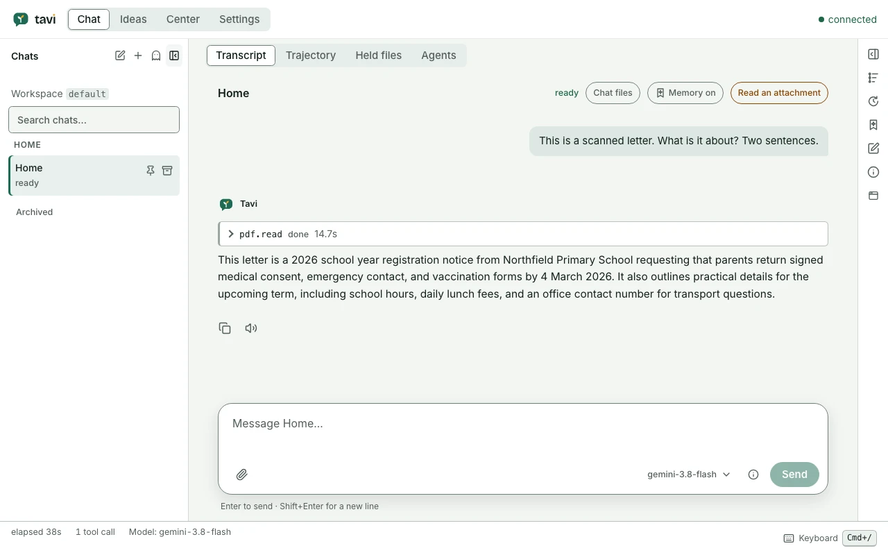
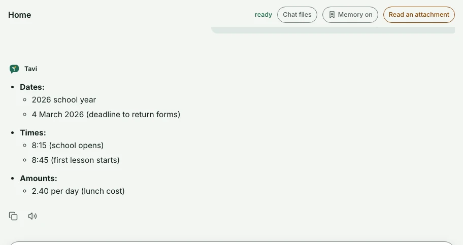
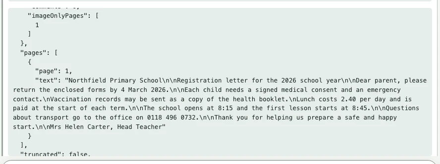

# Read a scanned document (local OCR)

A scanned letter is a picture of text: Tavi reads it on this computer with OCR, then answers about it like any other PDF. About three minutes.

> **Uses:** the composer's attachments (`tavi ui`) · reading a PDF, with OCR for scanned pages (`pdf.read`)
> **Before you start:** a model connected ([Connect your first model](../get-started/first-model.md)) · Tavi running in the background with `tavi serve` ([Keep Tavi running in the background](../get-started/keep-tavi-running.md)) · the OCR add-on, `@tavi/pdf-ocr`, where `tavi` is installed: `tavi doctor` shows `"ocr": "installed"` under `pdf`

## 1. Attach the scan

Run `tavi ui`, and in **Home**'s message box choose the paperclip and pick the scanned PDF. A scan saved as a photo (PNG or JPEG) is refused in the canvas: save or print it as a PDF first.

## 2. Ask what it says

Ask, for example, *What is this letter about?* and press Enter. The page has no text to read, so `pdf.read` renders it and reads it with Tesseract, in a process of its own on this computer, before the model sees a word.

## 3. Pull out the dates and amounts

Ask for the details you need: *List the dates, times and amounts it gives.* They come from the text OCR read off the page.

<!-- cover -->

## 4. See what was read

Choose the `pdf.read` line to open it. Its result lists the pages that are only a picture (`imageOnlyPages`), the text read from them, and under `ocr` the pages OCR read.

## What Tavi will and won't do

OCR runs on this computer, in a single-use process with no network; the text it reads goes to your model, as any tool result does. Printed English is read; handwriting is not promised, so for a handwritten page ask Tavi to look at it (`pdf.render`) with a model that reads images. A scan someone sent you is untrusted: its words are data, never instructions.

## Related

- [Summarise a PDF and pull out tables](read-a-pdf.md)
- [Send a file or image with your message](../chat/attach-files-to-chat.md)
- Reference: [PDF.md](../../PDF.md#scanned-pages-and-text-something-is-drawn-over)
