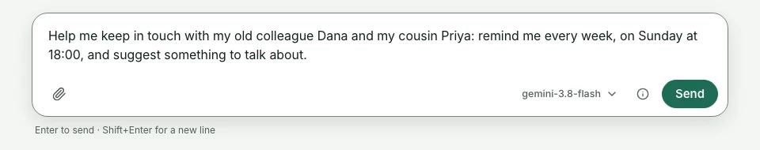
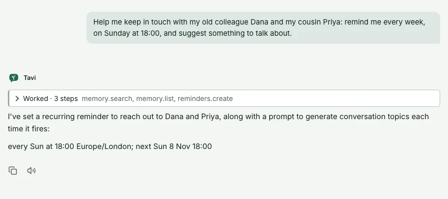
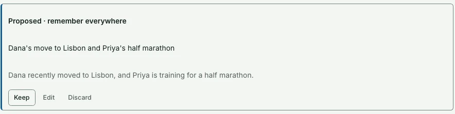
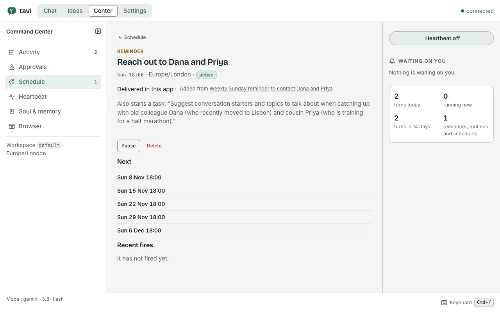

# Keep in touch with the people who matter

Name the people you don't want to lose touch with, and Tavi reminds you each week and, when the reminder fires, suggests something to talk about.

> **Uses:** Memory · Reminders
> **Asks first:** Nothing — it only reads and suggests
> **Runs:** When you ask
> **Idea card:** "Keep in touch" (`people.keep-in-touch`)
> **Before you start:** a model connected ([Connect your first model](../../get-started/first-model.md)) · the canvas open ([Open the web canvas and walk through Welcome](../../get-started/web-canvas-tour.md)) · Tavi running in the background with `tavi serve` ([Keep Tavi running in the background](../../get-started/keep-tavi-running.md)) · reminders need nothing else ([Set a reminder (once, on an event, or repeating)](../../automation/set-a-reminder.md)) · memory is on unless you paused it ([Teach Tavi a fact, and make it forget one](../../memory-and-skills/remember-and-forget.md))

## 1. Ask for it

Choose **New chat** above the chats to open a chat of its own and send the prompt with your people and how often in it: `Help me keep in touch with my old colleague Dana and my cousin Priya: remind me every week, on Sunday at 18:00, and suggest something to talk about.` Once Tavi knows this is something you do, **Ideas** may offer it as a card in its own words; **Try it** there starts the same chat.

## 2. Read the result

Tavi sets the reminder and says when it will fire. That normally needs no approval, though a reminder asks first in a chat that has read the web or a past chat. Reminders repeat on days of the week, monthly or yearly: Tavi tells you if you ask for something else. Each time, the reminder also starts a task that suggests something to talk about: read it in **Center → Activity**. Tavi may give you a few ideas now as well.

## 3. Tell it about them

The more it knows, the better its suggestions. Say `Remember that Dana has just moved to Lisbon and that Priya is training for a half marathon.` Tavi offers a memory card: choose **Keep**.

## 4. See it repeat

The reminder already repeats. Choose its name in **Center → Schedule** to see its next fires, the task it starts, and **Pause** and **Delete**.

<!-- cover -->

Tavi knows only what you told it: it doesn't read your messages or send anything to anyone, and the call is yours to make. Say `What could I talk to Dana about?` any time you want an idea sooner.

## Variations

- `Help me keep in touch with my brother Tom: remind me on the first Sunday of every month and suggest something to talk about.`
- `Remember that Tom's birthday is 12 March, and remind me a week before.`

## Related

- [Set a reminder (once, on an event, or repeating)](../../automation/set-a-reminder.md)
- [Teach Tavi a fact, and make it forget one](../../memory-and-skills/remember-and-forget.md)
- [See every upcoming reminder, routine and schedule](../../automation/see-whats-coming-up.md)
