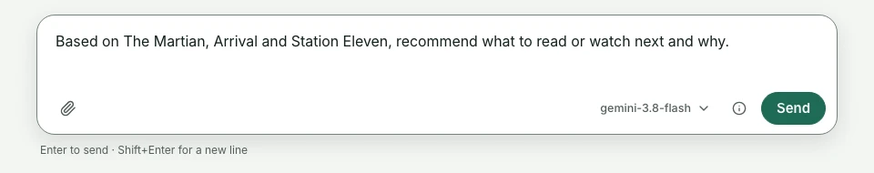
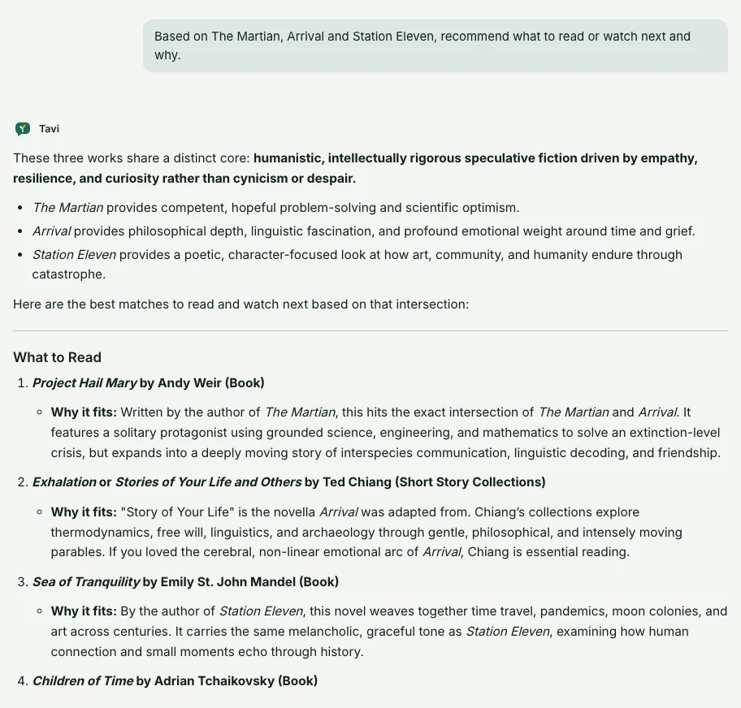
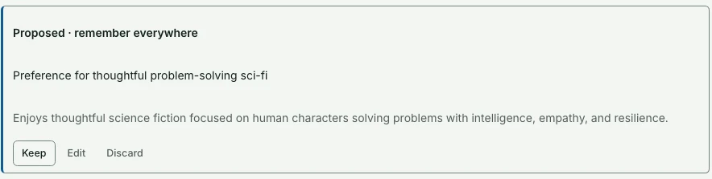
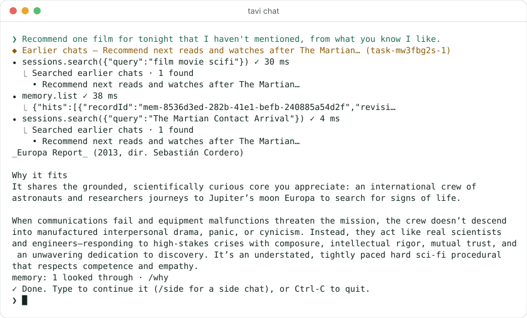

# Get a recommendation from what you loved

Name a few books, films or shows you loved, and Tavi suggests what to read or watch next and says why. Tell it your taste once, and it remembers.

> **Uses:** Memory · Web
> **Asks first:** Nothing — it only reads and suggests
> **Runs:** When you ask
> **Idea card:** "Recommend something" (`people.recommendations`)
> **Before you start:** a model connected ([Connect your first model](../../get-started/first-model.md)) · the canvas open ([Open the web canvas and walk through Welcome](../../get-started/web-canvas-tour.md)) · web search set up ([Set up web search](../../web-and-browser/set-up-web-search.md)) · memory is on unless you paused it ([Teach Tavi a fact, and make it forget one](../../memory-and-skills/remember-and-forget.md))

## 1. Ask for it

Choose **New chat** above the chats to open a chat of its own and send the prompt with what you loved in it: `Based on The Martian, Arrival and Station Eleven, recommend what to read or watch next and why.` Once Tavi knows this is something you do, **Ideas** may offer it as a card in its own words; **Try it** there starts the same chat.

## 2. Read the result

Tavi picks a few titles and says what links each one to what you named. It may check the web for something recent.

<!-- cover -->

## 3. Have it remember your taste

Say `Remember that I love thoughtful science fiction about people solving problems.` Tavi offers a memory card: choose **Keep**.

## 4. Ask again another day

You no longer need to list your favourites. Ask in Home: run `tavi chat` and send `Recommend one film for tonight that I haven't mentioned, from what you know I like.` Home has a short recap of your earlier chats, and the line under the answer says how it got to your taste: **memory: 1 used** when it found the taste by searching, or **memory: 1 looked through** when it read everything you keep. That second number is all it looked through, not what it used, so it grows with what you keep; `/why` names each one.

<picture>
  <source media="(prefers-color-scheme: dark)" srcset="../../../assets/use-cases/everyday/friends-and-culture/recommendations/04-ask-again-another-day-dark.svg">
  
</picture>

Tavi doesn't know where you can watch something, or what you have already seen, unless you tell it. Check a title exists and is what it says before you go looking: a model can misremember details.

## Variations

- `Based on Bluey and Paddington, recommend a film for a six-year-old and why.`
- `Based on Piranesi, recommend three short novels, none of them from before 2000.`

## Related

- [Teach Tavi a fact, and make it forget one](../../memory-and-skills/remember-and-forget.md)
- [Research a question with cited sources](../../web-and-browser/research-with-sources.md)
- [Watch for tour dates near you](tour-radar.md)
