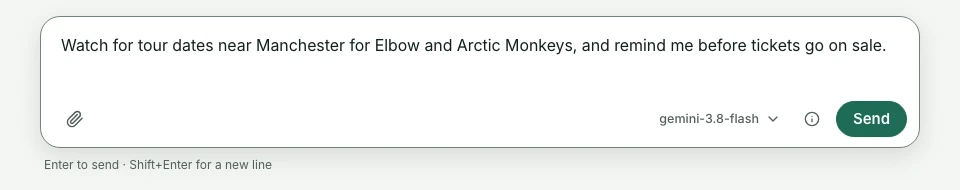
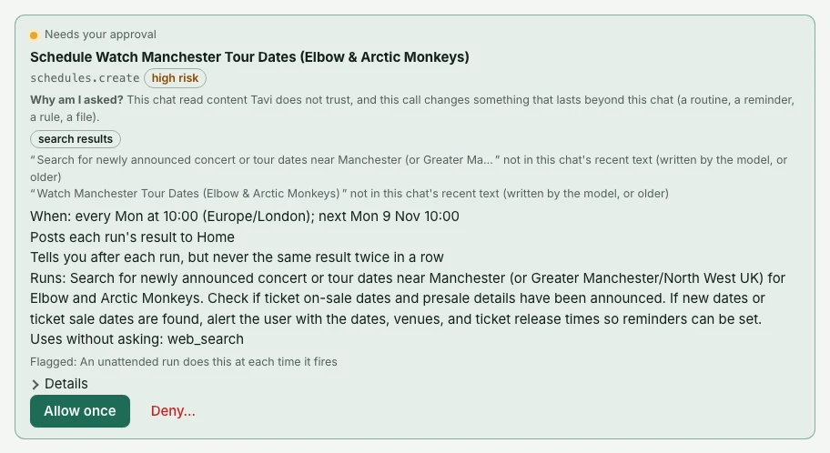
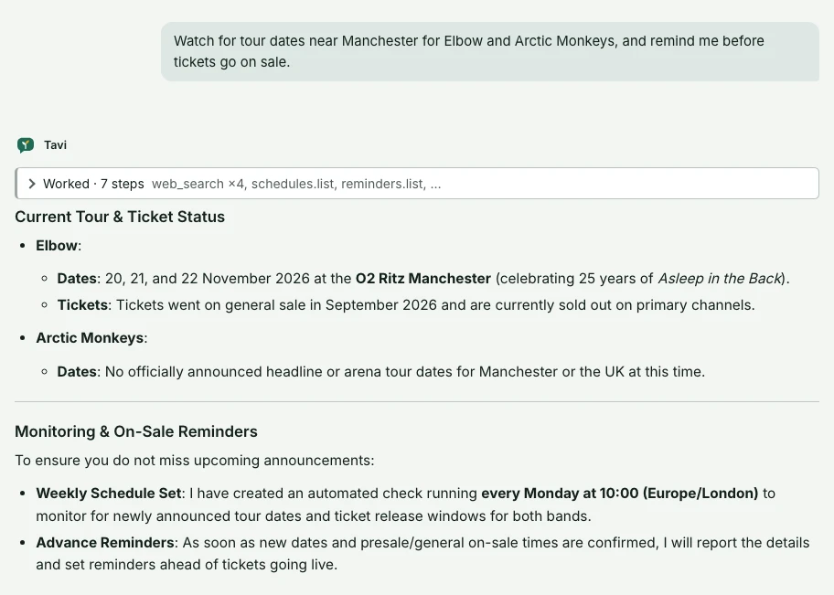

# Watch for tour dates near you

Tavi looks for concerts near your city by the artists you follow, and a schedule keeps looking, so you hear before the tickets go.

> **Uses:** Web · Routines
> **Asks first:** Nothing — it only reads and suggests
> **Runs:** Weekly
> **Idea card:** "Watch for concerts" (`people.tour-radar`)
> **Before you start:** a model connected ([Connect your first model](../../get-started/first-model.md)) · the canvas open ([Open the web canvas and walk through Welcome](../../get-started/web-canvas-tour.md)) · web search set up ([Set up web search](../../web-and-browser/set-up-web-search.md)) · Tavi running in the background with `tavi serve` ([Keep Tavi running in the background](../../get-started/keep-tavi-running.md)), for the schedule ([Run a task every weekday morning](../../automation/schedule-a-task.md))

## 1. Ask for it

Choose **New chat** above the chats to open a chat of its own and send the prompt with your city and artists in it: `Watch for tour dates near Manchester for Elbow and Arctic Monkeys, and remind me before tickets go on sale.` Once Tavi knows this is something you do, **Ideas** may offer it as a card in its own words; **Try it** there starts the same chat.

## 2. Make it recurring

Because you asked it to keep watching, Tavi searches the web and proposes a schedule of its own. Creating a schedule always asks, because it keeps running after this chat: read what it will run and when, then choose **Allow once**. Tavi picks how often. Each run spends searches, so if it says daily and weekly would do, choose **Deny…** and ask for weekly. It may also ask to open a site in the browser: allow that or deny it, and Tavi carries on from its search. The schedule is listed in **Center → Schedule** and in `tavi schedules list`. Each run's result goes to Home. If you have no Home yet, the first result starts one.

<!-- cover -->

## 3. Read the result

Tavi tells you what it found today and confirms the schedule.

Tavi only knows what it finds published, so a show announced in the morning may reach you with the next run. Check the date and the seller on the venue's own site, and never buy from a link you can't trust. Tavi doesn't buy tickets.

## Variations

- `Watch for tour dates near Glasgow or Edinburgh for The National.`
- Once you know the sale date, say `Remind me at 08:45 on the day tickets go on sale` ([Set a reminder (once, on an event, or repeating)](../../automation/set-a-reminder.md)).

## Related

- [Create, change, pause and cancel schedules from a chat](../../automation/manage-schedules-by-chatting.md)
- [Follow a topic with a research routine](../../automation/research-routine.md)
- [Turn a chat that worked into a schedule](../../automation/repeat-this.md)
- [Get a recommendation from what you loved](recommendations.md)
