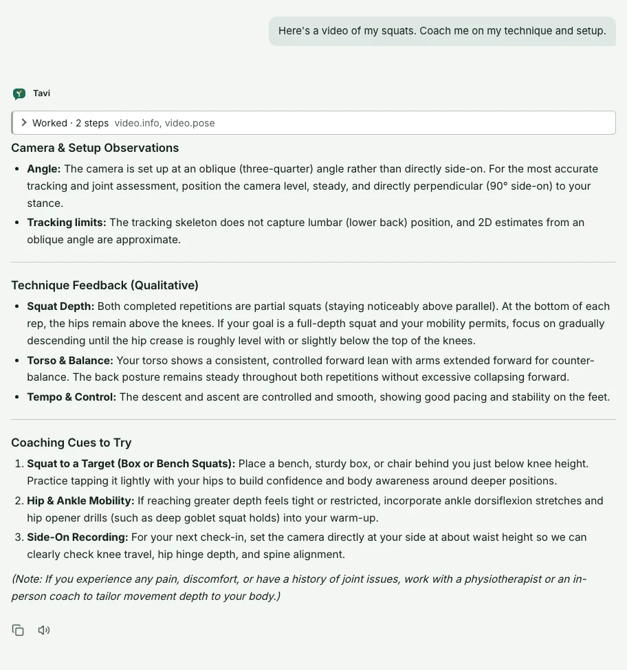
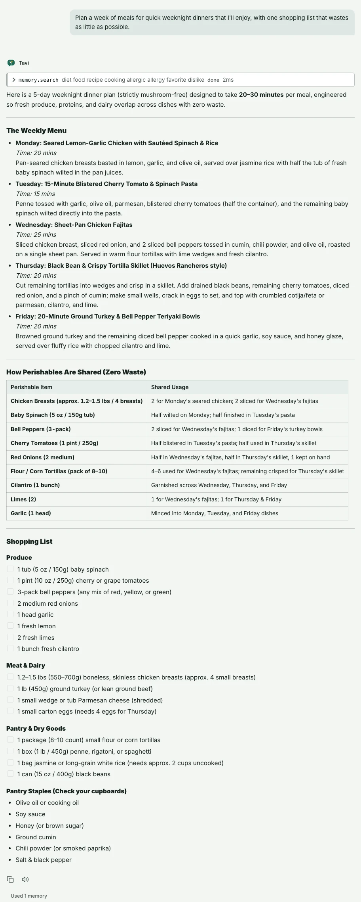
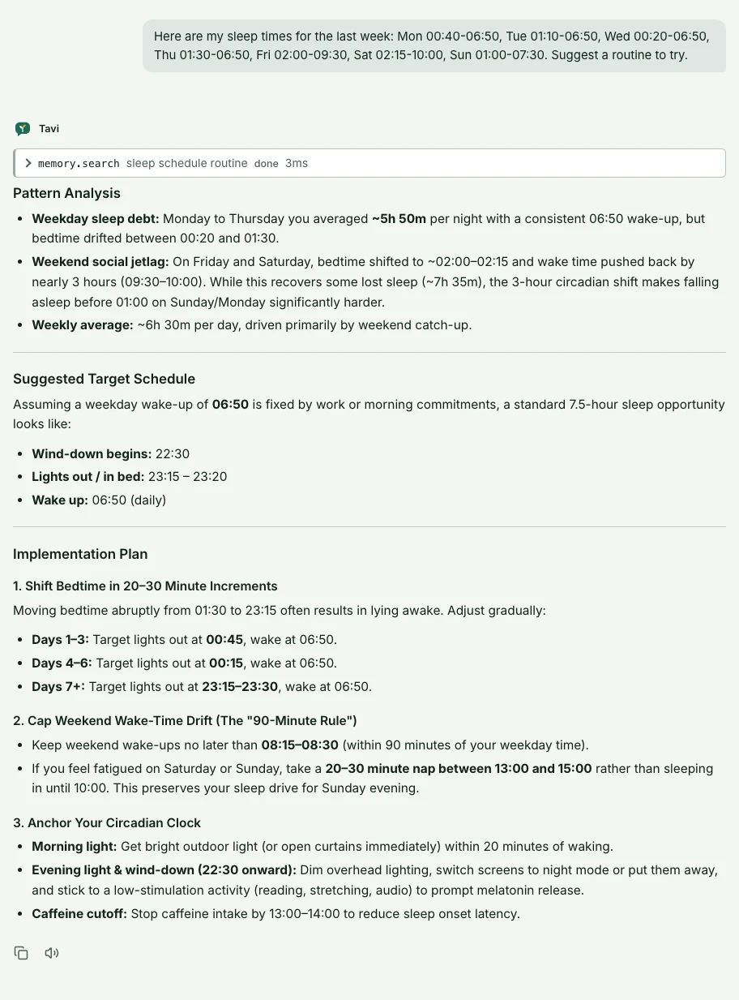
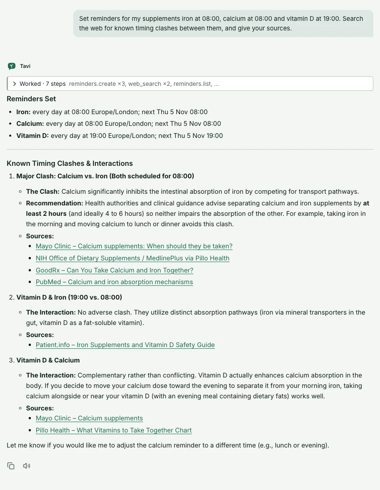
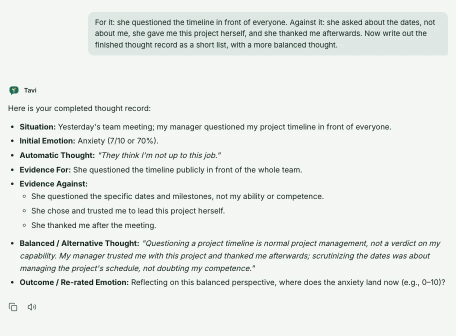

<!-- Generated by scripts/docs/guide-indexes.mjs from the guides: edit the guides, not this file. -->

# Health and fitness

Form checks, meals, sleep and supplements.

| | Guide |
| :--- | :--- |
|  | [Get coached on your squat from a video](form-check.md) Send Tavi a short clip of yourself exercising and it measures the movement on this computer, then coaches you on your technique and setup from what it measured. |
|  | [Plan a week of meals with one shopping list](meal-plan.md) Tell Tavi what you're eating for and it plans your week's meals around what it knows about you, with a single shopping list that uses ingredients more than once. |
|  | [Find a better sleep routine from your week](sleep.md) Give Tavi your sleep times for the last week and it spots the pattern and suggests a routine to try. |
|  | [Get reminded of your supplements, and of what clashes](supplements.md) Give Tavi your supplements and when you take them. |
|  | [Walk through a thought record](thought-record.md) When something small keeps going round your head, Tavi takes you through a thought record: what happened, what you thought and felt, the evidence, and a more balanced way to see it. |

[All everyday recipes](../README.md)
