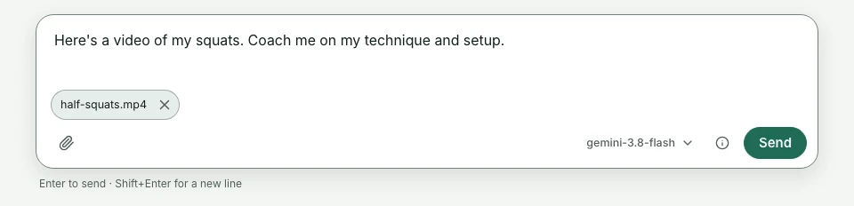
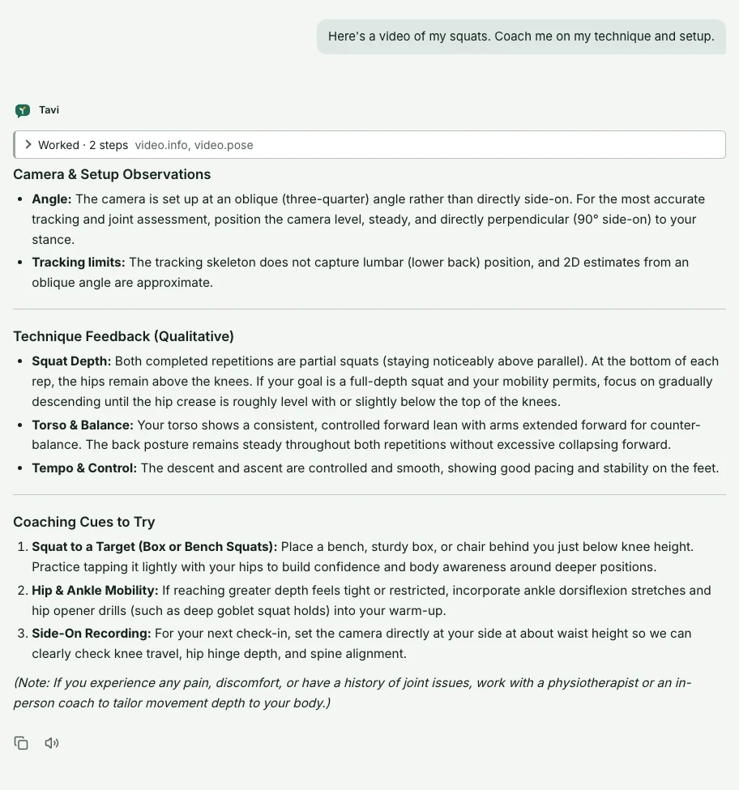

# Get coached on your squat from a video

Send Tavi a short clip of yourself exercising and it measures the movement on this computer, then coaches you on your technique and setup from what it measured.

> **Uses:** Video
> **Asks first:** Nothing — it only reads and suggests
> **Runs:** When you ask
> **Idea card:** "Check my form" (`health-home.form-check`)
> **Before you start:** a model connected ([Connect your first model](../../get-started/first-model.md)) · the canvas open ([Open the web canvas and walk through Welcome](../../get-started/web-canvas-tour.md)) · FFmpeg and the pose add-on set up ([Get coaching on your exercise form](../../photos-and-video/check-exercise-form.md))

## 1. Ask for it

Film yourself side-on at hip height, with your whole body in frame and nobody else in it. Choose **New chat** above the chats to open a chat of its own. Choose the paperclip, pick your clip, and send the prompt with your exercise in it: `Here's a video of my squats. Coach me on my technique and setup.` Once Tavi knows this is something you do, **Ideas** may offer it as a card in its own words; **Try it** there starts the same chat.

## 2. Read the coaching

Tavi runs `video.pose`, and sometimes `video.frames` to look at stills from the clip, both named on the **Worked** line above its answer. It tells you what it saw and what to try next, including how to film the clip better if the camera angle got in the way. The measures come from `video.pose`; the advice around them is your model's.

<!-- cover -->

## What this is not

Tavi is not a physiotherapist or a coach who has watched you train. The angles are 2D, from one camera, so they are approximate, and it doesn't judge injury risk or diagnose. If something hurts, stop and see a physiotherapist or a doctor.

The movement is measured on this computer, but what the tools return goes to your model, as any tool result does: the measures and overlay and, if Tavi uses `video.frames`, the stills. With a provider's model they go to that provider; with a local model they stay here ([VIDEO.md](../../../VIDEO.md#what-leaves-the-machine)).

## Variations

- `Here's a video of my lunges. Coach me on my technique and setup.`
- Send a second clip after changing something, and ask what moved between the two.

## Related

- [Get coaching on your exercise form](../../photos-and-video/check-exercise-form.md)
- [Send a file or image with your message](../../chat/attach-files-to-chat.md)
- [Transcribe a video locally](../../photos-and-video/transcribe-a-video.md)
