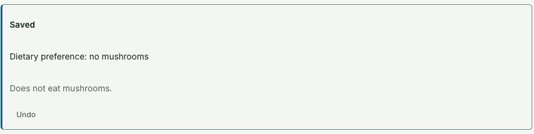
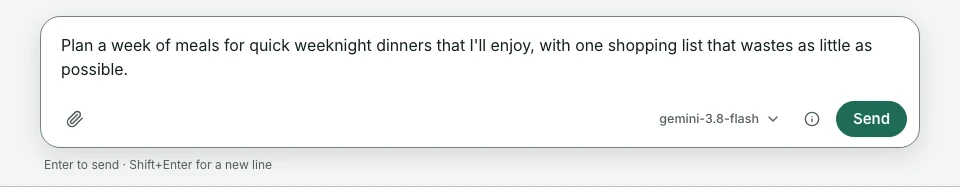
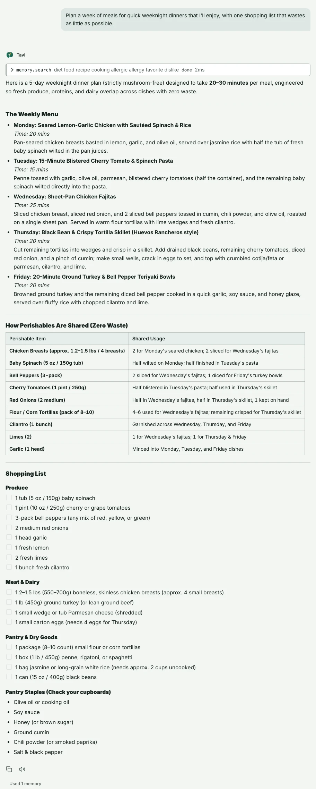

# Plan a week of meals with one shopping list

Tell Tavi what you're eating for and it plans your week's meals around what it knows about you, with a single shopping list that uses ingredients more than once.

> **Uses:** Memory
> **Asks first:** Nothing — it only reads and suggests
> **Runs:** When you ask
> **Idea card:** "Plan my meals" (`health-home.meal-plan`)
> **Before you start:** a model connected ([Connect your first model](../../get-started/first-model.md)) · the canvas open ([Open the web canvas and walk through Welcome](../../get-started/web-canvas-tour.md))

## 1. Tell Tavi what you don't eat

Tavi can only plan around what it knows. Choose **New chat** above the chats to open a chat of its own, send `Remember that I don't eat mushrooms.` and choose **Keep** on the card it proposes; later chats can use the fact ([Teach Tavi a fact, and make it forget one](../../memory-and-skills/remember-and-forget.md)).

## 2. Ask for it

Choose **New chat** above the chats to open a chat of its own and send the prompt with your goal in it: `Plan a week of meals for quick weeknight dinners that I'll enjoy, with one shopping list that wastes as little as possible.` Once Tavi knows this is something you do, **Ideas** may offer it as a card in its own words; **Try it** there starts the same chat.

## 3. Read the plan

You get the meals, what each shared ingredient goes into, and one shopping list. **Used 1 memory** under the answer, or **Looked through 1 memory** when Tavi read what you keep, shows it had the fact you kept, and the mushrooms stay out. How much of the week it covers can vary, so say if you want more: here it planned five weeknight dinners for a goal about weeknights. Check the list against what you already have, and ask for a swap for anything you don't fancy.

<!-- cover -->

## What this is not

Tavi isn't a dietitian. The plan is ordinary cooking ideas, not advice for a medical condition, an allergy or a pregnancy, and it won't know an ingredient is unsafe for you unless you say so. Check labels yourself, and ask a doctor or a dietitian if your diet matters to your health.

## Variations

- `Plan a week of meals for eating more vegetables on a budget that I'll enjoy, with one shopping list that wastes as little as possible.`
- Ask for a change once it's planned: `Swap Thursday for something with no oven.`
- Ask for the whole week: `Add lunches and the weekend, and keep to one shopping list.`

## Related

- [Teach Tavi a fact, and make it forget one](../../memory-and-skills/remember-and-forget.md)
- [Review memories Tavi proposed](../../memory-and-skills/review-memories.md)
- [Pin an idea, make it recurring, or try it](../../automation/ideas-tab.md)
