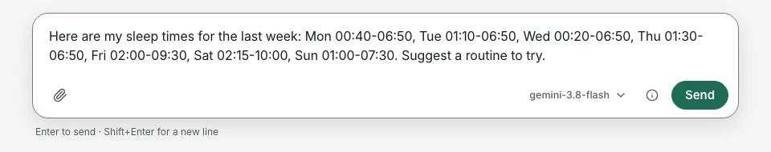
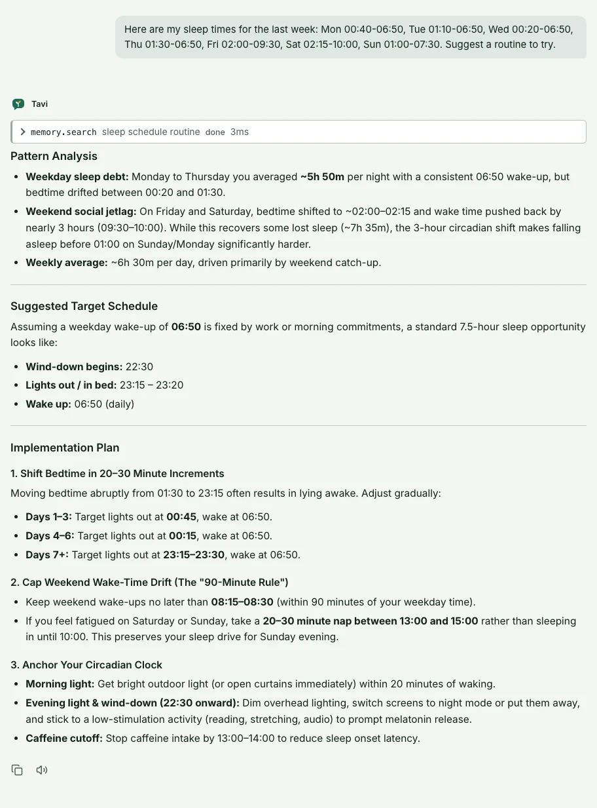

# Find a better sleep routine from your week

Give Tavi your sleep times for the last week and it spots the pattern and suggests a routine to try.

> **Uses:** Memory
> **Asks first:** Nothing — it only reads and suggests
> **Runs:** When you ask
> **Idea card:** "Improve my sleep" (`health-home.sleep`)
> **Before you start:** a model connected ([Connect your first model](../../get-started/first-model.md)) · the canvas open ([Open the web canvas and walk through Welcome](../../get-started/web-canvas-tour.md))

## 1. Ask for it

Write down when you fell asleep and woke up each day. Choose **New chat** above the chats to open a chat of its own and send the prompt with your times in it: `Here are my sleep times for the last week: Mon 00:40-06:50, Tue 01:10-06:50, Wed 00:20-06:50, Thu 01:30-06:50, Fri 02:00-09:30, Sat 02:15-10:00, Sun 01:00-07:30. Suggest a routine to try.` Once Tavi knows this is something you do, **Ideas** may offer it as a card in its own words; **Try it** there starts the same chat.

## 2. Read the routine

Tavi reads the pattern in your times and suggests a routine.

<!-- cover -->

## 3. Keep what you're trying

Pick the one thing you'll try and have Tavi remember it, so you can come back in a fortnight with new times and compare: `/remember I'm trying a fixed wake-up time of 06:50 for better sleep`.

## What this is not

Tavi isn't a doctor, and a routine won't fix a sleep disorder. It only sees the times you type. If you've slept badly for weeks, you snore loudly or stop breathing at night, or you're falling asleep in the day, see a doctor.

## Variations

- Ask for one change at a time: `Which single change would help most?`
- Ask for a nudge at bedtime: `Remind me to start winding down every evening at 22:30` ([Set a reminder (once, on an event, or repeating)](../../automation/set-a-reminder.md)).

## Related

- [Set a reminder (once, on an event, or repeating)](../../automation/set-a-reminder.md)
- [Teach Tavi a fact, and make it forget one](../../memory-and-skills/remember-and-forget.md)
