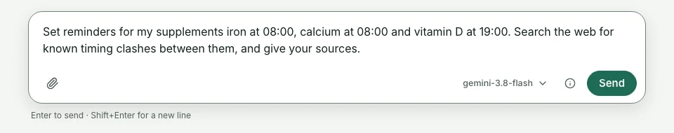
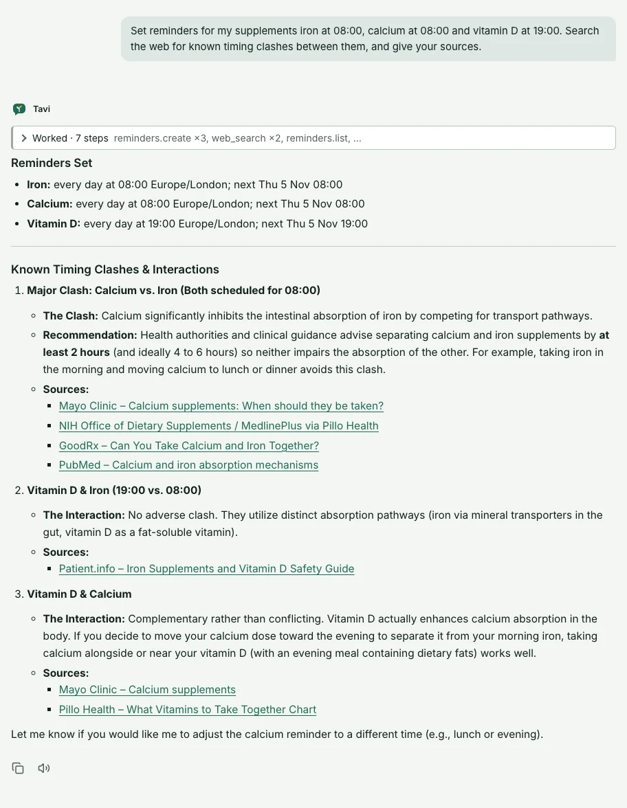
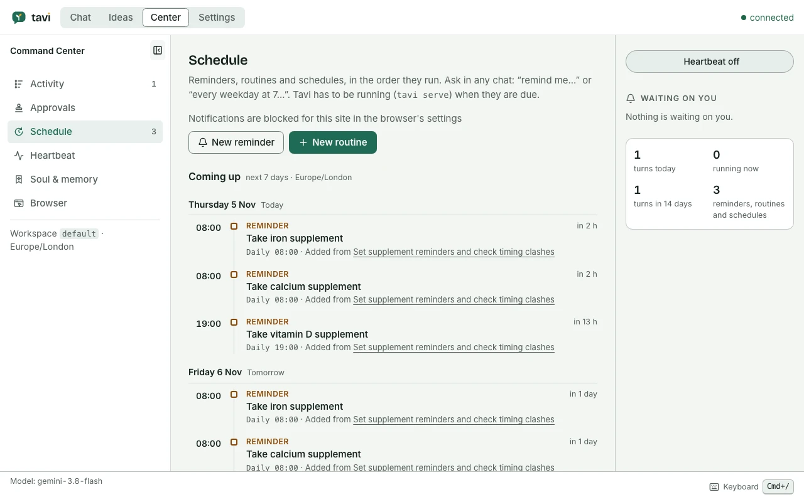

# Get reminded of your supplements, and of what clashes

Give Tavi your supplements and when you take them. It sets a reminder for each, tells you about known timing clashes between them, and checks them on the web if you ask. Check what it says with a pharmacist or your doctor.

> **Uses:** Reminders · Web
> **Asks first:** Nothing — it only reads and suggests
> **Runs:** When you ask
> **Idea card:** "Remind me of supplements" (`health-home.supplements`)
> **Before you start:** a model connected ([Connect your first model](../../get-started/first-model.md)) · web search set up ([Set up web search](../../web-and-browser/set-up-web-search.md)) · Tavi running in the background with `tavi serve` so reminders fire ([Keep Tavi running in the background](../../get-started/keep-tavi-running.md)) · the canvas open ([Open the web canvas and walk through Welcome](../../get-started/web-canvas-tour.md))

## 1. Ask for it

Choose **New chat** above the chats to open a chat of its own and send the prompt with your list in it, each with its time: `Set reminders for my supplements iron at 08:00, calcium at 08:00 and vitamin D at 19:00. Search the web for known timing clashes between them, and give your sources.` Once Tavi knows this is something you do, **Ideas** may offer it as a card in its own words; **Try it** there starts the same chat.

## 2. Read the clashes

Tavi searches and sets one reminder for each. Once a chat has read the web, anything that lasts beyond it asks first, so the reminders may stop on a card: check it and choose **Allow once**, or **Allow selected; deny unchecked** when it lists them together. Then it tells you what clashes, with its sources. Iron and calcium are a well-known pair: calcium can get in the way of iron being absorbed, so they're usually taken apart. Open the links, because how much a clash matters can depend on the dose. To move a reminder, say so; that asks first too.

<!-- cover -->

## 3. Check your reminders

Open **Center → Schedule** to see each one and when it fires next, or run `tavi reminders list`. To change a time, tell Tavi in a chat; the reminder's own page can pause or delete it.

## What this is not

Tavi isn't a pharmacist or a doctor. It reads public pages, which can be wrong or incomplete, and it doesn't know your health or your medicines unless you tell it. Before you start, stop or re-time anything, check with a pharmacist or your doctor, above all if you take prescription medicine or are pregnant.

## Variations

- `Set reminders for my supplements magnesium at 21:00 and fish oil at 13:00. Search the web for known timing clashes between them, and give your sources.`
- Ask a follow-up: `Which of these are better with food?`

## Related

- [Set a reminder (once, on an event, or repeating)](../../automation/set-a-reminder.md)
- [See every upcoming reminder, routine and schedule](../../automation/see-whats-coming-up.md)
- [Research a question with cited sources](../../web-and-browser/research-with-sources.md)
