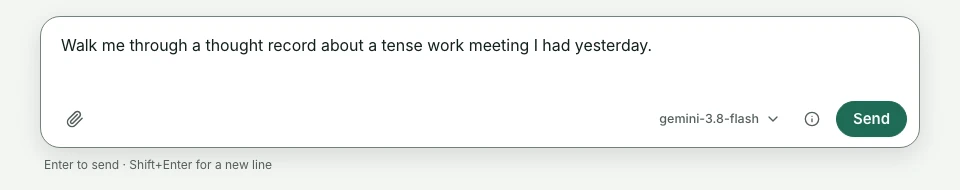
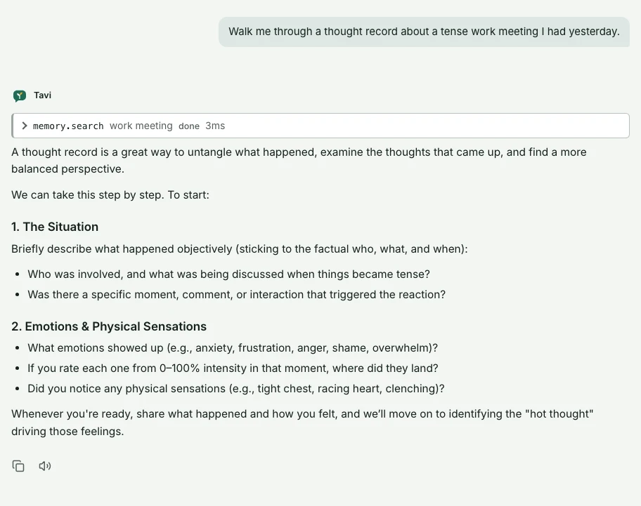
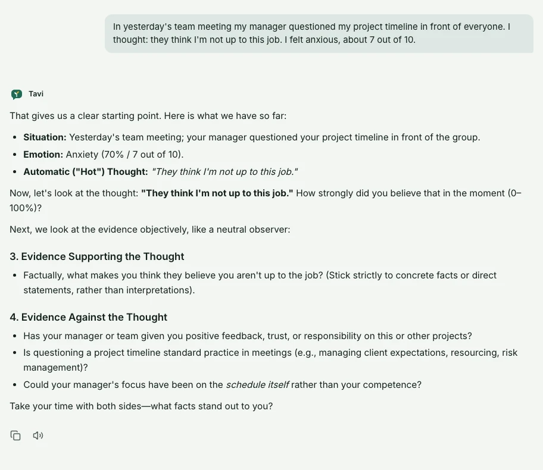
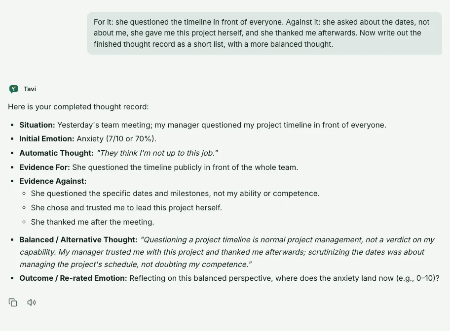

# Walk through a thought record

When something small keeps going round your head, Tavi takes you through a thought record: what happened, what you thought and felt, the evidence, and a more balanced way to see it. This is a self-help exercise, not therapy.

> **Uses:** Memory
> **Asks first:** Nothing — it only reads and suggests
> **Runs:** When you ask
> **Idea card:** "Reflect with me" (`health-home.thought-record`)
> **Before you start:** a model connected ([Connect your first model](../../get-started/first-model.md)) · the canvas open ([Open the web canvas and walk through Welcome](../../get-started/web-canvas-tour.md))

## 1. Ask for it

Choose **New chat** above the chats to open a chat of its own and send the prompt with your situation in it: `Walk me through a thought record about a tense work meeting I had yesterday.` Once Tavi knows this is something you do, **Ideas** may offer it as a card in its own words; **Try it** there starts the same chat.

## 2. Say what happened

Tavi starts by asking about the situation. Answer in your own words: what happened, what went through your mind, and how strong the feeling was.

## 3. Weigh the evidence

Tavi takes the thought that stung most and asks what supports it and what doesn't. List both, even if the second list feels thin, and ask Tavi to write out the finished record.

## 4. Read the balanced thought

Tavi draws it together into a more balanced thought, in your words. Rate the feeling again: it doesn't have to be gone, only a bit easier to hold.

<!-- cover -->

## What this is not

This is not therapy, and Tavi isn't a therapist or a doctor. It suits everyday worries like the one here, not a crisis or anything you've been struggling with for a long time. For real support, talk to your doctor or a licensed therapist. If you're in crisis or thinking of harming yourself, call your local emergency number, or a crisis line: 988 in the US, Samaritans on 116 123 in the UK and Ireland, or [findahelpline.com](https://findahelpline.com) elsewhere.

## Variations

- `Walk me through a thought record about an awkward chat with a friend.`
- For something you'd rather not have in your chats or memory, use a private chat ([Chat without leaving a trace](../../chat/private-chats.md)).

## Related

- [Chat without leaving a trace](../../chat/private-chats.md)
- [Teach Tavi a fact, and make it forget one](../../memory-and-skills/remember-and-forget.md)
