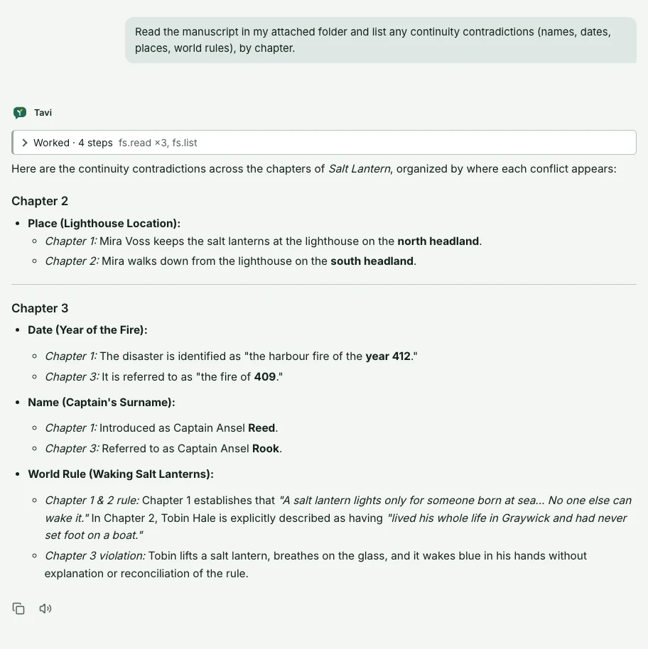
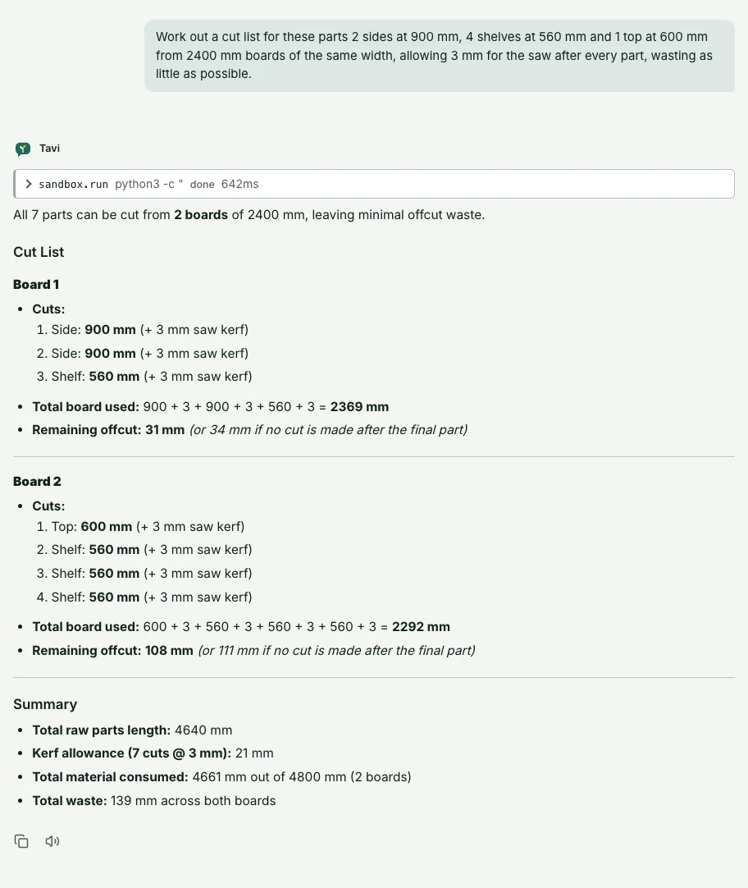
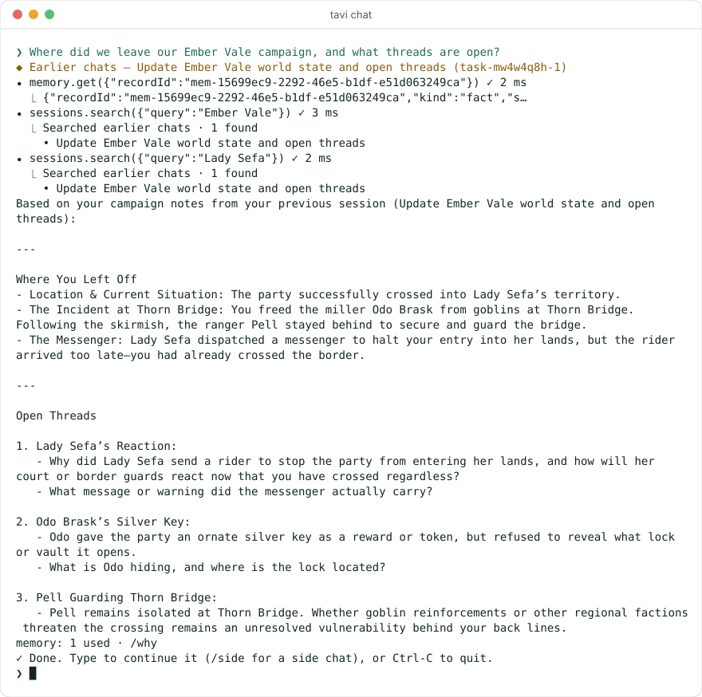
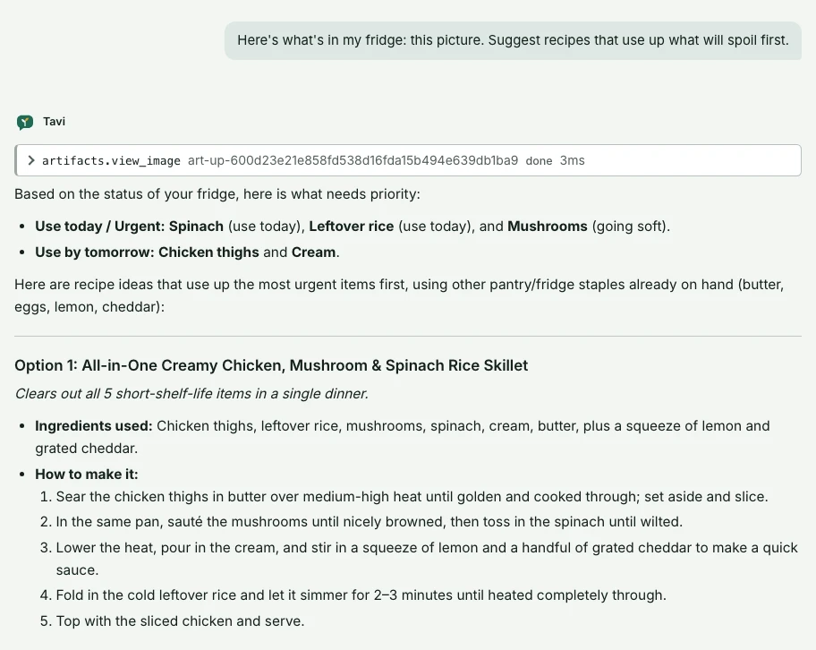
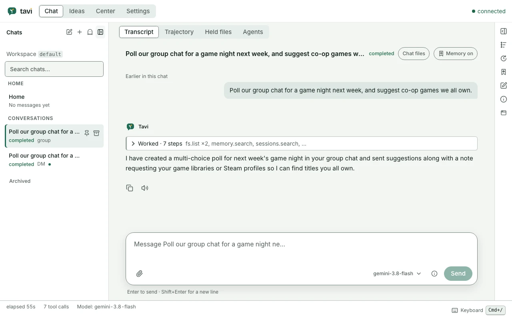
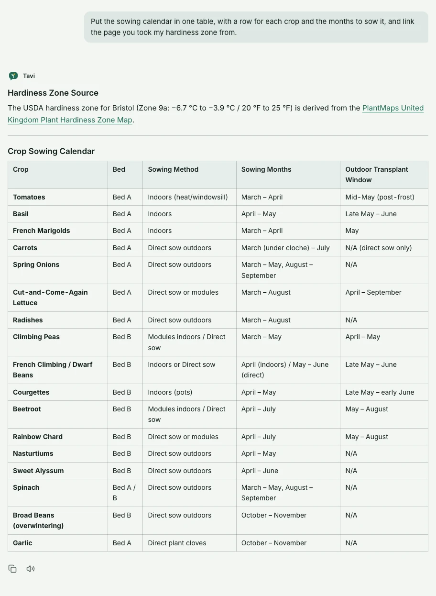
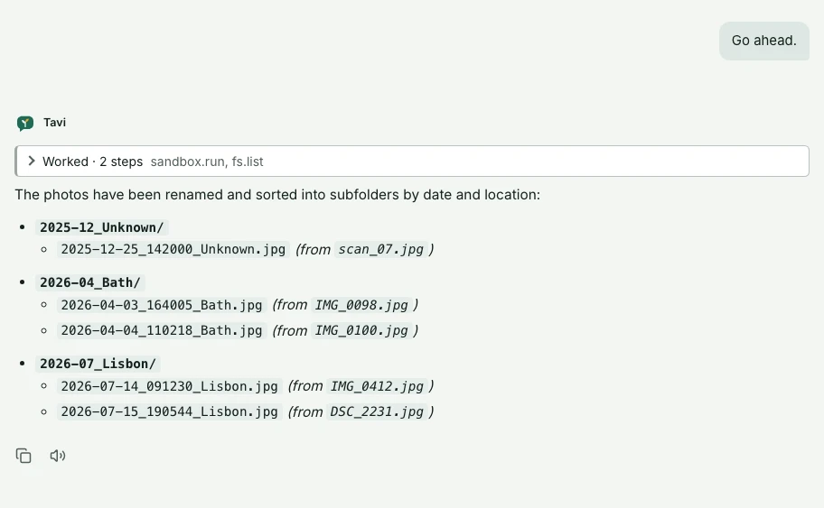
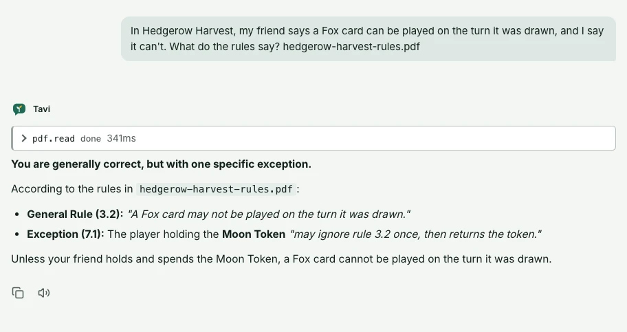
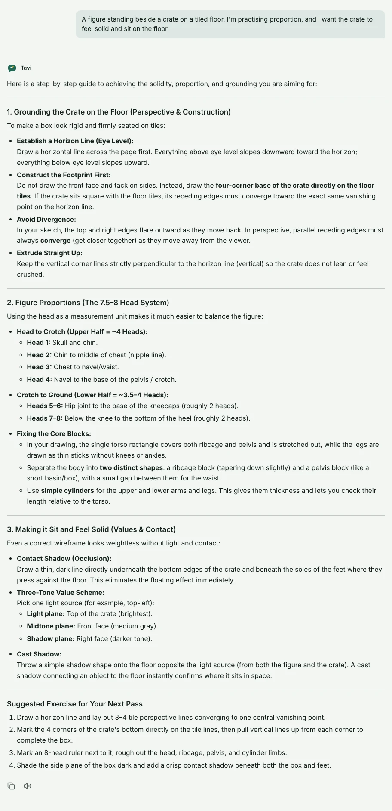

<!-- Generated by scripts/docs/guide-indexes.mjs from the guides: edit the guides, not this file. -->

# Hobbies and games

Art, gardens, recipes, woodworking, writing and games.

| | Guide |
| :--- | :--- |
|  | [Check a manuscript for continuity slips](canon-audit.md) Give Tavi the folder your manuscript is in, and it reads every chapter and lists what contradicts itself: names, dates, places and the rules of your world, chapter by chapter. |
|  | [Work out a cut list for a build](cut-list.md) Give Tavi the parts you need and the boards you have. |
|  | [Keep your campaign's lore straight](dnd-lore.md) After each session, tell Tavi what happened. |
|  | [Cook from what's in your fridge](fridge-recipes.md) Send Tavi a picture of your fridge or a list of what's in it, and it suggests recipes that use up what will go off first. |
|  | [Plan a game night with your group](game-night.md) In your friends' Discord room, ask Tavi to find a night next week: it drafts a poll of dates, asks you before posting it, and suggests co-op games for the group. |
|  | [Plan your garden beds for your climate](garden-plan.md) Tell Tavi where you are and how big your beds are. |
|  | [Sort a folder of photos by date and place](photo-organise.md) Attach a folder of photos, and Tavi works out new names and places from the date and location stored in each picture. |
|  | [Settle a board-game rules argument](rules.md) Give Tavi the game and the dispute, with the rulebook as a PDF, and it quotes the rule that decides it. |
|  | [Get an honest critique of a drawing](sketch-critique.md) Send Tavi a picture of a drawing. |

[All everyday recipes](../README.md)
