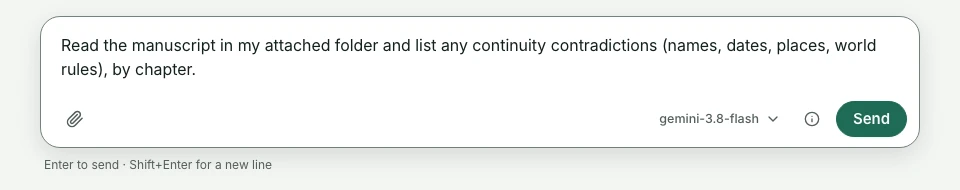
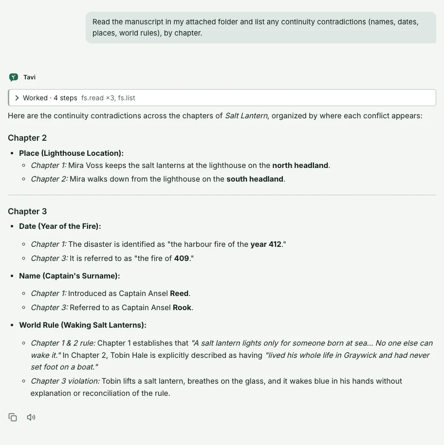

# Check a manuscript for continuity slips

Give Tavi the folder your manuscript is in, and it reads every chapter and lists what contradicts itself: names, dates, places and the rules of your world, chapter by chapter.

> **Uses:** Files
> **Asks first:** Nothing — it only reads and suggests
> **Runs:** When you ask
> **Idea card:** "Check my manuscript" (`learning.canon-audit`)
> **Before you start:** a model connected ([Connect your first model](../../get-started/first-model.md)) · the canvas open ([Open the web canvas and walk through Welcome](../../get-started/web-canvas-tour.md)) · `tavi serve` started with your manuscript's folder by its full path, here `tavi serve --fs-root /Users/you/writing/salt-lantern` ([Give Tavi a working folder](../../files-and-code/attach-a-folder.md))

## 1. Ask for it

Keep the chapters as text files, Markdown or plain, in a folder of their own, and start Tavi with that folder by its full path: `tavi serve --fs-root /Users/you/writing/salt-lantern`. Each new chat then has it attached read-only, so Tavi can read it and can't change a word. Choose **New chat** above the chats to open a chat of its own and send the prompt: `Read the manuscript in my attached folder and list any continuity contradictions (names, dates, places, world rules), by chapter.` Once Tavi knows this is something you do, **Ideas** may offer it as a card in its own words; **Try it** there starts the same chat.

## 2. Read the list

Tavi reads each chapter with `fs.read`, named on the lines above its answer, and lists each contradiction with the chapters it sits in and what each one says.

<!-- cover -->

Tavi finds what it reads, and only that: a slip that hangs on something it hasn't been told, such as your series bible or a sequel, won't show unless that's in the folder too. It can also flag something you meant, such as a narrator who lies, so treat the list as things to check. A long novel may be more than one chat can hold in one go: ask for a few chapters at a time.

## Variations

- `Check only the dates and ages in my attached folder, and give me a timeline of who was how old when.`
- Add your notes to the folder as `bible.md`: `Treat bible.md as correct, and list anything in the chapters that goes against it.`

## Related

- [Give Tavi a working folder](../../files-and-code/attach-a-folder.md)
- [Turn a chapter into flashcards](../learning/flashcards.md)
