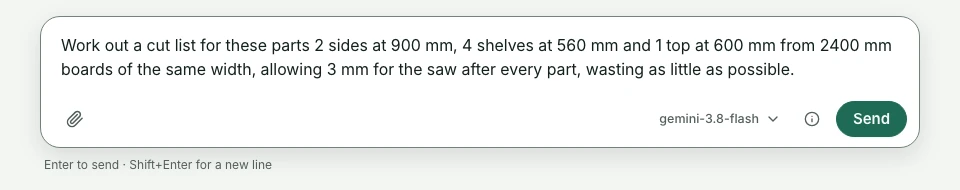
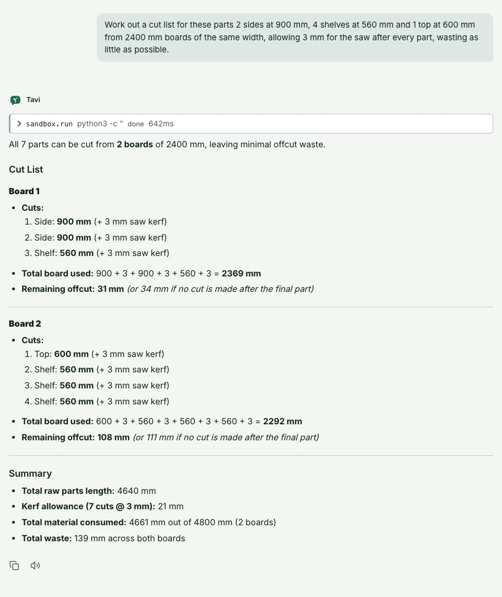

# Work out a cut list for a build

Give Tavi the parts you need and the boards you have. It works out which part to cut from which board, wasting as little as it can.

> **Uses:** Sandbox
> **Asks first:** Nothing — it only reads and suggests
> **Runs:** When you ask
> **Idea card:** "Make a cut list" (`learning.cut-list`)
> **Before you start:** a model connected ([Connect your first model](../../get-started/first-model.md)) · the canvas open ([Open the web canvas and walk through Welcome](../../get-started/web-canvas-tour.md)) · the shell sandbox working ([Build and test a real project in the sandbox](../../files-and-code/build-a-real-project.md))

## 1. Ask for it

Choose **New chat** above the chats to open a chat of its own and send the prompt with your parts and boards in it. Say how wide your saw cut is, or the sums won't allow for it: `Work out a cut list for these parts 2 sides at 900 mm, 4 shelves at 560 mm and 1 top at 600 mm from 2400 mm boards of the same width, allowing 3 mm for the saw after every part, wasting as little as possible.` Once Tavi knows this is something you do, **Ideas** may offer it as a card in its own words; **Try it** there starts the same chat.

## 2. Read the cut list

Tavi works the layout out with a short script in the sandbox, `sandbox.run` on the line above its answer. A script is inline code, so it can stop on **Needs your approval**, flagged *runs inline code*: open **Details** to read what it would run, and choose **Allow once**. The answer gives you the layout, board by board, with the sums.

<!-- cover -->

Here two boards are enough, and only one layout fits them; these sums were checked by hand. Board 1 takes 900 + 900 + 560 = 2,360 mm, plus three saw cuts at 3 mm, which is 2,369 mm and leaves 31 mm. Board 2 takes 600 + 560 + 560 + 560 = 2,280 mm, plus four saw cuts, which is 2,292 mm and leaves 108 mm. The two sides and the top add up to exactly 2,400 mm, but that leaves no room for the saw.

Check the sums before you cut: Tavi works only from the numbers you give it. Measure each board first, and square up its ends, which can take a few millimetres. It knows nothing of knots or warped wood, and it's no judge of what's safe to cut or how: follow your tool's instructions.

## Variations

- `Allow 10 mm off each end of every board for squaring up.`
- Sheets: `Lay these parts out on a 2440 by 1220 mm sheet, and tell me if any part has to run with the grain.`

## Related

- [Build and test a real project in the sandbox](../../files-and-code/build-a-real-project.md)
- [Approve, reject or always-allow a tool call](../../chat/approve-tool-calls.md)
