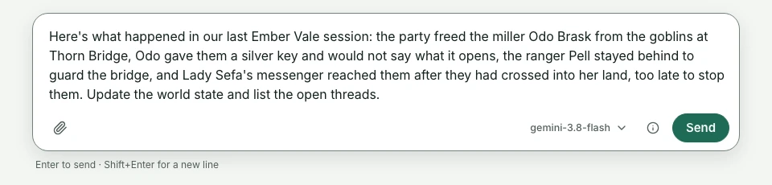
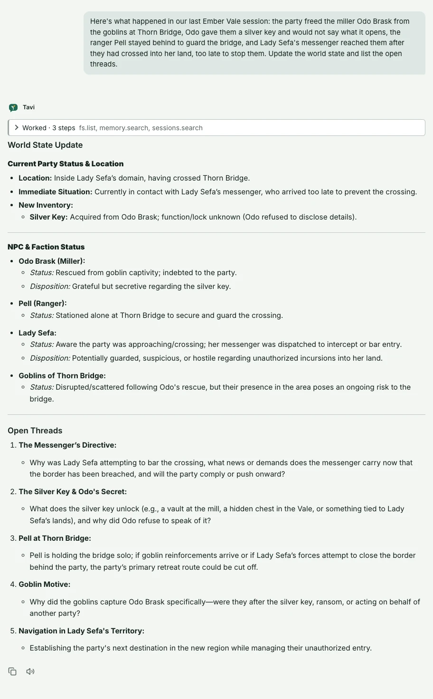
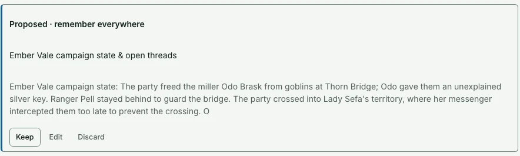
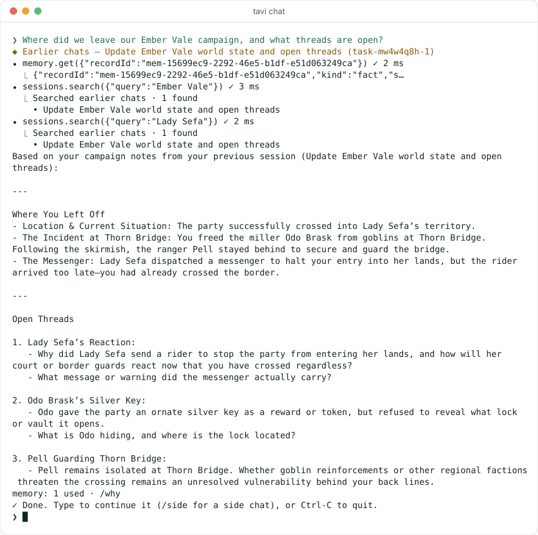

# Keep your campaign's lore straight

After each session, tell Tavi what happened. It brings the world's state up to date, lists the open threads, and keeps what you want for next time.

> **Uses:** Memory
> **Asks first:** Nothing — it only reads and suggests
> **Runs:** When you ask
> **Idea card:** "Track campaign lore" (`learning.dnd-lore`)
> **Before you start:** a model connected ([Connect your first model](../../get-started/first-model.md)) · the canvas open ([Open the web canvas and walk through Welcome](../../get-started/web-canvas-tour.md))

## 1. Ask for it

Choose **New chat** above the chats to open a chat of its own and send the prompt with your campaign and your notes in it: `Here's what happened in our last Ember Vale session: the party freed the miller Odo Brask from the goblins at Thorn Bridge, Odo gave them a silver key and would not say what it opens, the ranger Pell stayed behind to guard the bridge, and Lady Sefa's messenger reached them after they had crossed into her land, too late to stop them. Update the world state and list the open threads.` Once Tavi knows this is something you do, **Ideas** may offer it as a card in its own words; **Try it** there starts the same chat.

## 2. Read the world state

Tavi sets out who is where and what has changed, then the open threads.

## 3. Keep it for next time

Tavi only keeps what you ask it to: `Remember the state of our Ember Vale campaign and its open threads, and that her messenger reached them too late, for our next session.` A memory card appears under the answer, with a short summary, not the whole answer. Read it against your notes, put right what's drifted or missing with **Edit**, and choose **Keep**.

## 4. Pick it up next session

Before the next game, ask in Home or in `tavi chat`: `Where did we leave our Ember Vale campaign, and what threads are open?` Tavi finds what it kept, can look through earlier chats as well, and says on the line under its answer how much of its memory it used.

<!-- cover -->
<picture>
  <source media="(prefers-color-scheme: dark)" srcset="../../../assets/use-cases/everyday/hobbies-and-games/dnd-lore/04-pick-it-up-next-session-dark.svg">
  
</picture>

Tavi knows what you've told it and nothing else, so it can only keep your campaign straight if each session's notes reach it. What it adds, such as a reason for a thread, is its own guess: the world is yours. After a session, ask it again to remember: it proposes a change to what it kept, and you can read it before you keep it ([Update a fact Tavi knows: Replace, or Keep both](../../memory-and-skills/update-a-memory.md)).

## Variations

- `What does each player's character know that the others don't?`
- `Suggest three hooks for next session from the open threads.`

## Related

- [Teach Tavi a fact, and make it forget one](../../memory-and-skills/remember-and-forget.md)
- [Settle a board-game rules argument](rules.md)
