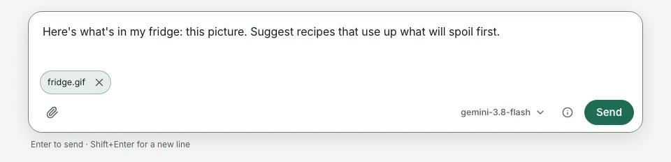
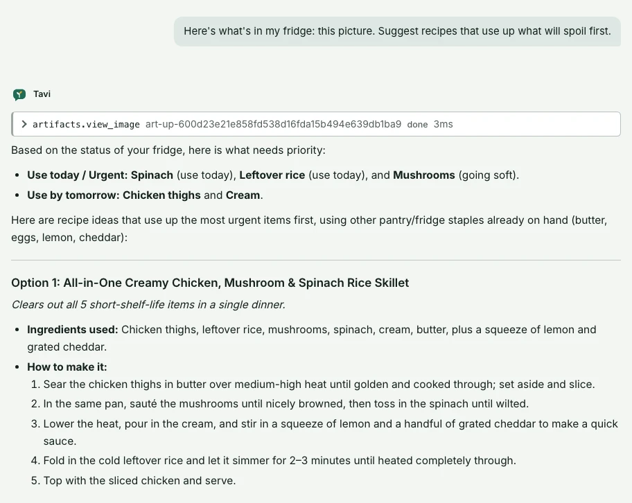

# Cook from what's in your fridge

Send Tavi a picture of your fridge or a list of what's in it, and it suggests recipes that use up what will go off first.

> **Uses:** Images
> **Asks first:** Nothing — it only reads and suggests
> **Runs:** When you ask
> **Idea card:** "Cook from my fridge" (`health-home.fridge-recipes`)
> **Before you start:** a model that reads images connected ([Ask about a photo](../../photos-and-video/ask-about-a-photo.md)) · the canvas open ([Open the web canvas and walk through Welcome](../../get-started/web-canvas-tour.md)) · a picture of your fridge, saved as a GIF

## 1. Ask for it

Open the fridge and take one picture, with anything near its date at the front. The canvas takes a picture as a GIF, so save it as one first ([Send a file or image with your message](../../chat/attach-files-to-chat.md)). Choose **New chat** above the chats to open a chat of its own. Choose the paperclip, pick the picture, and send the prompt: `Here's what's in my fridge: this picture. Suggest recipes that use up what will spoil first.` Once Tavi knows this is something you do, **Ideas** may offer it as a card in its own words; **Try it** there starts the same chat.

## 2. Read the result

Tavi opens the picture with `artifacts.view_image`, named on the line above its answer, picks out what needs using first, and builds recipes around that, a few of them, with the method for each.

<!-- cover -->

Tavi goes by what it can see and read in the picture. It can't smell the milk or see a date that's turned away, and it isn't a food-safety authority: go by the label and your own nose. Tell it what you don't eat, and it starts again.

## Variations

- No picture: `Here's what's in my fridge: spinach (use today), chicken thighs (use tomorrow), cream, mushrooms, eggs. Suggest recipes that use up what will spoil first.`
- `I've got twenty minutes and one pan.`

## Related

- [Ask about a photo](../../photos-and-video/ask-about-a-photo.md)
- [Send a file or image with your message](../../chat/attach-files-to-chat.md)
- [Plan a week of meals with one shopping list](../health-and-fitness/meal-plan.md)
