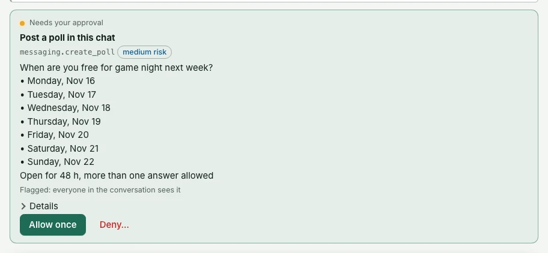
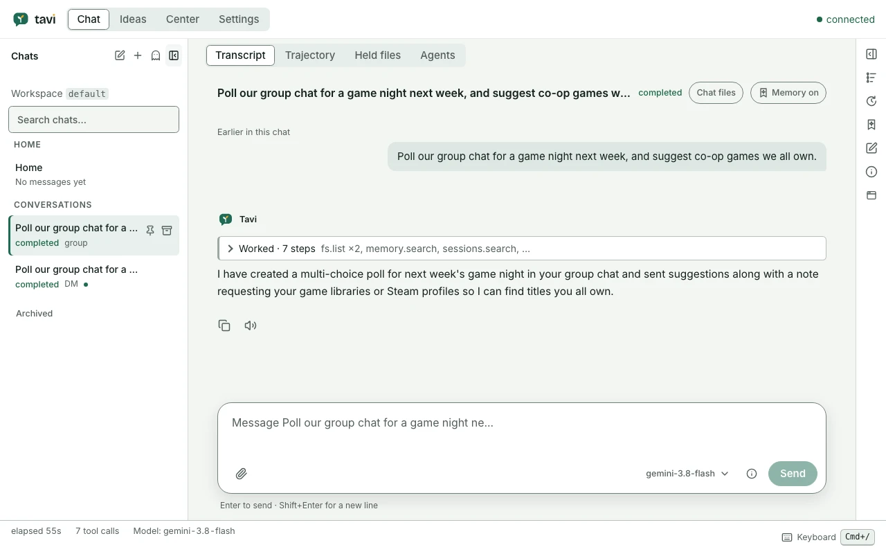

# Plan a game night with your group

In your friends' Discord room, ask Tavi to find a night next week: it drafts a poll of dates, asks you before posting it, and suggests co-op games for the group.

> **Uses:** Messaging
> **Asks first:** Messaging
> **Runs:** When you ask
> **Idea card:** "Plan a game night" (`people.game-night`)
> **Before you start:** a model connected ([Connect your first model](../../get-started/first-model.md)) · Tavi on your Discord server, with a room, and you allowed ([Add Tavi to a Discord server](../../channels/discord-rooms.md)) · your friends in that room

## 1. Ask for it in the room

In the room, address the bot with the prompt: `@yourbot Poll our group chat for a game night next week, and suggest co-op games we all own.` A poll is a post in the room, so Tavi drafts it and asks you first: the card, in the canvas and in your DM with the bot, shows the question and every date. **Ideas** may offer this as a card once Tavi knows you do it; its prompt is the one to send in the room.

## 2. Approve the poll

Choose **Allow once**, in the canvas or with the button in your DM. Tavi posts the poll in the room and answers with co-op games to try. It can't see anyone's game library, so it suggests games and asks the group which ones they have: say in the room what you own and it narrows the list. When the votes are in, ask `@yourbot Which night won?` ([Run a poll in a group and wait for the answers](../../channels/run-a-poll.md)).

<!-- cover -->

## Variations

- `@yourbot Poll our group for a board game night this weekend, and suggest games for four to six players.`
- Say what the group owns in the same message, such as `… we have Overcooked 2, It Takes Two and Deep Rock Galactic between us`. Tavi reads no one's memory in a room, so the room's own words are what it goes by.

## Related

- [Run a poll in a group and wait for the answers](../../channels/run-a-poll.md)
- [Add Tavi to a Discord server](../../channels/discord-rooms.md)
