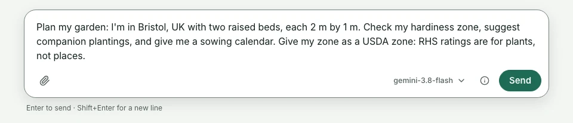
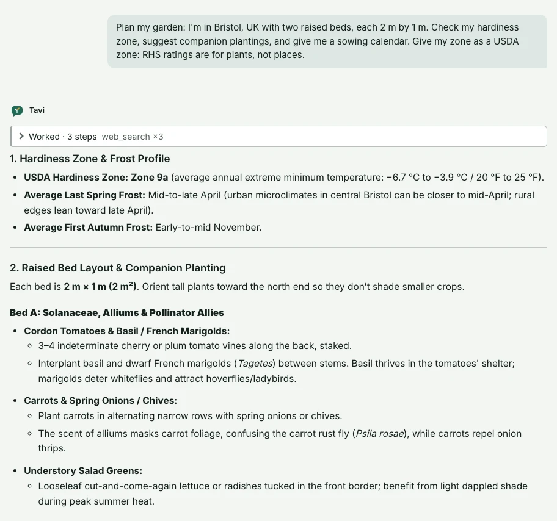
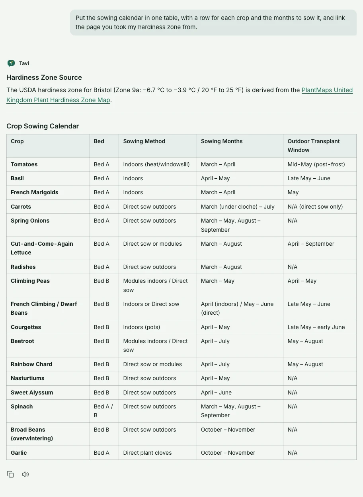

# Plan your garden beds for your climate

Tell Tavi where you are and how big your beds are. It checks your hardiness zone on the web, suggests plants that do well together, and draws up a sowing calendar.

> **Uses:** Web
> **Asks first:** Nothing — it only reads and suggests
> **Runs:** When you ask
> **Idea card:** "Plan my garden" (`learning.garden-plan`)
> **Before you start:** a model connected ([Connect your first model](../../get-started/first-model.md)) · web search on ([Set up web search](../../web-and-browser/set-up-web-search.md)) · the canvas open ([Open the web canvas and walk through Welcome](../../get-started/web-canvas-tour.md))

## 1. Ask for it

Choose **New chat** above the chats to open a chat of its own and send the prompt with your town and beds in it: `Plan my garden: I'm in Bristol, UK with two raised beds, each 2 m by 1 m. Check my hardiness zone, suggest companion plantings, and give me a sowing calendar. Give my zone as a USDA zone: RHS ratings are for plants, not places.` Once Tavi knows this is something you do, **Ideas** may offer it as a card in its own words; **Try it** there starts the same chat, without that last sentence.

## 2. Read the plan

Tavi searches the web, named on the lines above its answer, and leads with your hardiness zone and frost dates. Then comes what to grow together in each bed, and the calendar.

## 3. Get the calendar as a table

Ask for it in a form you can pin up: `Put the sowing calendar in one table, with a row for each crop and the months to sow it, and link the page you took my hardiness zone from.` Once a chat has read the web, a further search can stop on a card: check the words it would search for, and choose **Allow once**.

<!-- cover -->

A USDA zone is a place's, a band of its coldest winter nights. An RHS rating such as H4 is a plant's, how much cold that plant stands, so a town doesn't have one, and the two scales line up only roughly. If an answer gives you one as your town's rating, it's wrong, which is why the prompt asks for a USDA zone alone.

A zone is one town's average: your walls, your soil and your slope all change it, and the months move with each year's weather. Check the back of the seed packet, and go by your last frost. Companion planting is more gardeners' lore than proven science, so take the pairings as things to try. Tavi can't see your garden, so tell it how much sun each bed gets.

## Variations

- `I only get morning sun on the second bed.`
- A balcony: `Plan my garden: I'm in Leeds, UK with three 40 cm pots on a south-facing balcony.`

## Related

- [Set up web search](../../web-and-browser/set-up-web-search.md)
- [Research a question with cited sources](../../web-and-browser/research-with-sources.md)
- [Cook from what's in your fridge](fridge-recipes.md)
