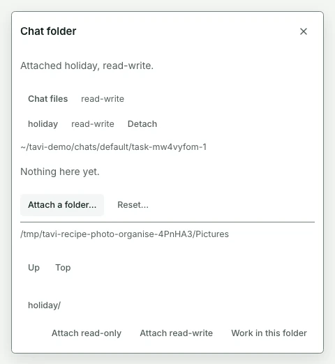
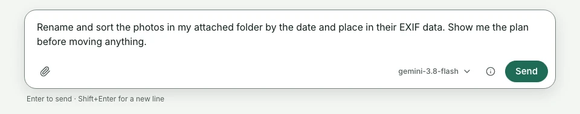
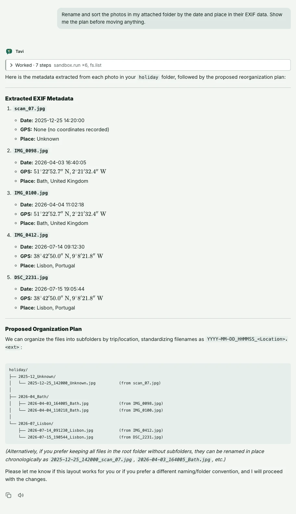
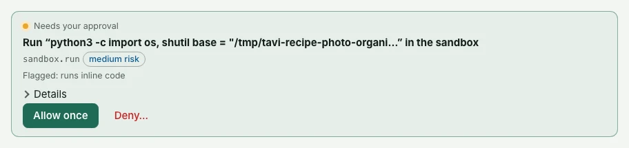
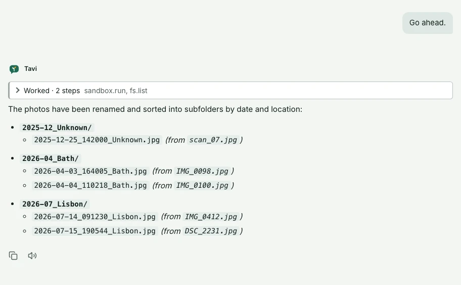

# Sort a folder of photos by date and place

Attach a folder of photos, and Tavi works out new names and places from the date and location stored in each picture. It shows you the plan first, and moves nothing until you say so.

> **Uses:** Files · Sandbox
> **Asks first:** Files
> **Runs:** When you ask
> **Idea card:** "Sort my photos" (`productivity.photo-organise`)
> **Before you start:** a model connected ([Connect your first model](../../get-started/first-model.md)) · the canvas open ([Open the web canvas and walk through Welcome](../../get-started/web-canvas-tour.md)) · `tavi serve` started with the folder above your photos by its full path, here `tavi serve --fs-root /Users/you/Pictures` ([Give Tavi a working folder](../../files-and-code/attach-a-folder.md)) · the shell sandbox working ([Build and test a real project in the sandbox](../../files-and-code/build-a-real-project.md))

## 1. Attach the folder

A new chat sees that folder read-only, and sorting needs to write. So in **Home**, choose the **Chat files** chip in the header, then **Attach a folder…**. Open **Pictures** and choose **Attach read-write** on the folder to sort. Try it first on a copy, or a few photos. In a Home with no messages yet, the panel lists only the folders you pick, and your first message brings them along; reloading the page drops them.

## 2. Ask for it

Send the prompt in Home: `Rename and sort the photos in my attached folder by the date and place in their EXIF data. Show me the plan before moving anything.` Once Tavi knows this is something you do, **Ideas** may offer it as a card in its own words; **Try it** there starts the same chat.

## 3. Read the plan

Tavi reads the date and the location out of each photo with short scripts in the sandbox, `sandbox.run` above its answer. A script is inline code, so these can stop on **Needs your approval**, flagged *runs inline code*, even though they only read: open **Details** to see what would run, and choose **Allow once**. Then it lists what it found and where each photo would go, without moving anything. Check the plan: a photo with no location in it can't be given a place, so here `scan_07.jpg` goes under *Unknown*.

## 4. Allow the moves

If the plan is right, say `Go ahead.`, or name the option you want if it offers two. Tavi moves the photos with a script too, not with its file tools, so the card to read is this one: **Needs your approval**, **Run … in the sandbox**, flagged *runs inline code*. Open **Details** and check the names, then choose **Allow once**. Nothing moves until you do.

## 5. Check the folder

Tavi says what it moved and where. Look in the folder yourself before you delete any copy, and choose **Detach** in the **Chat folder** panel when you're done, so Home stops seeing your photos.

<!-- cover -->

Tavi takes place names from the coordinates in each file, as far as it knows them. The sandbox has no network, so it looks nothing up: check any that matter. A scan or a picture from a messaging app often has no date or location of its own.

## Variations

- `Sort by year and month only, and leave the file names alone.`
- `Put anything with no location in a folder called unsorted.`

## Related

- [Give Tavi a working folder](../../files-and-code/attach-a-folder.md)
- [Approve, reject or always-allow a tool call](../../chat/approve-tool-calls.md)
- [Build and test a real project in the sandbox](../../files-and-code/build-a-real-project.md)
