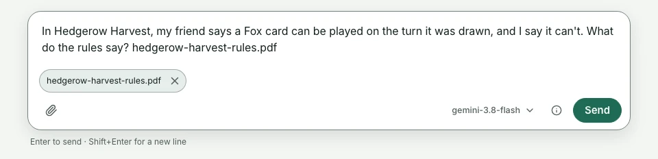
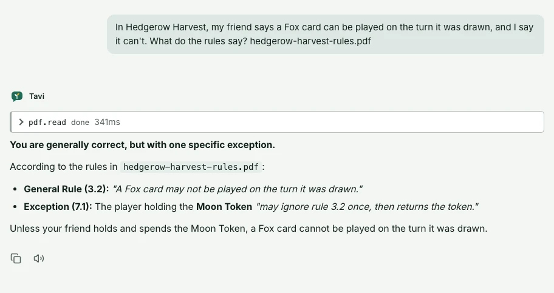

# Settle a board-game rules argument

Give Tavi the game and the dispute, with the rulebook as a PDF, and it quotes the rule that decides it.

> **Uses:** PDFs
> **Asks first:** Nothing — it only reads and suggests
> **Runs:** When you ask
> **Idea card:** "Settle a rules question" (`learning.rules`)
> **Before you start:** a model connected ([Connect your first model](../../get-started/first-model.md)) · the canvas open ([Open the web canvas and walk through Welcome](../../get-started/web-canvas-tour.md)) · the rulebook as a PDF, if you have one ([Summarise a PDF and pull out tables](../../documents/read-a-pdf.md))

## 1. Ask for it

Choose **New chat** above the chats to open a chat of its own. Attach the rulebook with the paperclip, and send the prompt with the game and the dispute in it: `In Hedgerow Harvest, my friend says a Fox card can be played on the turn it was drawn, and I say it can't. What do the rules say? hedgerow-harvest-rules.pdf` Once Tavi knows this is something you do, **Ideas** may offer it as a card in its own words; **Try it** there starts the same chat.

## 2. Read the ruling

Tavi reads the rulebook with `pdf.read`, named on the line above its answer, quotes the rule, and says what it means for your turn. Here the rule on page 1 has an exception on page 2, and the ruling gives both.

<!-- cover -->

Tavi can quote only what's in the rulebook you gave it. Without one it answers from what it knows of the game, which may be wrong or from another edition, so check that before you lose a game over it. A scanned rulebook is read with OCR first ([Read a scanned document (local OCR)](../../documents/read-a-scan.md)).

## Variations

- `Does anything else in the rulebook change this?`
- `Quote the rule on what happens when the deck runs out.`

## Related

- [Summarise a PDF and pull out tables](../../documents/read-a-pdf.md)
- [Send a file or image with your message](../../chat/attach-files-to-chat.md)
- [Keep your campaign's lore straight](dnd-lore.md)
